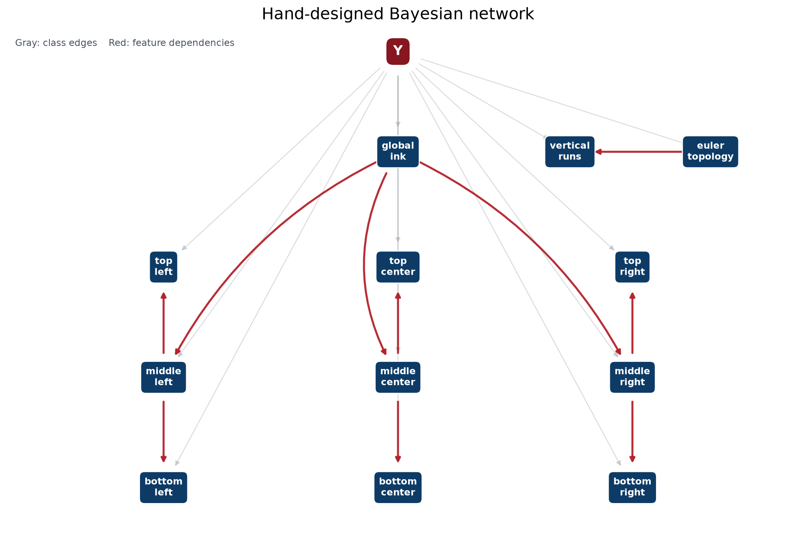
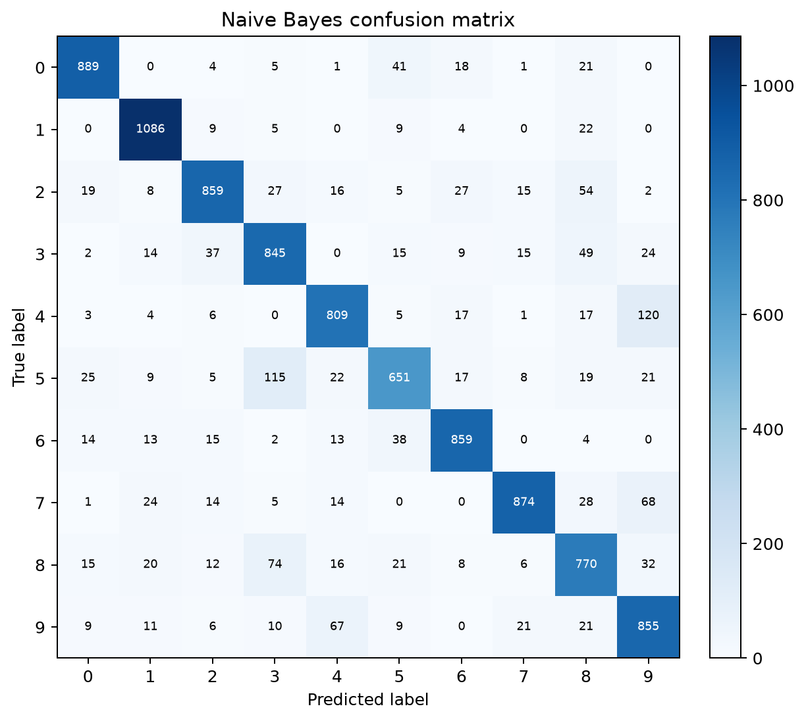
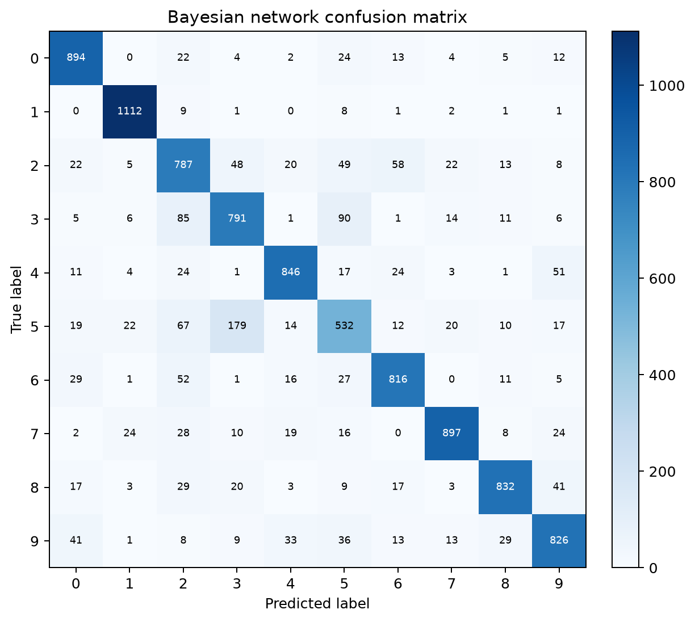
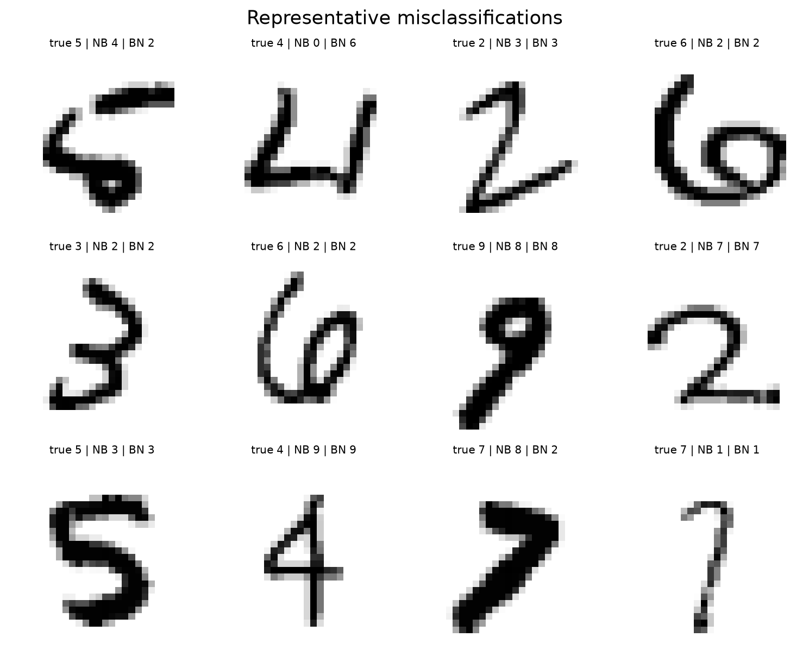

# Assignment 2：手写数字识别中的朴素贝叶斯与小型贝叶斯网络

## 1. 总体设计

本实验只使用课程提供的标准 MNIST 数据：60,000 张训练图和 10,000 张测试图，每张图为 $28\times28$、像素范围为 $0$–$255$。数据文件的 SHA-256 与课程清单一致。模型选择阶段仅使用训练集内部固定随机种子 `1322` 的分层划分（49,999 张训练、10,001 张验证），最终选定方案再用全部 60,000 张图重训。测试集不参与特征、DAG 或超参数选择。

两个模型的参数估计、平滑、对数概率、预测和评测指标均以 NumPy 自行实现，没有调用 `sklearn.naive_bayes`、`pgmpy`、`bnlearn` 或任何现成分类器。程序入口为：

```bash
python main.py --validation-study
```

程序会自动查找随作业提供的数据目录，也可以用 `--data-dir PATH` 指定；结果写入 `figures/metrics.json`，同时生成混淆矩阵、网络结构图和误分类样例。

## 2. Naive Bayes

### 2.1 模型与预处理

每张图展平成 $X=(x_1,\ldots,x_{784})$。像素按以下边界离散为 7 个灰度状态：

| 状态 | 原始像素值 |
|---:|:---|
| 0 | 0 |
| 1 | 1–15 |
| 2 | 16–31 |
| 3 | 32–63 |
| 4 | 64–127 |
| 5 | 128–191 |
| 6 | 192–255 |

相较于单纯二值化，多档灰度保留了抗锯齿和笔画强度信息。模型采用给定类别后像素条件独立的假设：

$$
P(y\mid X)\propto P(y)\prod_{i=1}^{784}P(x_i\mid y).
$$

类别先验和像素条件概率均使用加性平滑。设类别 $c$ 的样本数为 $N_c$，像素 $i$ 取状态 $v$ 的计数为 $N_{civ}$，则

$$
P(y=c)=\frac{N_c+\alpha}{N+10\alpha},\qquad
P(x_i=v\mid y=c)=\frac{N_{civ}+\alpha}{N_c+7\alpha}.
$$

预测时不直接连乘，而计算

$$
\log P(y=c)+\sum_{i=1}^{784}\log P(x_i\mid y=c),
$$

以避免 784 个小概率相乘导致浮点下溢。`predict_proba` 先减去每行最大对数分数，再指数化和归一化。

### 2.2 模型选择

训练内验证结果如下。灰度档边界先比较二值、4 档、5 档和 7 档方案，7 档最好；随后固定离散化比较平滑系数：

| 方案 | 验证 Accuracy |
|:---|---:|
| 二值化（阈值 32） | 83.72% |
| 4 档灰度 | 84.07% |
| 5 档灰度 | 84.07% |
| 7 档灰度，$\alpha=0.1$ | **84.09%** |
| 7 档灰度，$\alpha=0.5$ | 84.02% |
| 7 档灰度，$\alpha=1.0$ | 84.00% |

因此最终实验使用 7 档和 $\alpha=0.1$。类构造器仍按统一协议保留默认值 `alpha=1.0`。

## 3. Small Bayesian Network

### 3.1 离散特征

网络从原始像素提取 12 个离散特征。密度都以像素值除以 255 后的平均值定义；九宫格集中在边界 `[7, 12, 17, 22]` 覆盖的中央 $15\times15$ 区域，减少大面积恒为背景的边缘像素对统计的稀释。每个密度特征用训练集分位点固化为 5 个状态；零值较多的格子将“完全无墨迹”独立设为状态 0，其余正值按四分位点分成 4 档。

| 编号 | 特征 | 状态数 | 含义 |
|---:|:---|---:|:---|
| 0 | `global_ink` | 5 | 全图平均墨迹强度 |
| 1–3 | `top_left/center/right` | 5 | 中央九宫格上排密度 |
| 4–6 | `middle_left/center/right` | 5 | 中央九宫格中排密度 |
| 7–9 | `bottom_left/center/right` | 5 | 中央九宫格下排密度 |
| 10 | `euler_topology` | 4 | 二值图 Euler 数（连通分量数减孔洞数），截断为 -1、0、1、2 |
| 11 | `vertical_runs` | 5 | 每个有效列中竖向连续墨迹段的平均数量 |

拓扑和竖向段数先以 `pixel > 64` 二值化。Euler 数由局部 $2\times2$ 模式计数得到；竖向段数通过逐列统计由背景进入前景的位置得到。这两项分别描述“孔洞/连通性”和“沿竖直方向的笔画复杂度”，对区分 0、1、3、5、6、8、9 很有帮助。

### 3.2 DAG 结构



类别节点 $Y$ 是根节点，也是全部 12 个特征的父节点。红色特征边为：

- `global_ink -> middle_left/middle_center/middle_right`：中排局部墨迹量受到整体书写粗细和墨迹量影响。
- `middle_left -> top_left` 与 `middle_left -> bottom_left`：同一列的上下区域通过连续竖向笔画相关。
- `middle_center -> top_center` 与 `middle_center -> bottom_center`：中央列上下区域共享主干、闭环等结构。
- `middle_right -> top_right` 与 `middle_right -> bottom_right`：右侧上下区域共享收笔和弧线结构。
- `euler_topology -> vertical_runs`：孔洞与连通结构会影响一列中出现多少段分离墨迹。

因此每个特征最多有两个父节点：类别 $Y$ 和至多一个特征父节点；网络无环、无隐藏变量，共有 10 条特征间有向边，满足题目要求。

联合分布分解为

$$
P(y,F_1,\ldots,F_{12})=P(y)\prod_{i=1}^{12}P(F_i\mid y,F_{p(i)}),
$$

没有特征父节点时删除 $F_{p(i)}$。对于节点 $F_i$ 的每个类别和父状态组合，直接统计子状态次数，并在子变量的最后一维使用加性平滑：

$$
P(F_i=v\mid y=c,F_p=u)
=\frac{N(c,u,v)+\alpha}{\sum_{v'}N(c,u,v')+K_i\alpha}.
$$

其中 $K_i$ 是该节点状态数。预测时全部特征已观测，直接累加各 CPT 的对数概率，无需采样或近似推理。

### 3.3 特征与结构消融

| 验证方案 | Accuracy |
|:---|---:|
| 宽泛上/中/下、左/中/右及形状统计 | 61.85% |
| 全图等分 3×3 密度 + 拓扑/笔画特征 | 74.84% |
| 中央 $18\times18$ 九宫格 | 81.46% |
| 中央 $15\times15$ 九宫格 + 最终 DAG | **约 83.1%** |

固定最终结构后的 $\alpha=0.1,0.5,1.0$ 验证准确率分别为 83.09%、83.02%、83.01%，差异只有 7–8 张图。结构搜索阶段预先选定的 $\alpha=0.5$ 在稀疏 CPT 上更稳健，因此最终保留 $\alpha=0.5$，没有根据测试集结果再次改动。

## 4. 完整测试集结果

| 模型 | Accuracy | Macro Precision | Macro Recall | Macro F1 |
|:---|---:|---:|---:|---:|
| Naive Bayes | **84.97%** | **85.05%** | **84.71%** | **84.79%** |
| Small Bayesian Network | 83.33% | 83.09% | 82.93% | 82.95% |

### 4.1 混淆矩阵





Naive Bayes 最多的定向混淆为 `4 -> 9`（120 张）、`5 -> 3`（115 张）、`8 -> 3`（74 张）、`7 -> 9`（68 张）和 `9 -> 4`（67 张）。Bayesian Network 最多的定向混淆为 `5 -> 3`（179 张）、`3 -> 5`（90 张）、`3 -> 2`（85 张）、`5 -> 2`（67 张）和 `2 -> 6`（58 张）。

`4/9`、`3/5` 的局部墨迹布局经常接近；而 `2/3/5` 的区别依赖曲线方向和精细端点位置，仅凭 12 个粗粒度离散特征难以完全表达。Bayesian Network 对 1 的召回率达到 97.97%，说明稀疏、近竖直的全局形态容易由当前特征捕获；对 5 的召回率只有 59.64%，反映了方向性和局部曲率信息不足。

### 4.2 误分类样例



图中 `true` 为真实类别，`NB` 和 `BN` 分别为两个模型预测。部分样本本身书写含混，例如开口的 5 类似 3、倾斜的 4 类似 9、缺少底横的 7 类似 1；另一些错误来自模型表达能力：Naive Bayes 忽略相邻像素关系，小型网络则将连续位置压缩为九宫格密度，都会丢失笔画方向和精细轮廓。

## 5. 对比、困难与反思

Naive Bayes 使用 784 个局部观测，信息量大，但“给定类别后所有像素独立”的假设明显不成立。它仍取得更高总体准确率，说明大量像素级证据可以部分抵消不合理的独立假设；代价是参数量更大，且难以直接解释某一整条笔画。

小型 Bayesian Network 只使用 12 个具有语义的变量，参数量和预测开销更小，并显式表达了同列上下墨迹、整体墨迹与局部密度、拓扑与竖向段数之间的依赖。困难主要在于：特征必须足够少且离散，DAG 又要同时符合语义、避免稀疏父状态组合。过宽的区域会把形状差异平均掉，区域过小则产生大量零状态；将窗口集中到数字主体并为零墨迹单设状态是最明显的改进。

若继续改进，会在仍满足“6–12 个离散特征、手工 DAG”的前提下尝试：加入水平/竖直端点或交叉数的方向性特征；使用训练内交叉验证而非单次划分确认边界稳定性；在不增加父节点上限的情况下比较少量有明确语义的 DAG。不会使用自动结构学习，也不会用测试集选择这些方案。

## 6. 可复现性与数据来源

- Python 依赖仅为 NumPy 和 Matplotlib。
- `python -m unittest discover -s tests -v` 运行协议、边界、概率归一化和 DAG 测试。
- `python main.py --validation-study` 复现训练内平滑参数比较和最终测试评估。
- 原始数据来源：MNIST，课程数据清单给出的镜像为 <https://storage.googleapis.com/cvdf-datasets/mnist/>。
- 作业规范来源：课程提供的《手写数字识别：朴素贝叶斯与小型贝叶斯网络 (Assignment - 2)》。本文代码与实验分析均为本作业独立实现。
