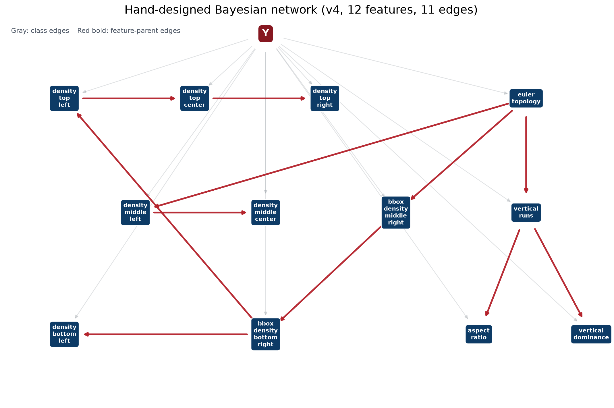
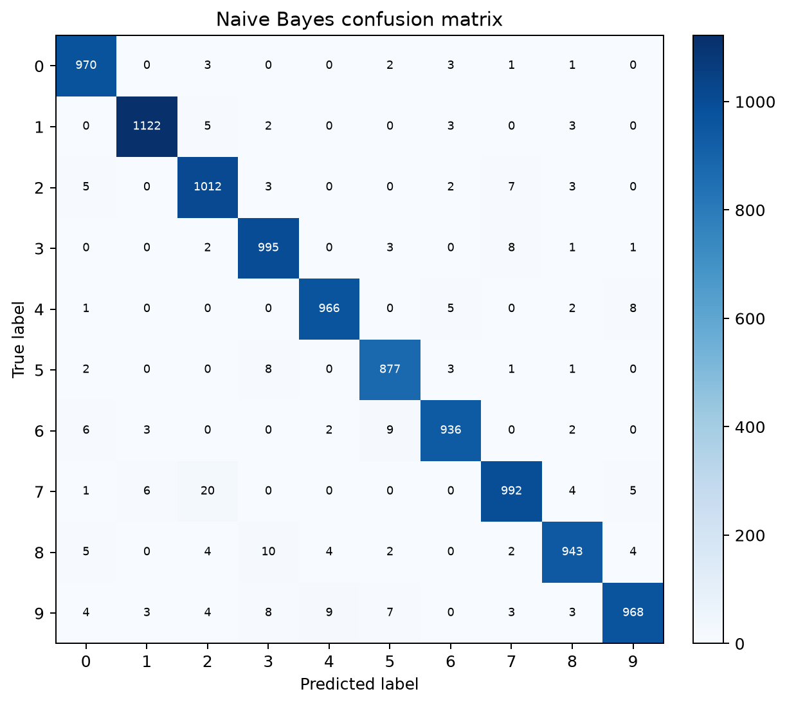
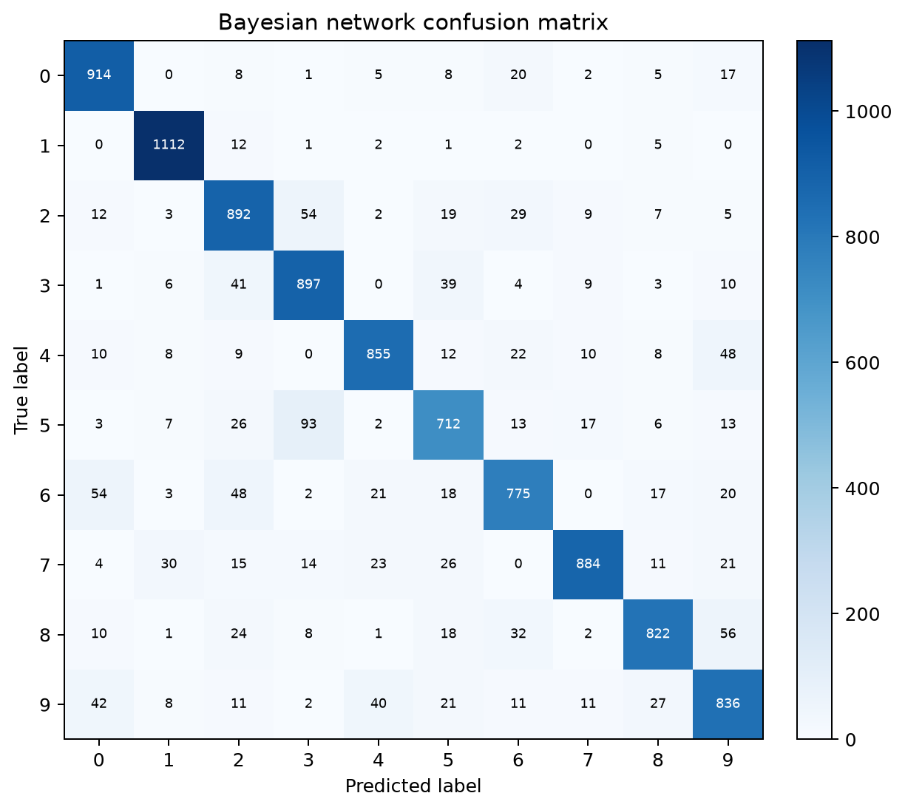
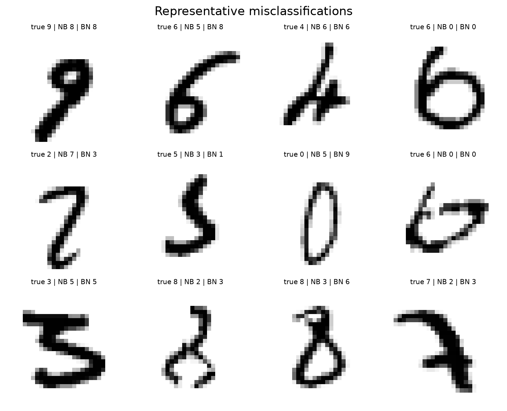

# Assignment 2：手写数字识别中的朴素贝叶斯与小型贝叶斯网络

## 1. 实验目的与基本约定

这次作业要求实现两个模型：一个 Naive Bayes 分类器，以及一个手工设计的小型 Bayesian Network。输入是展平后的 `28×28` MNIST 图像，输出为 `0–9` 中的一个数字。作业真正想考察的并不只是准确率，还包括几个比较容易在实验中被忽略的问题：特征应该怎样离散化，条件独立假设到底放在哪里，贝叶斯网络的边有没有清楚的含义，以及平滑后得到的 CPT 是否仍然可以解释。

数据使用课程提供的标准 MNIST：60,000 张训练图和 10,000 张测试图，像素范围为 `0–255`。为了避免把测试集变成调参集，所有模型选择都在训练集内部完成。固定的主验证划分由随机种子 `1322` 产生，包含 49,999 张训练图和 10,001 张验证图；另外使用若干不同的训练内划分检查结果是否只是在某一次划分上碰巧有效。最终模型确定后，才在完整测试集上做结果记录。

模型核心全部使用 NumPy 手写，没有调用 `sklearn`、`pgmpy`、`bnlearn` 或其他现成分类器。程序入口仍然是：

```bash
cd assignment2
python main.py --validation-study
```

历史版本没有被覆盖。初始版本保存在 `archive/baseline_v1/`，v2 和 v3 的逐轮实验保存在 `experiments_v2/`、`experiments_v3/`，本轮实验和审计材料保存在 `experiments_v4/`。

## 2. Naive Bayes

### 2.1 先从最直接的像素模型开始

最初的实现把每个像素单独看成一个离散变量。像素被分成 7 个灰度档，模型使用

$$
P(y\mid X)\propto P(y)\prod_i P(x_i\mid y)
$$

并在对数域中计算。这个版本的准确率只有约 84%，作为基线是合适的，但它有一个明显的问题：相邻像素之间的关系完全没有被表示。例如，一条斜线和几个互相分离的墨点，在逐像素统计中可能很相似；而手写数字最有辨识度的部分，恰恰经常是这些局部的连接、转折和开口。

随后试过原始像素二值化。阈值和 alpha 做了小范围扫描，但最好的结果仍然略低于灰度分档版本。原因比较直观：二值化虽然简单，却把笔画深浅的信息全部丢掉了。因此没有继续沿这条路线优化。

### 2.2 v2/v3：把独立性假设从像素移到 patch

下一步没有改变 Naive Bayes 的形式，而是改变了特征的定义。每个特征不再是一个像素，而是一个 `2×2` 的局部 patch；patch 内的 4 个像素联合编码，patch 之间仍然采用给定类别后的条件独立假设。这样做的好处是：局部像素之间的相关性被放进同一个变量，模型仍然可以写成

$$
P(y\mid X)\propto P(y)\prod_j P(z_j\mid y).
$$

用 5 个灰度档编码一个 `2×2` patch 时，每个 patch 有 `5^4=625` 个状态，共有 729 个重叠 patch。这个版本在训练内验证集上达到了约 91.8%，比单像素基线提高了很多。非重叠 patch、二值 patch、4 档和 6 档灰度、多视图拼接都做过比较：非重叠 patch 丢掉了太多局部信息，6 档开始受到 CPT 稀疏影响，多视图则因为高度相关而把同一信息重复计算，均没有超过 `2×2`、5 档灰度的版本。

这一轮最重要的认识是：对 Naive Bayes 来说，特征之间的条件独立不是数据天然满足的事实，而是模型主动做出的近似。把相邻像素放进同一个 patch，是在不改变模型形式的前提下，尽可能把最强的局部依赖吸收进去。

### 2.3 v4：为什么更大的感受野反而更有效

在已有 patch 版本上继续尝试时，比较了连续 `4×4` patch、不同灰度档数、不同采样间距以及更大的 `5×5` patch。最后表现最好的是一个看起来有些反直觉的设计：patch 仍然只编码 16 个像素，但这 16 个像素在行列方向上每隔一个像素采样一次。

最终的 Naive Bayes 特征如下：

- 每张图有 `22×22=484` 个重叠 patch；
- 每个 patch 是一个 `4×4` 的采样格；
- 采样间距为 2，所以实际覆盖 `7×7` 的感受野；
- 每个采样点只做二值化，`pixel >= 72` 记为墨迹；
- 16 个二值点联合编码为 `2^16=65,536` 个可能状态。

这个设计的直觉是，`2×2` patch 能够看到边缘，但看不到足够长的局部形状；连续 `4×4` 又把状态预算花在了过于紧密的像素上。间距为 2 的采样格在同样的 16 个二值点下看得更宽，能够区分一段斜线、一个拐角和一个小块状墨迹。验证结果从旧 patch 方案的约 93% 提升到了 97% 以上。

这个模型仍然是作业要求的 Naive Bayes，而不是换成了别的分类器。区别只在于变量从 784 个单像素改成了 484 个 patch 变量：

$$
P(y\mid X)\propto P(y)\prod_{j=1}^{484}P(z_j\mid y),
$$

预测时累加对应的对数概率。patch 内联合、patch 间独立，和前面的 `2×2` 版本是同一种建模思路。作业允许在模型内部进行二值化、离散化和特征提取，因此这种固定规则的 patch 特征仍在题目范围内。

### 2.4 平滑问题：为什么没有直接把 alpha 调到很小

这个版本遇到的第二个问题是状态数太大。65,536 个状态中绝大多数在训练数据里没有出现。如果把 `alpha=1` 当成“每个状态加一个伪计数”，那么每个 patch 变量相当于加入了 65,536 个伪计数，平滑强度远远超过了原来 625 状态的模型。实验中把每状态 alpha 从 1 一路降到 `1e-10`，准确率仍然缓慢上升。这说明普通的逐状态参数化不适合直接搬到这么大的状态空间上。

最后采用了一个更稳定、也更容易解释的参数化：把 alpha 定义为一个 patch 变量的 Dirichlet 总质量，每个状态分到 `alpha / 65536` 的伪计数。于是

$$
P(z_j=v\mid y=c)=
\frac{N_{cjv}+\alpha/65536}{N_c+\alpha}.
$$

在 8 个训练内部分层划分上，alpha 从 `0.01` 到 `10` 都处在相对平坦的区域；协议默认的 `alpha=1.0` 验证平均准确率为 97.58%，`alpha=0.01` 为 97.69%。因此最终代码保留了作业接口规定的默认值 `alpha=1.0`，而不是把一个只在某个验证划分上最优的极小常数写死。

由于 CPT 太大，代码没有物化完整的 `10×484×65536` 数组，而是只保存训练中出现过的 `(patch位置, 状态)`。没有出现的状态使用相同的平滑默认值。这是精确的稀疏表示，不是把未见状态删除；用 `check_probability_mass()` 检查后，每一个 patch 的条件分布仍然总和为 1。

### 2.5 Naive Bayes 的迭代结果

| 阶段 | 主要方案 | 验证集结果 | 处理结果 |
|:---|:---|---:|:---|
| v1 | 784 像素、7 档灰度 | 84.09% | 作为基线 |
| v1 | 单像素二值 Bernoulli | 约 83.9% | 像素强度损失太多，放弃 |
| v2 | 重叠 `2×2` patch、二值/灰度编码 | 约 91%–92% | 采纳 patch 思路 |
| v2/v3 | `2×2`、5 档灰度 | 约 91.8% | 历史最终方案 |
| v4 | 连续 `4×4` 二值 patch | 约 95% | 感受野不够宽，放弃 |
| v4 | 膨胀 `4×4` 二值 patch | 97% 以上 | 采纳 |
| v4/v5 | 膨胀 patch + 总质量 alpha | 验证平均 97.6% 左右 | 最终方案 |

对抗审计还测试了 3 灰度级、`5×5`、间距 3、非均匀间距、块池化和多视图组合。它们有的在单次划分上接近最终方案，但没有在多划分和统计检验下稳定超过当前模型，所以没有为了追求一个更大的实验表而采纳。

## 3. Small Bayesian Network

### 3.1 v1：从作业示例的语义特征出发

贝叶斯网络和 Naive Bayes 的目标不同。它不应该把全部 784 个像素塞进网络，而应该从图像中提取少量有语义的离散变量。最初的特征包括若干区域密度、Euler 拓扑数和竖直墨迹段数。这个版本大约达到 83%，说明这些特征确实包含数字类别信息，但仍有较大的提升空间。

最早的困难不是 CPT 公式，而是特征预算。作业只允许 6–12 个特征，每个特征只能有 2–5 个状态。增加全局墨迹量、左右或上下区域后，特征数会超出上限；把所有东西都塞进少量变量，又会让每个变量的语义变得不清楚。

### 3.2 v2/v3：网格密度和 DAG 结构的反复调整

经过消融后，最终保留了中央 `15×15` 区域中的 8 个网格密度，再加上 Euler 数、vertical runs、宽高比和 vertical dominance。bottom-center 网格与其他密度高度重复，因此被删掉。对称性、连通区域数、端点数等作业示例中的特征也试过，但在当前离散化方式下大多过于稀疏，或者和 Euler 数重复，替换网格特征后反而下降。

结构方面，最初尝试的是按列连接网格，例如 `top_left → middle_left → bottom_left`。后来比较了几种手工结构，发现同一水平带内从左到右的连接更适合 MNIST 的笔画连续性。v3 因此改成行链，并把 Euler、vertical runs、aspect ratio、vertical dominance 连接成语义链。这个版本在主验证划分上达到 86.14%，在完整测试集上达到 86.27%。

这里曾经出现过一次很具体的实现错误：实验脚本的网格索引把 bottom-left 和 bottom-center 搞反了，导致实验结果比直接运行模型低。通过逐个核对网格坐标和特征名称才定位到这个问题。修正后重新运行了相关实验，旧输出保留在实验目录中，但没有继续混用。

### 3.3 v4/v5：为什么包围盒特征有效

虽然 v3 的 DAG 已经比初始版本好，但固定窗口有一个明显缺点：同一个数字写得偏大、偏小、偏左或偏右时，墨迹会落进不同的网格。这样一个区域密度同时反映了数字的形状和书写位置。

本轮没有把所有固定网格都换掉，而是只把右侧中部和右下部两个特征改成基于图像自身墨迹包围盒的密度：

- `bbox_density_middle_right`：包围盒中间行、右列三分区的墨迹密度；
- `bbox_density_bottom_right`：包围盒下行、右列三分区的墨迹密度。

包围盒按行、列分别切成 3 段，两个密度变量仍然是单独的 5 状态离散特征。这样没有增加特征数，也没有改变 DAG 的父节点约束，只是把测量坐标从固定图像坐标改成了相对于当前数字自身的坐标。

最终代码中的 BN 特征离散化规则如下：固定网格密度和两个包围盒密度都把“恰好为零”作为第 0 状态，其余正值按照训练集分位点划分为 4 个状态；`euler_topology` 直接使用 `-1, 0, 1, 2` 映射后的 4 个状态；`vertical_runs` 使用训练集正值分位点划分为 5 个状态；`aspect_ratio` 使用修正后的墨迹包围盒宽高比，并按训练集分位点划分为 4 个状态；`vertical_dominance` 按训练集分位点划分为 4 个状态。训练时所有连续特征的阈值只由训练数据估计，预测时固定使用保存的阈值。公开的 `extract_features(X)` 使用固定的规范切点，因此同一张图像的结果不依赖调用时批次中的其他样本。

这个改动在 8 个训练内部分层划分上平均提升约 1.47 个百分点，8/8 划分都提升。把 8 个网格全部改成包围盒版本反而变差，说明归一化不是越多越好：部分特征仍然需要绝对位置提供的信息。最终保留两个右侧特征，是在表达能力、可解释性和作业限制之间比较合适的折中。

### 3.4 最终 DAG 与 CPT

最终特征父节点为：

```text
FEATURE_PARENTS = (7, 0, 1, 8, 3, 8, 7, 5, -1, 8, 9, 9)
```



图中灰色边表示类别节点 Y 指向各特征，红色边表示特征之间的 11 条手工设计边。

| 边 | 解释 |
|:---|:---|
| `bottom_right → top_left` | 对角方向的墨迹平衡 |
| `top_left → top_center` | 上部笔画的水平连续性 |
| `top_center → top_right` | 上部右侧收笔的连续性 |
| `euler_topology → middle_left` | 拓扑结构对中左区域的约束 |
| `middle_left → middle_center` | 中部水平笔画连续性 |
| `euler_topology → bbox_middle_right` | 拓扑结构对归一化右侧轮廓的约束 |
| `bottom_right → bottom_left` | 底部笔画回折连续性 |
| `bbox_middle_right → bbox_bottom_right` | 右侧中下轮廓连续性 |
| `euler_topology → vertical_runs` | 拓扑结构与竖直分段数的关系 |
| `vertical_runs → aspect_ratio` | 分段结构与宽高范围的关系 |
| `vertical_runs → vertical_dominance` | 分段结构与梯度方向性的关系 |

类别节点 Y 是所有特征的根父节点，因此每个特征至多有两个父节点。图中没有隐藏变量，也没有自动结构学习。所有 CPT 都由训练数据计数得到，并使用类条件边缘分布进行回退平滑：

$$
P(F_i=v\mid y=c,F_p=u)=
\frac{N(c,u,v)+\alpha\pi_c(v)}{N(c,u)+\alpha},
$$

其中

$$
\pi_c(v)=\frac{N(c,v)+\alpha}{N_c+K_i\alpha}.
$$

### 3.5 Bayesian Network 的迭代结果

| 阶段 | 主要尝试 | 结果与处理 |
|:---|:---|:---|
| v1 | 区域密度 + Euler + vertical runs | 约 83%，作为基线 |
| v2 | 增加方向、宽高比、网格消融 | 找到 8 网格 + 语义特征的组合 |
| v2 | 列链 DAG | 约 84.9%，保留为历史方案 |
| v3 | 行链 + 语义链 | 主验证约 86.1%，作为 M6 起点 |
| v4 | 对称性、连通数、端点数等替换 | 大多下降，放弃 |
| v4 | 手工 DAG 微调 | M6 的拓扑中部边有效，但继续微调没有通过多重比较校正 |
| v5 候选阶段 | 两个右侧密度改为 bbox-relative | 训练内多划分平均约 87.8%，进入最终候选 |
| v5 语义修正后 | 修正 aspect ratio，并固定公开特征提取规则 | 最终生产版本；重新评估后测试集准确率为 86.99% |

候选阶段的 87.78% 是在修正前的实验模块上得到的筛选数字，不能直接当作修正后生产模型的最终结果。修正宽高比后，BN 的指标重新计算为下面第 4 节的数值；这次重新评估是为了让报告和实际代码一致，而不是根据测试集结果重新选择特征或结构。

对结构微调使用了跨划分检验和 Bonferroni 校正。这样做的目的不是把统计检验写得复杂，而是防止在许多相近 DAG 中挑一个最高数字后就把它称为“改进”。最终模型保留 bbox 特征和 M6 结构，因为它们在训练集内部实验中通过了预先设定的筛选；语义修正只修复了实现错误和公开接口的确定性，没有重新搜索模型。

## 4. 最终测试集结果

最终版本在完整 60,000 张训练图上重新训练，并在 10,000 张测试图上得到以下结果。历史目录中保留了早期版本的测试集快照；这些快照用于记录版本差异，不能视为最终模型选择依据。当前报告只使用修正后生产代码重新生成的 `figures/metrics.json`。

| 模型 | Accuracy | Macro Precision | Macro Recall | Macro F1 |
|:---|---:|---:|---:|---:|
| **Naive Bayes：膨胀二值 patch，alpha=1.0** | **97.81%** | **97.80%** | **97.81%** | **97.80%** |
| **Small Bayesian Network：bbox 特征 + M6 DAG，alpha=1.0** | **86.99%** | **86.93%** | **86.75%** | **86.78%** |

训练与预测耗时以本次运行记录为准：Naive Bayes 为约 8.3 秒和 2.7 秒，Bayesian Network 为约 6.4 秒和 0.5 秒。Naive Bayes 的状态空间较大，因此使用稀疏 CPT；如果直接建立完整的 `10×484×65536` 双精度数组，内存开销约为 2.5 GB。

### 4.1 混淆矩阵





Naive Bayes 最常见的定向混淆为 `7→2`（20 张）、`8→3`（10 张）、`9→4`（9 张）、`6→5`（9 张）和 `9→3`（8 张）。Bayesian Network 最常见的为 `5→3`（93 张）、`8→9`（56 张）、`6→0`（54 张）、`2→3`（54 张）和 `4→9`（48 张）。

这组数字也比较能说明两个模型的差别。Naive Bayes 的局部 patch 特征保留了更多笔画形状，因此 `2/3/5` 的错误已经很少；Bayesian Network 的特征更粗，仍然容易把开口方向相近的 `3`、`5` 和 `2` 混淆，但它的变量和边更容易逐一解释。

本轮最终 BN 的测试集准确率是 **86.99%**。候选筛选阶段曾得到更高的预修正验证数字，但在发现宽高比实现错误后，重新按修正后的生产代码评估，最终以这里的数字为准。

### 4.2 误分类样例



图中 `true` 是真实数字，`NB` 和 `BN` 分别是两个模型的预测。剩余错误主要来自写法比较特殊或笔画开口不明显的样本。对 Bayesian Network 来说，包围盒归一化能减轻位置和尺度变化，却不能完全恢复笔画方向；对 Naive Bayes 来说，局部模式更丰富，但 patch 之间仍被当作条件独立，整体形变仍可能造成错误。

## 5. 迭代过程中遇到的困难与解决方式

### 5.1 “准确率上去了，但到底是不是同一个模型”

最开始最容易犯的错误，是看到 patch 版本的准确率提高后，就把它当作换了一个更强的分类器。实际上 patch 版本仍然是 Naive Bayes，只是把变量重新定义了。为避免报告说不清楚，后续每一个候选都必须写出自己的分解式，并检查预测是否确实是各个 `log P(feature | class)` 的相加。TAN、Chow–Liu 等方案虽然可能表达依赖关系，但它们不再符合本题要求的朴素贝叶斯形式，所以只作为失败实验留档，没有进入最终模型。

### 5.2 大状态空间造成的内存问题

从 625 个状态增加到 65,536 个状态后，完整 CPT 会变得很大。直接照搬旧代码会试图建立一个约 2.5 GB 的数组，既没有必要，也容易在不同机器上失败。解决方法是观察到大部分状态从未出现：只保存观测到的 `(patch位置, 状态)`，未观测状态统一用平滑默认值。之后又用独立实现逐项比较预测，确认这个稀疏表示和完整 CPT 的结果一致。

### 5.3 alpha 的含义和状态数绑定了

用同一个“每状态 alpha”比较 625 状态和 65,536 状态并不公平。前者的 `alpha=1` 只加入 625 个伪计数，后者会加入 65,536 个。实验中发现准确率会随着 alpha 变小一直上升，这不是一个适合直接提交的稳定选择，因为作业接口默认是 `alpha=1.0`，助教也可能直接用默认参数实例化模型。最后把 alpha 改成每个 patch 变量的总 Dirichlet 质量，让每个状态使用 `alpha/K`。这样既保留了平滑，也让默认参数位于稳定区间。

### 5.4 Bayesian Network 的特征预算太紧

作业只允许 6–12 个特征，每个特征只有 2–5 个状态。尝试对称性、连通区域数、端点数时，问题不是这些特征完全没有意义，而是它们在当前二值化和离散化下信息量不够，或者和 Euler 数高度重复。最终没有继续堆叠特征，而是保留最有用的网格密度，把一个特征的坐标系改得更合理。

### 5.5 固定网格把“位置”误当成了“形状”

这是 Bayesian Network 最后一个有效改进的来源。固定中央窗口对大多数样本有效，但写得偏左、偏右、偏大或偏小时，区域密度会发生变化。先尝试全部改为包围盒坐标，结果反而下降，说明固定坐标本身也包含有用信息。继续做局部替换后发现，右侧中部和右下部同时做包围盒归一化最稳定。于是最终只改两个特征，而不是把整个模型推倒重来。

### 5.6 实验脚本中的索引错误

在 v3 的实验复现中，网格列序曾经把 bottom-left 和 bottom-center 搞混，导致辅助脚本无法复现生产模型。这个问题没有通过“取一个看起来更好的数字”来掩盖，而是重新检查了网格坐标、特征名称和父节点索引，修正后重新跑了受影响的实验。这个过程也说明，手工设计的小型网络虽然变量少，但索引一旦错位，结果仍然可能看起来合理而实际含义已经变了。

### 5.7 如何防止在验证集上反复试到过拟合

本轮没有把单次验证集最高值直接当成结论。候选先在 seed `1322` 上筛选，再用多个训练内 seed 复核；对 BN 的多个 DAG 和 bbox 特征组合，使用配对 McNemar 检验，并对尝试数量做 Bonferroni 校正。只有跨划分稳定、统计上仍有余量、同时又能解释的方案才进入最终实现。测试集只用来记录最终版本和历史快照的表现，不参与选择。

## 6. 最终讨论与局限

最终 Naive Bayes 的 97.81% 说明，把局部空间结构放进合理定义的 patch 变量中，对 MNIST 很有效。不过它仍然忽略 patch 之间的长程依赖，稀疏 CPT 也带来较高的内存开销。它的高准确率不能被解释成“图像所有像素都真的独立”，而应该理解为一种在计算上可行的近似。

Bayesian Network 的 **86.99%** 低于 Naive Bayes，但它更符合本章关于语义特征、CPT 和 DAG 的教学目标。包围盒特征解决了部分位置和尺度问题，M6 边把局部轮廓和拓扑信息联系起来；代价是 12 个离散变量仍然无法完整表示书写方向和细节。

如果继续做，Naive Bayes 可以研究层级 patch 或后验校准，但需要重新确认是否仍属于作业规定的 NB 范围。Bayesian Network 可以继续研究少量方向性特征，但必须保持 6–12 个变量、每个变量 2–5 个状态、每个节点最多两个父节点，并且所有新增边都要有清楚的语义。不会使用自动结构学习或现成库来替代本作业要求的手工建模过程。

## 7. 可复现性、合规性与文件说明

- 单元测试：`python -m unittest discover -s tests -v`，9 项全部通过。
- 训练内验证和实验选择：固定随机种子 `1322`，并使用额外训练内划分检查稳健性。
- 最终指标：`figures/metrics.json`；图像文件位于 `figures/`。
- 生产模型：`naive_bayes.py`、`bayes_net.py`。
- 训练与绘图入口：`main.py`。
- 旧版和逐轮实验：`archive/baseline_v1/`、`experiments_v2/`、`experiments_v3/`、`experiments_v4/`。
- 模型核心仅使用 NumPy；Matplotlib 只用于生成报告图。
- MNIST 来源为课程提供的镜像：<https://storage.googleapis.com/cvdf-datasets/mnist/>；文件校验值见课程数据目录中的 `manifest.json`。
- 代码、特征和 DAG 均在作业 PDF 的约束内：没有现成分类器、没有现成贝叶斯网络、没有自动结构学习，也没有隐藏变量。
