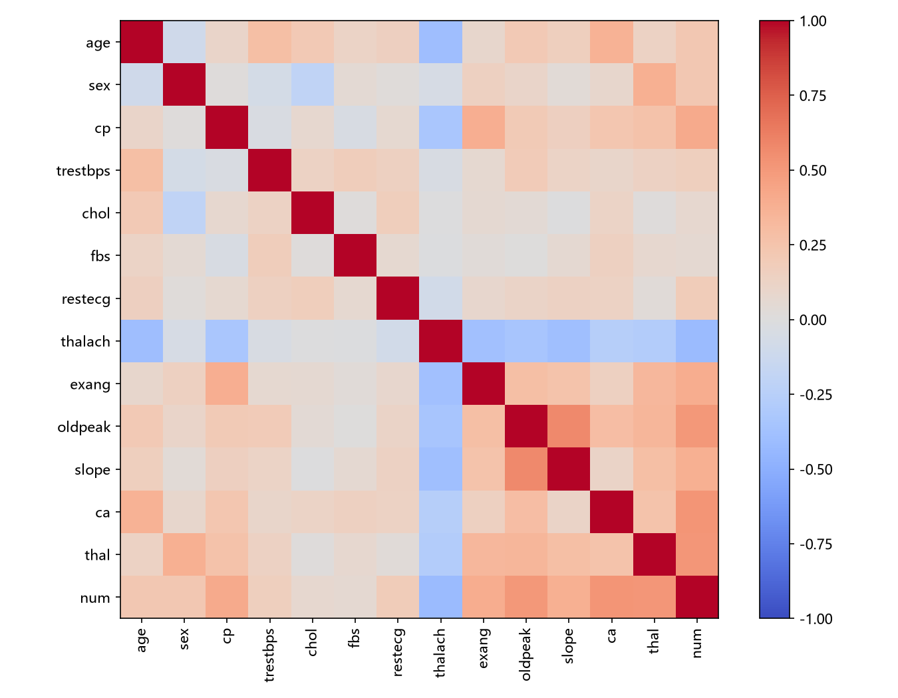
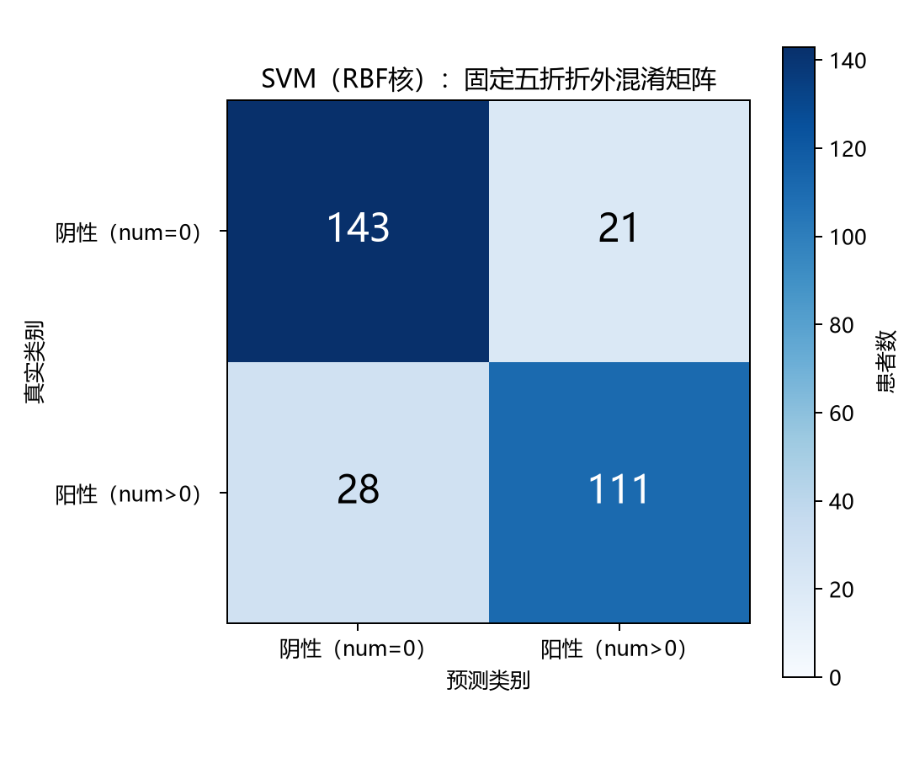
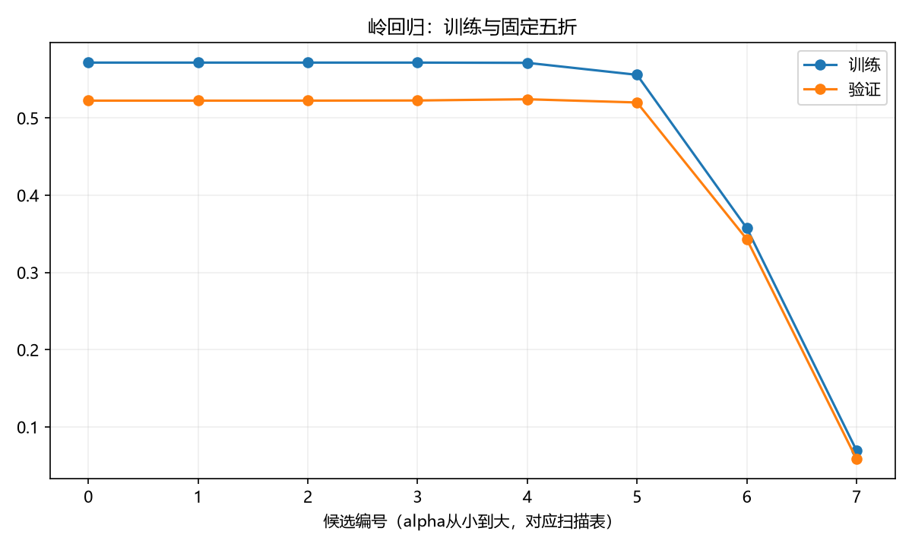
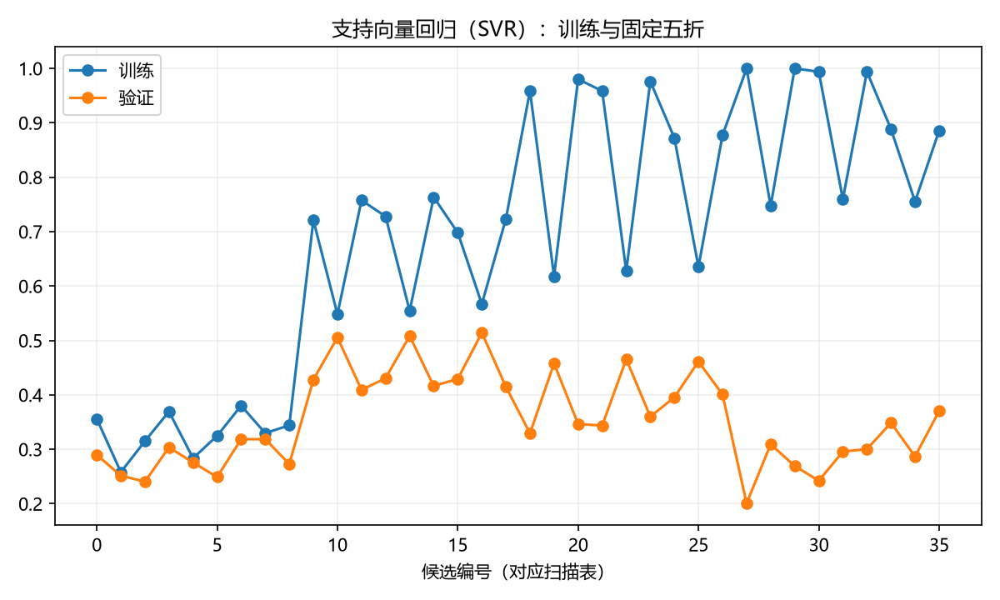

# 医学数据的分类与回归

## 1 总体设计

本实验采用 Cleveland 数据集，共 303 例、13 项特征。分类任务以 `num > 0` 为阳性，识别显著冠脉狭窄。回归任务以 `num` 的 0–4 级狭窄程度为目标，按等距等级拟合。五分类会丢失等级顺序，且最高等级仅 13 例，难以稳定估计该类的表现。

分类、回归和消融分别由 `classify.py`、`regress.py` 和 `ablations.py` 实现。安装依赖后，运行 `python assignment4/main.py` 可复现实验及图表，结果表输出至 `figures/tables.md`。默认数据路径为 `data/assignment4-data`，也可通过 `--data-dir` 指定。随机模型使用种子 42，单次划分对照使用种子 0–9。依赖版本和数据哈希见 `figures/results.json`。

超参数扫描采用课程指定的固定五折，分类按平均验证 AUC 选参，回归按平均验证 R² 选参。指标保留六位小数后并列时，取网格中先列出的配置。另以原五折逐折作为外层测试集，在其余四折内完成选参，评价选参流程的表现。

### 1.1 外层交叉验证

| 模型 | 评价指标 | 课程扫描最优 | 外层独立成绩 | 外层参数 |
|---|---|---|---|---|
| SVM（线性核） | AUC | 0.911160 | 0.904554 | [{'C': 0.01, 'gamma': 'scale', 'scale': True}, {'C': 0.1, 'gamma': 'scale', 'scale': True}, {'C': 0.001, 'gamma': 'scale', 'scale': True}, {'C': 0.001, 'gamma': 'scale', 'scale': True}, {'C': 0.01, 'gamma': 'scale', 'scale': True}] |
| SVM（RBF核） | AUC | 0.910040 | 0.897433 | [{'C': 100, 'gamma': 0.001, 'scale': True}, {'C': 0.1, 'gamma': 'scale', 'scale': True}, {'C': 10, 'gamma': 0.001, 'scale': True}, {'C': 1, 'gamma': 0.001, 'scale': True}, {'C': 1, 'gamma': 0.01, 'scale': True}] |
| 回归树（预剪枝） | R² | 0.292150 | 0.209500 | [{'max_depth': 4}, {'max_depth': 4}, {'max_depth': 3}, {'max_depth': 2}, {'max_depth': 4}] |
| 回归树（后剪枝） | R² | 0.236025 | 0.213837 | [{'path_fraction': 0.9}, {'path_fraction': 0.9}, {'path_fraction': 0.95}, {'path_fraction': 0.95}, {'path_fraction': 0.75}] |
| 岭回归 | R² | 0.524346 | 0.524346 | [{'alpha': 10}, {'alpha': 10}, {'alpha': 10}, {'alpha': 10}, {'alpha': 10}] |
| Lasso回归 | R² | 0.525461 | 0.525461 | [{'alpha': 0.01}, {'alpha': 0.01}, {'alpha': 0.01}, {'alpha': 0.01}, {'alpha': 0.01}] |
| 普通最小二乘线性回归 | R² | 0.522537 | 0.522537 | [{}, {}, {}, {}, {}] |
| 支持向量回归（SVR） | R² | 0.514087 | 0.504370 | [{'C': 1, 'epsilon': 0.1, 'gamma': 0.01}, {'C': 1, 'epsilon': 0.5, 'gamma': 0.01}, {'C': 1, 'epsilon': 0.1, 'gamma': 0.01}, {'C': 1, 'epsilon': 0.01, 'gamma': 0.01}, {'C': 1, 'epsilon': 0.1, 'gamma': 0.01}] |

外层评估中，线性核的 AUC 仍高于 RBF 核，岭回归和 Lasso 的 R² 保持稳定。两种回归树的外层 R² 均低于对应的扫描最优值。

## 2 数据探索

| 字段 | 最小值 | 最大值 | 缺失数 |
|---|---|---|---|
| age | 29.000000 | 77.000000 | 0 |
| sex | 0.000000 | 1.000000 | 0 |
| cp | 1.000000 | 4.000000 | 0 |
| trestbps | 94.000000 | 200.000000 | 0 |
| chol | 126.000000 | 564.000000 | 0 |
| fbs | 0.000000 | 1.000000 | 0 |
| restecg | 0.000000 | 2.000000 | 0 |
| thalach | 71.000000 | 202.000000 | 0 |
| exang | 0.000000 | 1.000000 | 0 |
| oldpeak | 0.000000 | 6.200000 | 0 |
| slope | 1.000000 | 3.000000 | 0 |
| ca | 0.000000 | 3.000000 | 4 |
| thal | 3.000000 | 7.000000 | 2 |
| num | 0 | 4 | 0 |

全表共有 6 处缺失，集中于 `ca`（4 处）和 `thal`（2 处）。

每折使用 `Pipeline` 执行中位数填补、标准化和模型拟合。填补值与标准化参数均由训练折估计，并应用于对应验证折。树模型省略标准化。中位数填补沿用课程基线，便于复核指标，同时保留存在少量缺失的病例。

五个严重程度等级分别有 164、55、36、35、13 例。二分类中，阴性 164 例，阳性 139 例。最高等级仅 13 例，个别大误差即可明显影响回归平方损失。

`oldpeak` 与狭窄等级的 Pearson 相关系数为 0.504092。随运动后 ST 段压低幅度增大，较高等级病例更常见，但各等级的取值有明显重叠。

输入特征中，`oldpeak` 与 `slope` 的 Pearson 相关系数为 0.577537，`age` 与 `thalach` 为 −0.393806。`num` 与 `ca`、`thalach` 的相关系数分别为 0.518909 和 −0.415040。

### 2.1 特征类型、单位与编码

| 字段 | 类型 | 含义 | 单位／编码 |
|---|---|---|---|
| age | 连续 | 年龄 | 岁 |
| sex | 离散 | 性别 | 0=女；1=男 |
| cp | 离散 | 胸痛类型 | 1=典型心绞痛；2=非典型心绞痛；3=非心绞痛性疼痛；4=无症状 |
| trestbps | 连续 | 静息血压 | mm Hg |
| chol | 连续 | 血清胆固醇 | mg/dl |
| fbs | 离散 | 空腹血糖是否超过120 mg/dl | 0=否；1=是 |
| restecg | 离散 | 静息心电图 | 0=正常；1=ST-T波异常；2=左心室肥厚 |
| thalach | 连续 | 运动负荷试验中达到的最大心率 | bpm（次/分钟） |
| exang | 离散 | 运动诱发心绞痛 | 0=否；1=是 |
| oldpeak | 连续 | 运动相对静息的ST段压低幅度 | 沿用原记录数值尺度；题目未注明物理单位 |
| slope | 离散 | 峰值运动ST段斜率 | 1=上斜；2=平直；3=下斜 |
| ca | 离散 | 荧光透视显影的主要血管支数 | 0–3；不能直接等同num的严重程度分级 |
| thal | 离散 | 心肌灌注检查编码 | 3=正常；6=固定缺损；7=可逆缺损 |
| num | 目标 | 狭窄严重程度 | 0=无超过50%的主要血管狭窄；1–4=有显著狭窄且程度递增，不是血管支数 |

13 项输入由 5 项连续变量和 8 项离散编码变量组成。`num` 表示狭窄等级，`ca` 表示显影的血管支数。

变量单位与编码沿用课程数据字典。SVM 和线性回归直接使用 `cp`、`thal` 等类别的原始数值编码，因此编码间距会影响距离或线性拟合。

## 3 复现核对

| 方法 | 指标 | 基线 | 我的值 | 差值 |
|---|---|---|---|---|
| SVM（线性核） | accuracy | 0.834863 | 0.834863 | 0.000000 |
| SVM（线性核） | precision | 0.836711 | 0.836711 | 0.000000 |
| SVM（线性核） | recall | 0.798413 | 0.798413 | -0.000000 |
| SVM（线性核） | f1 | 0.815262 | 0.815262 | 0.000000 |
| SVM（线性核） | auc | 0.910463 | 0.910463 | 0.000000 |
| SVM（RBF核） | accuracy | 0.838087 | 0.838087 | 0.000000 |
| SVM（RBF核） | precision | 0.852606 | 0.852606 | 0.000000 |
| SVM（RBF核） | recall | 0.783862 | 0.783862 | 0.000000 |
| SVM（RBF核） | f1 | 0.815278 | 0.815278 | 0.000000 |
| SVM（RBF核） | auc | 0.897508 | 0.897508 | -0.000000 |
| 回归树（预剪枝） | r2 | 0.292150 | 0.292150 | -0.000000 |
| 回归树（预剪枝） | mae | 0.712077 | 0.712077 | -0.000000 |
| 回归树（预剪枝） | rmse | 1.013903 | 1.013903 | 0.000000 |
| 岭回归 | r2 | 0.522760 | 0.522760 | -0.000000 |
| 岭回归 | mae | 0.634785 | 0.634785 | 0.000000 |
| 岭回归 | rmse | 0.842275 | 0.842275 | 0.000000 |
| Lasso回归 | r2 | 0.525461 | 0.525461 | 0.000000 |
| Lasso回归 | mae | 0.632992 | 0.632992 | -0.000000 |
| Lasso回归 | rmse | 0.840237 | 0.840237 | 0.000000 |
| 普通最小二乘线性回归 | r2 | 0.522537 | 0.522537 | 0.000000 |
| 普通最小二乘线性回归 | mae | 0.634911 | 0.634911 | 0.000000 |
| 普通最小二乘线性回归 | rmse | 0.842442 | 0.842442 | -0.000000 |
| 支持向量回归（SVR） | r2 | 0.430590 | 0.430590 | 0.000000 |
| 支持向量回归（SVR） | mae | 0.659730 | 0.659730 | -0.000000 |
| 支持向量回归（SVR） | rmse | 0.913401 | 0.913401 | 0.000000 |

自行复算的 25 项指标均满足 0.01 的基线容差。后续超参数扫描沿用相同的评估流程。

## 4 分类实验

主结果表并列给出课程固定参数基线、扫描最优配置和朴素参考线。分类以 AUC 为主要选参指标，回归以 R² 为主要选参指标，同时报告 MAE 和 RMSE。

| 模型／参照 | accuracy：基线（固定超参） | accuracy：我的最优（扫描后） | Δaccuracy | precision：基线（固定超参） | precision：我的最优（扫描后） | Δprecision | recall：基线（固定超参） | recall：我的最优（扫描后） | Δrecall | F1：基线（固定超参） | F1：我的最优（扫描后） | ΔF1 | AUC：基线（固定超参） | AUC：我的最优（扫描后） | ΔAUC |
|---|---|---|---|---|---|---|---|---|---|---|---|---|---|---|---|
| SVM（线性核） | 0.834863 | 0.844754 | +0.00989071 | 0.836711 | 0.866493 | +0.02978199 | 0.798413 | 0.784127 | -0.01428571 | 0.815262 | 0.821905 | +0.00664331 | 0.910463 | 0.911160 | +0.00069695 |
| SVM（RBF核） | 0.838087 | 0.838197 | +0.00010929 | 0.852606 | 0.842461 | -0.01014559 | 0.783862 | 0.798413 | +0.01455026 | 0.815278 | 0.818062 | +0.00278423 | 0.897508 | 0.910040 | +0.01253232 |
| 多数类参考线 | 0.541257 | 不适用 | 不适用 | 0.000000 | 不适用 | 不适用 | 0.000000 | 不适用 | 不适用 | 0.000000 | 不适用 | 不适用 | 0.500000 | 不适用 | 不适用 |

RBF 核调参后的 AUC 增益为 0.012532，大于线性核的 0.000697。调参后线性核的 AUC 仍较高，但其阳性召回率较固定基线下降。

表中 Δ 为扫描最优配置与固定基线的指标差。

热力图显示 RBF 核在各组 `C`、`gamma` 下的五折平均验证 AUC。最高值为 0.910040，对应 `C=100`、`gamma=0.001`，位于扫描边界。`gamma=1` 和 `10` 时，多数组合的验证 AUC 下降。

### 4.1 线性核与 RBF 核的比较

线性核在固定参数、五折扫描及外层评估中的 AUC 均较高。按各自最优配置比较，线性核为 0.911160，RBF 核为 0.910040，差值为 0.001120。

按各自最优配置计算，训练 AUC 与验证 AUC 的差值在线性核和 RBF 核中分别为 0.005785 和 0.015535。RBF 核获得了更高的训练 AUC，但验证排序表现略低于线性核。

在默认判别阈值下，RBF 核的阳性召回率为 0.798413，高于线性核的 0.784127。以降低漏诊为目标时，应结合阳性召回率和误报代价选择判别阈值。

### 4.2 AUC 计算、逐类指标与筛查含义

| 默认参数模型 | 硬标签AUC（错误口径示例） | 连续分数AUC（正式口径） | 差值 |
|---|---|---|---|
| SVM（线性核） | 0.832350 | 0.910463 | 0.078113 |
| SVM（RBF核） | 0.834166 | 0.897508 | 0.063342 |

硬标签丢失了类别内部的排序信息，使固定参数下的 AUC 排名由连续分数口径的线性核领先，变为 RBF 核领先。
正式 AUC 使用 `decision_function` 输出的连续分数。敏感性为阳性召回率 TP/(TP+FN)，特异性为阴性召回率 TN/(TN+FP)，阳性精确率为 TP/(TP+FP)。二分类中，以相反标签和相反分数计算的阴性 AUC 与阳性 AUC 相同。混淆矩阵汇总 303 例折外预测，表中比例指标按折计算后取平均。

### 4.3 最优配置的分类指标

按五折平均验证 AUC 选出的配置为线性核 `C=0.01`，RBF 核 `C=100`、`gamma=0.001`。下表汇总两组配置的训练和验证指标。

| 指标 | SVM（线性核，网格最优） | SVM（RBF核，网格最优） |
|---|---|---|
| accuracy | 0.844754 | 0.838197 |
| auc | 0.911160 | 0.910040 |
| hard_auc | 0.840359 | 0.835381 |
| precision_0 | 0.831760 | 0.838712 |
| recall_0 | 0.896591 | 0.872348 |
| f1_0 | 0.862226 | 0.854080 |
| precision_1 | 0.866493 | 0.842461 |
| recall_1 | 0.784127 | 0.798413 |
| f1_1 | 0.821905 | 0.818062 |
| precision | 0.866493 | 0.842461 |
| recall | 0.784127 | 0.798413 |
| f1 | 0.821905 | 0.818062 |
| sensitivity | 0.784127 | 0.798413 |
| specificity | 0.896591 | 0.872348 |
| auc_0 | 0.911160 | 0.910040 |
| auc_1 | 0.911160 | 0.910040 |
| accuracy_0 | 0.844754 | 0.838197 |
| accuracy_1 | 0.844754 | 0.838197 |
| train_accuracy | 0.858079 | 0.857256 |
| train_auc | 0.916945 | 0.925575 |
| train_hard_auc | 0.853000 | 0.853067 |
| train_precision_0 | 0.838045 | 0.843565 |
| train_recall_0 | 0.914654 | 0.903979 |
| train_f1_0 | 0.874636 | 0.872689 |
| train_precision_1 | 0.887211 | 0.876363 |
| train_recall_1 | 0.791345 | 0.802156 |
| train_f1_1 | 0.836464 | 0.837551 |
| train_precision | 0.887211 | 0.876363 |
| train_recall | 0.791345 | 0.802156 |
| train_f1 | 0.836464 | 0.837551 |
| train_sensitivity | 0.791345 | 0.802156 |
| train_specificity | 0.914654 | 0.903979 |
| train_auc_0 | 0.916945 | 0.925575 |
| train_auc_1 | 0.916945 | 0.925575 |
| train_accuracy_0 | 0.858079 | 0.857256 |
| train_accuracy_1 | 0.858079 | 0.857256 |
| support_vectors | 142.600000 | 96.800000 |
| zero_count | 0.000000 | — |

线性核验证AUC=0.911160略高于RBF的0.910040，但召回率分别为0.784127与0.798413，两核的排序能力和漏诊表现需要分开评价。

`train_` 表示训练折指标，无此前缀的指标来自验证折。类别后缀 0、1 分别表示阴性和阳性。`support_vectors` 和 `zero_count` 分别为支持向量数与精确零权重数的五折均值，后者仅适用于线性核。

### 4.4 SVM（线性核）混淆矩阵

线性核最优配置的 303 例折外预测中，真阴性 147 例、假阳性 17 例、假阴性 30 例、真阳性 109 例。图中行对应真实类别，列对应预测类别。

### 4.5 SVM（RBF 核）混淆矩阵

RBF 核最优配置的 303 例折外预测中，真阴性 143 例、假阳性 21 例、假阴性 28 例、真阳性 111 例。

### 4.6 两种核对惩罚参数 C 的敏感性

| 核 | C | 训练AUC | 验证AUC | 训练错误率 | 验证错误率 |
|---|---|---|---|---|---|
| SVM（线性核） | 0.001000 | 0.911462 | 0.907902 | 0.288773 | 0.290219 |
| SVM（线性核） | 0.010000 | 0.916945 | 0.911160 | 0.141921 | 0.155246 |
| SVM（线性核） | 0.100000 | 0.921292 | 0.907406 | 0.146040 | 0.155191 |
| SVM（线性核） | 1 | 0.923765 | 0.910463 | 0.141914 | 0.165137 |
| SVM（线性核） | 10 | 0.923162 | 0.908061 | 0.140268 | 0.175027 |
| SVM（线性核） | 100 | 0.923163 | 0.908061 | 0.140268 | 0.175027 |
| SVM（RBF核） | 0.001000 | 0.912736 | 0.908771 | 0.458746 | 0.458743 |
| SVM（RBF核） | 0.010000 | 0.912901 | 0.908098 | 0.458746 | 0.458743 |
| SVM（RBF核） | 0.100000 | 0.913024 | 0.908332 | 0.171625 | 0.171694 |
| SVM（RBF核） | 1 | 0.922924 | 0.908592 | 0.143570 | 0.151913 |
| SVM（RBF核） | 10 | 0.941133 | 0.904939 | 0.122127 | 0.158525 |
| SVM（RBF核） | 100 | 0.974781 | 0.869393 | 0.062721 | 0.201530 |

固定 `gamma=0.01` 后，RBF 核随 `C` 增大而提高训练 AUC，但验证 AUC 在 `C=100` 时降至 0.869393。
当 `C` 由 0.001 增至 100 时，线性核验证 AUC 的极差为 0.003754，RBF 核在 `gamma=0.01` 下的极差为 0.039378。线性核在 `C=10` 和 `100` 时的验证 AUC 均为 0.908061，已进入平台。

SVM 的目标函数由权重范数惩罚与 `C` 加权的间隔违例损失组成。增大 `C` 会提高原目标中的违例代价，同时放宽对偶约束 `0 ≤ αᵢ ≤ C` 的上限，相当于减弱相对正则化。

### 4.7 SVM（线性核）参数扫描

扫描基线对照（C=1，线性核）：

| 指标 | 基线（固定超参） | 我的最优（扫描后） | Δ（最优−基线） |
|---|---|---|---|
| AUC | 0.910463 | 0.911160 | +0.00069695 |
| accuracy | 0.834863 | 0.844754 | +0.00989071 |
| precision | 0.836711 | 0.866493 | +0.02978199 |
| recall | 0.798413 | 0.784127 | -0.01428571 |
| f1 | 0.815262 | 0.821905 | +0.00664331 |

线性核调参后 AUC 提高 0.000697，阳性召回率有所下降。

| 编号 | 参数 | auc | train_auc | accuracy | hard_auc | support_vectors |
|---|---|---|---|---|---|---|
| 0 | {'C': 0.001, 'gamma': 'scale', 'scale': True} | 0.907902 | 0.911462 | 0.709781 | 0.684139 | 223.400000 |
| 1 | {'C': 0.01, 'gamma': 'scale', 'scale': True} | 0.911160 | 0.916945 | 0.844754 | 0.840359 | 142.600000 |
| 2 | {'C': 0.1, 'gamma': 'scale', 'scale': True} | 0.907406 | 0.921292 | 0.844809 | 0.840900 | 100.400000 |
| 3 | {'C': 1, 'gamma': 'scale', 'scale': True} | 0.910463 | 0.923765 | 0.834863 | 0.832350 | 92.200000 |
| 4 | {'C': 10, 'gamma': 'scale', 'scale': True} | 0.908061 | 0.923162 | 0.824973 | 0.822718 | 91.200000 |
| 5 | {'C': 100, 'gamma': 'scale', 'scale': True} | 0.908061 | 0.923163 | 0.824973 | 0.822718 | 91.000000 |

六个候选中，`C=0.01` 的验证 AUC 最高，为 0.911160。

次优配置为 `C=1`，验证 AUC 为 0.910463。`C=0.01` 施加了更强的相对正则化，验证 AUC 略高。

### 4.8 SVM（RBF 核）参数扫描

扫描基线对照（C=1，gamma=scale）：

| 指标 | 基线（固定超参） | 我的最优（扫描后） | Δ（最优−基线） |
|---|---|---|---|
| AUC | 0.897508 | 0.910040 | +0.01253232 |
| accuracy | 0.838087 | 0.838197 | +0.00010929 |
| precision | 0.852606 | 0.842461 | -0.01014559 |
| recall | 0.783862 | 0.798413 | +0.01455026 |
| f1 | 0.815278 | 0.818062 | +0.00278423 |

RBF 核调参后 AUC 提高 0.012532。

| 编号 | 参数 | auc | train_auc | accuracy | hard_auc | support_vectors |
|---|---|---|---|---|---|---|
| 0 | {'C': 0.001, 'gamma': 'scale', 'scale': True} | 0.901562 | 0.918932 | 0.541257 | 0.500000 | 222.400000 |
| 1 | {'C': 0.001, 'gamma': 0.001, 'scale': True} | 0.907029 | 0.911612 | 0.541257 | 0.500000 | 222.400000 |
| 2 | {'C': 0.001, 'gamma': 0.01, 'scale': True} | 0.908771 | 0.912736 | 0.541257 | 0.500000 | 222.400000 |
| 3 | {'C': 0.001, 'gamma': 0.1, 'scale': True} | 0.898487 | 0.922222 | 0.541257 | 0.500000 | 222.400000 |
| 4 | {'C': 0.001, 'gamma': 1, 'scale': True} | 0.806371 | 1.000000 | 0.541257 | 0.500000 | 222.400000 |
| 5 | {'C': 0.001, 'gamma': 10, 'scale': True} | 0.660632 | 1.000000 | 0.541257 | 0.500000 | 222.600000 |
| 6 | {'C': 0.01, 'gamma': 'scale', 'scale': True} | 0.900906 | 0.918905 | 0.541257 | 0.500000 | 223.800000 |
| 7 | {'C': 0.01, 'gamma': 0.001, 'scale': True} | 0.907253 | 0.911667 | 0.541257 | 0.500000 | 222.400000 |
| 8 | {'C': 0.01, 'gamma': 0.01, 'scale': True} | 0.908098 | 0.912901 | 0.541257 | 0.500000 | 223.000000 |
| 9 | {'C': 0.01, 'gamma': 0.1, 'scale': True} | 0.898263 | 0.922360 | 0.541257 | 0.500000 | 225.000000 |
| 10 | {'C': 0.01, 'gamma': 1, 'scale': True} | 0.805714 | 1.000000 | 0.541257 | 0.500000 | 241.000000 |
| 11 | {'C': 0.01, 'gamma': 10, 'scale': True} | 0.696062 | 1.000000 | 0.541257 | 0.500000 | 242.400000 |
| 12 | {'C': 0.1, 'gamma': 'scale', 'scale': True} | 0.903754 | 0.924762 | 0.847978 | 0.843930 | 199.400000 |
| 13 | {'C': 0.1, 'gamma': 0.001, 'scale': True} | 0.907902 | 0.911818 | 0.541257 | 0.500000 | 222.800000 |
| 14 | {'C': 0.1, 'gamma': 0.01, 'scale': True} | 0.908332 | 0.913024 | 0.828306 | 0.818676 | 221.200000 |
| 15 | {'C': 0.1, 'gamma': 0.1, 'scale': True} | 0.900226 | 0.927519 | 0.841421 | 0.837329 | 208.400000 |
| 16 | {'C': 0.1, 'gamma': 1, 'scale': True} | 0.805929 | 1.000000 | 0.541257 | 0.500000 | 241.400000 |
| 17 | {'C': 0.1, 'gamma': 10, 'scale': True} | 0.701919 | 1.000000 | 0.541257 | 0.500000 | 242.400000 |
| 18 | {'C': 1, 'gamma': 'scale', 'scale': True} | 0.897508 | 0.963564 | 0.838087 | 0.834166 | 137.800000 |
| 19 | {'C': 1, 'gamma': 0.001, 'scale': True} | 0.906801 | 0.912600 | 0.841530 | 0.832962 | 208.000000 |
| 20 | {'C': 1, 'gamma': 0.01, 'scale': True} | 0.908592 | 0.922924 | 0.848087 | 0.843389 | 130.800000 |
| 21 | {'C': 1, 'gamma': 0.1, 'scale': True} | 0.899503 | 0.975785 | 0.841475 | 0.837870 | 151.000000 |
| 22 | {'C': 1, 'gamma': 1, 'scale': True} | 0.804436 | 1.000000 | 0.580710 | 0.544650 | 241.400000 |
| 23 | {'C': 1, 'gamma': 10, 'scale': True} | 0.711969 | 1.000000 | 0.541257 | 0.500000 | 242.400000 |
| 24 | {'C': 10, 'gamma': 'scale', 'scale': True} | 0.884454 | 0.998694 | 0.814973 | 0.812488 | 132.200000 |
| 25 | {'C': 10, 'gamma': 0.001, 'scale': True} | 0.909077 | 0.919660 | 0.848033 | 0.843389 | 124.800000 |
| 26 | {'C': 10, 'gamma': 0.01, 'scale': True} | 0.904939 | 0.941133 | 0.841475 | 0.837870 | 104.800000 |
| 27 | {'C': 10, 'gamma': 0.1, 'scale': True} | 0.887087 | 0.999959 | 0.801749 | 0.799285 | 145.600000 |
| 28 | {'C': 10, 'gamma': 1, 'scale': True} | 0.803155 | 1.000000 | 0.593989 | 0.562762 | 241.400000 |
| 29 | {'C': 10, 'gamma': 10, 'scale': True} | 0.714213 | 1.000000 | 0.541257 | 0.500000 | 242.400000 |
| 30 | {'C': 100, 'gamma': 'scale', 'scale': True} | 0.873347 | 1.000000 | 0.791803 | 0.789293 | 128.000000 |
| 31 | {'C': 100, 'gamma': 0.001, 'scale': True} | 0.910040 | 0.925575 | 0.838197 | 0.835381 | 96.800000 |
| 32 | {'C': 100, 'gamma': 0.01, 'scale': True} | 0.869393 | 0.974781 | 0.798470 | 0.794965 | 103.000000 |
| 33 | {'C': 100, 'gamma': 0.1, 'scale': True} | 0.878662 | 1.000000 | 0.791749 | 0.788884 | 141.800000 |
| 34 | {'C': 100, 'gamma': 1, 'scale': True} | 0.803155 | 1.000000 | 0.593989 | 0.562762 | 241.400000 |
| 35 | {'C': 100, 'gamma': 10, 'scale': True} | 0.714213 | 1.000000 | 0.541257 | 0.500000 | 242.400000 |

36 个候选中，`C=100`、`gamma=0.001` 的验证 AUC 最高，为 0.910040。

次优配置 `C=10`、`gamma=0.001` 的验证 AUC 为 0.909077。最优配置位于 `C` 上界和数值 `gamma` 下界。

#### 4.8.1 核参数 gamma 对训练和验证 AUC 的影响

`C` 与 `gamma` 各取 6 个值，形成 36 组配置。联合热力图展示验证 AUC，完整扫描表同时列出各组的训练和验证 AUC。

为单独考察核宽度，固定 `C=1`，沿用相同折内预处理和五折划分。`gamma=scale` 作为自适应宽度的参照。

| gamma | 训练AUC | 五折验证AUC | 差距（训练−验证） | 验证accuracy | 平均支持向量数 |
|---|---|---|---|---|---|
| scale | 0.963564 | 0.897508 | 0.066056 | 0.838087 | 137.800000 |
| 0.001000 | 0.912600 | 0.906801 | 0.005799 | 0.841530 | 208.000000 |
| 0.010000 | 0.922924 | 0.908592 | 0.014332 | 0.848087 | 130.800000 |
| 0.100000 | 0.975785 | 0.899503 | 0.076282 | 0.841475 | 151.000000 |
| 1 | 1.000000 | 0.804436 | 0.195564 | 0.580710 | 241.400000 |
| 10 | 1.000000 | 0.711969 | 0.288031 | 0.541257 | 242.400000 |

固定C=1时，gamma从0.01增大到10使训练AUC由0.922924升至1，而验证AUC由0.908592降至0.711969，训练拟合增强并未转化为泛化收益。

`gamma` 从 0.01 增至 10 后，训练 AUC 达到 1.000000，训练与验证 AUC 的差值增至 0.288031，验证准确率降至 0.541257，与多数类参考线相同。验证 AUC 在 `gamma` 从 0.001 增至 0.01 时曾有所提高，随后持续下降。

RBF 核为 `K(x,x′)=exp(−gamma·‖x−x′‖²)`，距离基于折内标准化后的输入。`gamma` 越大，样本间相似度衰减越快，模型响应越集中于训练点附近。`gamma=10` 时，支持向量数接近各折训练样本数，与训练拟合增强而验证表现下降的结果一致。

### 4.9 各 gamma 水平下的最优配置

gamma=0.001时，该行最佳C=100，训练AUC=0.925575、验证AUC=0.910040、差距=0.015535。

gamma=0.01时，该行最佳C=0.001，训练AUC=0.912736、验证AUC=0.908771、差距=0.003965。

gamma=0.1时，该行最佳C=0.1，训练AUC=0.927519、验证AUC=0.900226、差距=0.027292。

gamma=1时，该行最佳C=0.001，训练AUC=1.000000、验证AUC=0.806371、差距=0.193629。

gamma=10时，该行最佳C=10，训练AUC=1.000000、验证AUC=0.714213、差距=0.285787。

## 5 回归实验

| 模型／参照 | R²：基线（固定超参） | R²：我的最优（扫描后） | ΔR² | MAE：基线（固定超参） | MAE：我的最优（扫描后） | ΔMAE | RMSE：基线（固定超参） | RMSE：我的最优（扫描后） | ΔRMSE |
|---|---|---|---|---|---|---|---|---|---|
| 回归树（预剪枝） | 0.292150 | 0.292150 | +0.00000000 | 0.712077 | 0.712077 | +0.00000000 | 1.013903 | 1.013903 | +0.00000000 |
| 岭回归 | 0.522760 | 0.524346 | +0.00158615 | 0.634785 | 0.633793 | -0.00099202 | 0.842275 | 0.841125 | -0.00114995 |
| Lasso回归 | 0.525461 | 0.525461 | -0.00000076 | 0.632992 | 0.632995 | +0.00000372 | 0.840237 | 0.840238 | +0.00000048 |
| 普通最小二乘线性回归 | 0.522537 | 0.522537 | +0.00000000 | 0.634911 | 0.634911 | +0.00000000 | 0.842442 | 0.842442 | +0.00000000 |
| 支持向量回归（SVR） | 0.430590 | 0.514087 | +0.08349650 | 0.659730 | 0.628416 | -0.03131327 | 0.913401 | 0.851529 | -0.06187212 |
| 回归树（后剪枝，相对完整树） | 0.003372 | 0.236025 | +0.23265371 | 0.749126 | 0.744002 | -0.00512369 | 1.209231 | 1.051016 | -0.15821518 |
| 回归树（后剪枝，相对课程深度3树） | 0.292150 | 0.236025 | -0.05612447 | 0.712077 | 0.744002 | +0.03192514 | 1.013903 | 1.051016 | +0.03711280 |
| 训练均值参考线 | -0.011653 | 不适用 | 不适用 | 1.014840 | 不适用 | 不适用 | 1.228765 | 不适用 | 不适用 |

预剪枝扫描选中课程基线深度 3。后剪枝改善了完整树的预测表现，但验证 R² 低于深度 3 的预剪枝树。正则化线性模型的 R² 较高，SVR 在部分配置下的 MAE 较低。

普通最小二乘采用固定配置。后剪枝分别与完整树及课程指定的深度 3 预剪枝树比较。

剪枝树示意图采用五折选出的路径位置，在全部 303 例上重新计算剪枝路径并拟合。图用于解释模型分裂规则，验证指标来自交叉验证。

| 节点 | 特征 | 阈值 | 样本数 |
|---|---|---|---|
| 0 | thal | 4.500000 | 303 |
| 1 | ca | 0.500000 | 168 |
| 2 | leaf | -2.000000 | 119 |
| 3 | cp | 3.500000 | 49 |
| 4 | leaf | -2.000000 | 29 |
| 5 | exang | 0.500000 | 20 |
| 6 | leaf | -2.000000 | 9 |

根节点按 `thal` 分裂，表明灌注检查结果参与了树的首层划分。

每个节点的左分支对应特征值小于或等于阈值。`ca`、`thal` 分别来自显影和灌注检查，`oldpeak` 则来自运动负荷试验。

### 5.1 预剪枝与后剪枝的区别及效果比较

预剪枝在树生长过程中施加约束，本实验通过max_depth限制最大深度；达到限制后不再继续分裂。后剪枝先生成完整树，再根据代价复杂度准则，以ccp_alpha权衡拟合误差和叶节点数量，删除收益不足的子树。因此预剪枝可能阻止后续有益分裂，后剪枝则先考察更完整的结构，但二者都需要验证数据选择复杂度。

固定五折扫描中，预剪枝以深度 3 取得最高 R²（0.292150），高于后剪枝的最优值 0.236025。后剪枝保留更深分支的能力在该扫描中未带来验证收益。

外层评估中，预剪枝与后剪枝的平均 R² 分别为 0.209500 和 0.213837。两者在外层评估中接近，且排序与固定五折扫描相反。

#### 5.1.1 后剪枝树前两层的实际分裂及临床解释

| 层级 | 节点 | 规则（左分支） | 解释 |
|---|---|---|---|
| 1 | 0 | thal ≤ 4.500000 | 阈值4.5将正常灌注编码3与固定／可逆缺损编码6、7分开，反映检查结果的分组。 |
| 2 | 1 | ca ≤ 0.500000 | 阈值0.5将显影支数0与至少1支分开，使用了题目所述昂贵检查信息。 |
| 2 | 8 | oldpeak ≤ 0.700000 | 按运动ST段压低幅度分组，数值较大对应不同的运动负荷反应；这是统计分组而非因果证据。 |

早期分裂同时依赖灌注和显影信息。评价检查前的初筛表现时，应采用第 6.1 节的去特征对照。

### 5.2 回归树（预剪枝）参数扫描

扫描基线对照（max_depth=3）：

| 指标 | 基线（固定超参） | 我的最优（扫描后） | Δ（最优−基线） |
|---|---|---|---|
| R² | 0.292150 | 0.292150 | +0.00000000 |
| MAE | 0.712077 | 0.712077 | +0.00000000 |
| RMSE | 1.013903 | 1.013903 | +0.00000000 |

预剪枝再次选中课程基线深度 3，验证 R² 保持为 0.292150。

| 编号 | 参数 | r2 | train_r2 | mae | rmse | 树深 | leaves | leaf_min | leaf_median | singleton_fraction | ccp_alpha |
|---|---|---|---|---|---|---|---|---|---|---|---|
| 0 | {'max_depth': 1} | 0.147202 | 0.269653 | 0.870262 | 1.123749 | 1.000000 | 2.000000 | 110.600000 | 121.200000 | 0.000000 | 0.000000 |
| 1 | {'max_depth': 2} | 0.215153 | 0.436834 | 0.764508 | 1.070871 | 2.000000 | 4.000000 | 23.000000 | 57.300000 | 0.000000 | 0.000000 |
| 2 | {'max_depth': 3} | 0.292150 | 0.568319 | 0.712077 | 1.013903 | 3.000000 | 8.000000 | 3.000000 | 21.300000 | 0.025000 | 0.000000 |
| 3 | {'max_depth': 4} | 0.284241 | 0.681943 | 0.693950 | 1.023114 | 4.000000 | 15.800000 | 1.000000 | 7.600000 | 0.125833 | 0.000000 |
| 4 | {'max_depth': 5} | 0.176890 | 0.781663 | 0.717008 | 1.091165 | 5.000000 | 27.600000 | 1.000000 | 2.700000 | 0.307668 | 0.000000 |
| 5 | {'max_depth': 6} | 0.130593 | 0.856788 | 0.719228 | 1.128722 | 6.000000 | 40.800000 | 1.000000 | 2.500000 | 0.353510 | 0.000000 |
| 6 | {'max_depth': 7} | 0.080483 | 0.918607 | 0.723437 | 1.164852 | 7.000000 | 54.600000 | 1.000000 | 2.000000 | 0.376895 | 0.000000 |
| 7 | {'max_depth': 8} | 0.079465 | 0.959841 | 0.723192 | 1.170435 | 8.000000 | 67.400000 | 1.000000 | 2.000000 | 0.400992 | 0.000000 |
| 8 | {'max_depth': 9} | 0.083597 | 0.985456 | 0.720991 | 1.164179 | 9.000000 | 75.800000 | 1.000000 | 2.000000 | 0.443116 | 0.000000 |
| 9 | {'max_depth': 10} | -0.007820 | 0.994313 | 0.757135 | 1.215382 | 10.000000 | 80.400000 | 1.000000 | 2.000000 | 0.462319 | 0.000000 |
| 10 | {'max_depth': 11} | 0.007529 | 0.998379 | 0.748470 | 1.206354 | 10.800000 | 82.200000 | 1.000000 | 2.000000 | 0.479002 | 0.000000 |
| 11 | {'max_depth': 12} | 0.008029 | 0.999151 | 0.747486 | 1.206007 | 11.200000 | 82.800000 | 1.000000 | 1.800000 | 0.482368 | 0.000000 |
| 12 | {'max_depth': None} | 0.003372 | 1.000000 | 0.749126 | 1.209231 | 11.400000 | 82.800000 | 1.000000 | 1.800000 | 0.479665 | 0.000000 |

13 个候选中，深度 3 的验证 R² 最高，为 0.292150。

深度 4 的验证 R² 为 0.284241，排名第二。

#### 5.2.1 树深、叶内样本量与验证误差

| 设置     | 训练R²     | 验证R²     | 叶节点数均值    | 叶内样本中位数均值 | 单例叶比例均值  |
| ------ | -------- | -------- | --------- | --------- | -------- |
| 深度3回归树 | 0.568319 | 0.292150 | 8.000000  | 21.300000 | 0.025000 |
| 无限深回归树 | 1.000000 | 0.003372 | 82.800000 | 1.800000  | 0.479665 |

完整树将训练误差降为零，却把大量叶节点分给很少的患者，无法可靠估计新患者的平均严重程度。
岭回归的验证 R² 为 0.524346，不限深度的树为 0.003372。树以叶内训练标签的均值作为预测值。叶内样本较少时，个别高等级病例即可显著改变预测，单例叶则直接复现一个训练标签。加深树虽然降低了训练误差，却提高了叶内均值的估计方差。

### 5.3 回归树（后剪枝）参数扫描

扫描基线对照（完整未剪枝树（路径位置0））：

| 指标 | 基线（固定超参） | 我的最优（扫描后） | Δ（最优−基线） |
|---|---|---|---|
| R² | 0.003372 | 0.236025 | +0.23265371 |
| MAE | 0.749126 | 0.744002 | -0.00512369 |
| RMSE | 1.209231 | 1.051016 | -0.15821518 |

后剪枝将完整树的验证 R² 从 0.003372 提高至 0.236025。

| 编号 | 参数 | r2 | train_r2 | mae | rmse | 树深 | leaves | leaf_min | leaf_median | singleton_fraction | ccp_alpha |
|---|---|---|---|---|---|---|---|---|---|---|---|
| 0 | {'path_fraction': 1} | -0.011653 | 0.000000 | 1.014840 | 1.228765 | 0.000000 | 1.000000 | 242.400000 | 242.400000 | 0.000000 | 0.406158 |
| 1 | {'path_fraction': 0.95} | 0.232057 | 0.464870 | 0.759539 | 1.060486 | 2.800000 | 4.400000 | 14.800000 | 44.800000 | 0.000000 | 0.069026 |
| 2 | {'path_fraction': 0.9} | 0.236025 | 0.580416 | 0.744002 | 1.051016 | 4.000000 | 7.400000 | 3.600000 | 20.600000 | 0.028571 | 0.035945 |
| 3 | {'path_fraction': 0.75} | 0.165746 | 0.767620 | 0.739327 | 1.095443 | 7.000000 | 19.200000 | 1.000000 | 6.200000 | 0.121561 | 0.015639 |
| 4 | {'path_fraction': 0.5} | 0.153949 | 0.911861 | 0.716590 | 1.118376 | 9.000000 | 40.200000 | 1.000000 | 3.000000 | 0.254960 | 0.005611 |
| 5 | {'path_fraction': 0.25} | 0.066429 | 0.961225 | 0.747180 | 1.170719 | 10.600000 | 57.800000 | 1.000000 | 2.200000 | 0.311542 | 0.002888 |
| 6 | {'path_fraction': 0.1} | 0.022428 | 0.984272 | 0.747969 | 1.196928 | 10.800000 | 70.400000 | 1.000000 | 2.000000 | 0.387495 | 0.002207 |
| 7 | {'path_fraction': 0} | 0.003372 | 1.000000 | 0.749126 | 1.209231 | 11.400000 | 82.800000 | 1.000000 | 1.800000 | 0.479665 | 0.000000 |

8 个候选中，路径位置 0.9 的验证 R² 最高，为 0.236025。

路径位置 0.95 的验证 R² 为 0.232057，排名第二。位置 0.9 对应各训练折剪枝路径索引的第 90 百分位附近，由此得到的五折 `ccp_alpha` 分别为 0.03553422、0.03156148、0.03374656、0.03937471 和 0.03950617。

### 5.4 岭回归参数扫描

扫描基线对照（alpha=1）：

| 指标 | 基线（固定超参） | 我的最优（扫描后） | Δ（最优−基线） |
|---|---|---|---|
| R² | 0.522760 | 0.524346 | +0.00158615 |
| MAE | 0.634785 | 0.633793 | -0.00099202 |
| RMSE | 0.842275 | 0.841125 | -0.00114995 |

岭回归的验证 R² 由 0.522760 提高至 0.524346，增幅为 0.001586。

| 编号 | 参数 | r2 | train_r2 | mae | rmse |
|---|---|---|---|---|---|
| 0 | {'alpha': 0.001} | 0.522538 | 0.571809 | 0.634911 | 0.842441 |
| 1 | {'alpha': 0.01} | 0.522540 | 0.571809 | 0.634910 | 0.842440 |
| 2 | {'alpha': 0.1} | 0.522560 | 0.571809 | 0.634899 | 0.842425 |
| 3 | {'alpha': 1} | 0.522760 | 0.571806 | 0.634785 | 0.842275 |
| 4 | {'alpha': 10} | 0.524346 | 0.571514 | 0.633793 | 0.841125 |
| 5 | {'alpha': 100} | 0.520169 | 0.555985 | 0.639327 | 0.846580 |
| 6 | {'alpha': 1000} | 0.343253 | 0.357566 | 0.808043 | 0.993768 |
| 7 | {'alpha': 10000} | 0.058621 | 0.069756 | 0.975415 | 1.186277 |

8 个候选中，`alpha=10` 的验证 R² 最高，为 0.524346。

次优配置为基线 `alpha=1`，验证 R² 为 0.522760。适度加强正则化带来的增益较小。

#### 5.4.1 弱正则化与普通最小二乘

当正则化强度 `alpha` 趋近于零时，岭回归趋近普通最小二乘解。本节在相同预处理和固定五折下，比较扫描起点 `alpha=0.001` 与普通最小二乘。

| 模型 | 验证R² | 验证MAE | 验证RMSE |
|---|---|---|---|
| 岭回归（alpha=0.001） | 0.52253756 | 0.63491104 | 0.84244139 |
| 普通最小二乘线性回归 | 0.52253733 | 0.63491117 | 0.84244156 |

alpha=0.001时岭回归与普通最小二乘的R²相差仅+0.00000023，支持小惩罚下近似无正则化线性解的解释。

两者在 303 例上的折外预测最大绝对差为 0.00000899 个等级，五折汇总指标也接近，支持以 `alpha=0.001` 近似无正则化线性解。

### 5.5 Lasso回归参数扫描

扫描基线对照（alpha=0.01）：

| 指标 | 基线（固定超参） | 我的最优（扫描后） | Δ（最优−基线） |
|---|---|---|---|
| R² | 0.525461 | 0.525461 | -0.00000076 |
| MAE | 0.632992 | 0.632995 | +0.00000372 |
| RMSE | 0.840237 | 0.840238 | +0.00000048 |

Lasso 再次选中固定基线 `alpha=0.01`。两次评估的 R² 相差约 0.00000076，源于求解容差和迭代上限的差异。

| 编号 | 参数 | r2 | train_r2 | mae | rmse |
|---|---|---|---|---|---|
| 0 | {'alpha': 10} | -0.011653 | 0.000000 | 1.014840 | 1.228765 |
| 1 | {'alpha': 1} | -0.011653 | 0.000000 | 1.014840 | 1.228765 |
| 2 | {'alpha': 0.1} | 0.507696 | 0.541368 | 0.641279 | 0.858773 |
| 3 | {'alpha': 0.01} | 0.525461 | 0.571084 | 0.632995 | 0.840238 |
| 4 | {'alpha': 0.001} | 0.522913 | 0.571801 | 0.634600 | 0.842150 |
| 5 | {'alpha': 0.0001} | 0.522575 | 0.571809 | 0.634879 | 0.842412 |

6 个候选中，`alpha=0.01` 的验证 R² 最高，为 0.525461。

次优配置为 `alpha=0.001`，验证 R² 为 0.522913。

### 5.6 普通最小二乘线性回归：五折评估

采用带截距的 `LinearRegression`，沿用训练折中位数填补和标准化，在固定五折上评估。普通最小二乘为岭回归和 Lasso 提供无正则化参照。

| 验证折 | 训练R² | 验证R² | 训练MAE | 验证MAE | 训练RMSE | 验证RMSE |
|---|---|---|---|---|---|---|
| 1 | 0.558224 | 0.578279 | 0.590002 | 0.684856 | 0.798770 | 0.856053 |
| 2 | 0.581377 | 0.453051 | 0.627395 | 0.565768 | 0.820098 | 0.767168 |
| 3 | 0.582163 | 0.494202 | 0.584756 | 0.713042 | 0.781260 | 0.919652 |
| 4 | 0.559448 | 0.579653 | 0.634618 | 0.533535 | 0.830746 | 0.721639 |
| 5 | 0.577833 | 0.507501 | 0.601402 | 0.677355 | 0.779791 | 0.927708 |
| 五折汇总 | 0.571809 | 0.522537 | 0.607635 | 0.634911 | 0.802133 | 0.842442 |

普通最小二乘的单折验证 R² 介于 0.453051 和 0.579653，显示各折预测表现存在差异。

汇总行的R²和MAE为五折算术平均，RMSE为各折MSE平均后开方，与主结果表口径一致。

左图比较各折的训练与验证 R²。右图汇总 303 例折外预测，虚线表示预测值与真实等级相等。未截断的连续预测在五折上的汇总 R² 为 0.522537，MAE 为 0.634911，RMSE 为 0.842442。

### 5.7 支持向量回归（SVR）参数扫描

扫描基线对照（C=1，其余使用课程默认值）：

| 指标 | 基线（固定超参） | 我的最优（扫描后） | Δ（最优−基线） |
|---|---|---|---|
| R² | 0.430590 | 0.514087 | +0.08349650 |
| MAE | 0.659730 | 0.628416 | -0.03131327 |
| RMSE | 0.913401 | 0.851529 | -0.06187212 |

SVR 调参后的验证 R² 由 0.430590 提高至 0.514087，MAE 和 RMSE 同时下降。

| 编号 | 参数 | r2 | train_r2 | mae | rmse |
|---|---|---|---|---|---|
| 0 | {'C': 0.1, 'epsilon': 0.01, 'gamma': 'scale'} | 0.289863 | 0.356010 | 0.705628 | 1.035043 |
| 1 | {'C': 0.1, 'epsilon': 0.01, 'gamma': 0.01} | 0.251500 | 0.257980 | 0.713737 | 1.064451 |
| 2 | {'C': 0.1, 'epsilon': 0.01, 'gamma': 0.1} | 0.240471 | 0.314932 | 0.726120 | 1.070377 |
| 3 | {'C': 0.1, 'epsilon': 0.1, 'gamma': 'scale'} | 0.303466 | 0.369370 | 0.708083 | 1.023877 |
| 4 | {'C': 0.1, 'epsilon': 0.1, 'gamma': 0.01} | 0.275772 | 0.283578 | 0.716402 | 1.047649 |
| 5 | {'C': 0.1, 'epsilon': 0.1, 'gamma': 0.1} | 0.248969 | 0.324753 | 0.730805 | 1.063250 |
| 6 | {'C': 0.1, 'epsilon': 0.5, 'gamma': 'scale'} | 0.318589 | 0.380165 | 0.790321 | 1.011059 |
| 7 | {'C': 0.1, 'epsilon': 0.5, 'gamma': 0.01} | 0.318481 | 0.329613 | 0.784451 | 1.015071 |
| 8 | {'C': 0.1, 'epsilon': 0.5, 'gamma': 0.1} | 0.273043 | 0.344125 | 0.811499 | 1.044391 |
| 9 | {'C': 1, 'epsilon': 0.01, 'gamma': 'scale'} | 0.427918 | 0.721046 | 0.644736 | 0.917147 |
| 10 | {'C': 1, 'epsilon': 0.01, 'gamma': 0.01} | 0.505541 | 0.548128 | 0.601584 | 0.860143 |
| 11 | {'C': 1, 'epsilon': 0.01, 'gamma': 0.1} | 0.409104 | 0.757578 | 0.665171 | 0.932027 |
| 12 | {'C': 1, 'epsilon': 0.1, 'gamma': 'scale'} | 0.430590 | 0.728018 | 0.659730 | 0.913401 |
| 13 | {'C': 1, 'epsilon': 0.1, 'gamma': 0.01} | 0.508326 | 0.554348 | 0.605788 | 0.857760 |
| 14 | {'C': 1, 'epsilon': 0.1, 'gamma': 0.1} | 0.416305 | 0.763370 | 0.675220 | 0.925449 |
| 15 | {'C': 1, 'epsilon': 0.5, 'gamma': 'scale'} | 0.429321 | 0.697939 | 0.706874 | 0.916256 |
| 16 | {'C': 1, 'epsilon': 0.5, 'gamma': 0.01} | 0.514087 | 0.566911 | 0.628416 | 0.851529 |
| 17 | {'C': 1, 'epsilon': 0.5, 'gamma': 0.1} | 0.414828 | 0.723478 | 0.724981 | 0.927699 |
| 18 | {'C': 10, 'epsilon': 0.01, 'gamma': 'scale'} | 0.329313 | 0.958768 | 0.726582 | 0.989314 |
| 19 | {'C': 10, 'epsilon': 0.01, 'gamma': 0.01} | 0.457773 | 0.617869 | 0.611381 | 0.894637 |
| 20 | {'C': 10, 'epsilon': 0.01, 'gamma': 0.1} | 0.346462 | 0.980238 | 0.729955 | 0.979300 |
| 21 | {'C': 10, 'epsilon': 0.1, 'gamma': 'scale'} | 0.343583 | 0.958299 | 0.726998 | 0.978741 |
| 22 | {'C': 10, 'epsilon': 0.1, 'gamma': 0.01} | 0.465641 | 0.627643 | 0.619259 | 0.887658 |
| 23 | {'C': 10, 'epsilon': 0.1, 'gamma': 0.1} | 0.359969 | 0.976299 | 0.727293 | 0.968103 |
| 24 | {'C': 10, 'epsilon': 0.5, 'gamma': 'scale'} | 0.395533 | 0.872071 | 0.729330 | 0.940043 |
| 25 | {'C': 10, 'epsilon': 0.5, 'gamma': 0.01} | 0.461401 | 0.635148 | 0.668031 | 0.890395 |
| 26 | {'C': 10, 'epsilon': 0.5, 'gamma': 0.1} | 0.400735 | 0.877181 | 0.731110 | 0.935463 |
| 27 | {'C': 100, 'epsilon': 0.01, 'gamma': 'scale'} | 0.200520 | 0.999718 | 0.785065 | 1.077750 |
| 28 | {'C': 100, 'epsilon': 0.01, 'gamma': 0.01} | 0.309155 | 0.747266 | 0.717105 | 0.997249 |
| 29 | {'C': 100, 'epsilon': 0.01, 'gamma': 0.1} | 0.269340 | 0.999933 | 0.759017 | 1.031407 |
| 30 | {'C': 100, 'epsilon': 0.1, 'gamma': 'scale'} | 0.242144 | 0.993775 | 0.764972 | 1.048665 |
| 31 | {'C': 100, 'epsilon': 0.1, 'gamma': 0.01} | 0.295789 | 0.759490 | 0.727915 | 1.006278 |
| 32 | {'C': 100, 'epsilon': 0.1, 'gamma': 0.1} | 0.300255 | 0.993849 | 0.746068 | 1.008847 |
| 33 | {'C': 100, 'epsilon': 0.5, 'gamma': 'scale'} | 0.348599 | 0.888446 | 0.738291 | 0.973174 |
| 34 | {'C': 100, 'epsilon': 0.5, 'gamma': 0.01} | 0.286720 | 0.755292 | 0.777123 | 1.016404 |
| 35 | {'C': 100, 'epsilon': 0.5, 'gamma': 0.1} | 0.370339 | 0.885531 | 0.739111 | 0.956954 |

36 个候选中，`C=1`、`epsilon=0.5`、`gamma=0.01` 的验证 R² 最高，为 0.514087。

次优配置为 `C=1`、`epsilon=0.1`、`gamma=0.01`，验证 R² 为 0.508326。`epsilon` 控制损失的不敏感区间，`gamma` 控制核的局部性。

### 5.8 回归树后剪枝的参照与剪枝效果

以 `max_depth=None`、`ccp_alpha=0` 的完整树作为剪枝前参照，并列课程指定的深度 3 预剪枝树。

| 设置 | R² | MAE | RMSE | 平均树深 | 平均叶节点数 |
|---|---|---|---|---|---|
| 完整回归树（剪枝前） | 0.003372 | 0.749126 | 1.209231 | 11.400000 | 82.800000 |
| 课程回归树基线（深度3） | 0.292150 | 0.712077 | 1.013903 | 3.000000 | 8.000000 |
| 回归树后剪枝（网格最优） | 0.236025 | 0.744002 | 1.051016 | 4.000000 | 7.400000 |

后剪枝相对于完整树改善了三项预测指标，平均树深由 11.4 降至 4，平均叶节点数由 82.8 降至 7.4。相对于深度 3 的预剪枝树，后剪枝在三项预测指标上均较弱，且平均深度更大。

### 5.9 正则化系数与稳定性
表中系数采用各训练折标准化后的输入尺度，报告五折均值与标准差。

| 特征 | OLS | Ridge | Lasso |
|---|---|---|---|
| age | -0.072689 ± 0.021638 | -0.060598 ± 0.020003 | -0.047157 ± 0.019862 |
| sex | 0.089792 ± 0.033932 | 0.090949 ± 0.032149 | 0.081863 ± 0.032513 |
| cp | 0.195494 ± 0.031019 | 0.192494 ± 0.029040 | 0.190436 ± 0.030255 |
| trestbps | 0.076177 ± 0.011218 | 0.072504 ± 0.010680 | 0.061490 ± 0.010689 |
| chol | 0.009865 ± 0.027500 | 0.010430 ± 0.025881 | 0.004554 ± 0.019164 |
| fbs | -0.018726 ± 0.029572 | -0.016191 ± 0.027514 | -0.014099 ± 0.020083 |
| restecg | 0.090981 ± 0.010047 | 0.088648 ± 0.009696 | 0.083364 ± 0.009456 |
| thalach | -0.121905 ± 0.020737 | -0.120010 ± 0.020636 | -0.110236 ± 0.022863 |
| exang | 0.116425 ± 0.028934 | 0.117521 ± 0.027232 | 0.116232 ± 0.029393 |
| oldpeak | 0.216765 ± 0.020925 | 0.213911 ± 0.018502 | 0.217501 ± 0.018293 |
| slope | 0.103106 ± 0.012434 | 0.103464 ± 0.011759 | 0.097491 ± 0.012707 |
| ca | 0.400786 ± 0.028880 | 0.383994 ± 0.026818 | 0.388834 ± 0.027691 |
| thal | 0.256793 ± 0.021848 | 0.250895 ± 0.020888 | 0.257366 ± 0.022008 |

最优岭回归中，`ca` 的平均标准化系数绝对值最大。

### 5.10 正则化作用、稀疏性与相关特征稳定性

`alpha` 对应讲义中的正则化强度 λ，扫描涵盖多个数量级。

| 模型 | alpha | 平均精确零系数数 | 验证R² | 验证MAE |
|---|---|---|---|---|
| 岭回归 | 0.001000 | 0.000000 | 0.522538 | 0.634911 |
| 岭回归 | 0.010000 | 0.000000 | 0.522540 | 0.634910 |
| 岭回归 | 0.100000 | 0.000000 | 0.522560 | 0.634899 |
| 岭回归 | 1 | 0.000000 | 0.522760 | 0.634785 |
| 岭回归 | 10 | 0.000000 | 0.524346 | 0.633793 |
| 岭回归 | 100 | 0.000000 | 0.520169 | 0.639327 |
| 岭回归 | 1000 | 0.000000 | 0.343253 | 0.808043 |
| 岭回归 | 10000 | 0.000000 | 0.058621 | 0.975415 |
| Lasso回归 | 0.000100 | 0.000000 | 0.522575 | 0.634879 |
| Lasso回归 | 0.001000 | 0.200000 | 0.522913 | 0.634600 |
| Lasso回归 | 0.010000 | 0.600000 | 0.525461 | 0.632995 |
| Lasso回归 | 0.100000 | 4.400000 | 0.507696 | 0.641279 |
| Lasso回归 | 1 | 13.000000 | -0.011653 | 1.014840 |
| Lasso回归 | 10 | 13.000000 | -0.011653 | 1.014840 |

岭回归在本次全部强度下没有产生精确零系数，Lasso随惩罚增强出现稀疏解，并最终退化为常数预测。

| 特征 | 岭系数−OLS系数（五折均值） | 最优Lasso非零折数／5 | Lasso系数折间标准差 |
|---|---|---|---|
| age | 0.012090 | 5 | 0.019862 |
| sex | 0.001157 | 5 | 0.032513 |
| cp | -0.003000 | 5 | 0.030255 |
| trestbps | -0.003674 | 5 | 0.010689 |
| chol | 0.000565 | 3 | 0.019164 |
| fbs | 0.002536 | 4 | 0.020083 |
| restecg | -0.002332 | 5 | 0.009456 |
| thalach | 0.001895 | 5 | 0.022863 |
| exang | 0.001097 | 5 | 0.029393 |
| oldpeak | -0.002854 | 5 | 0.018293 |
| slope | 0.000358 | 5 | 0.012707 |
| ca | -0.016792 | 5 | 0.027691 |
| thal | -0.005898 | 5 | 0.022008 |

逐折非零频数反映了 Lasso 对各变量的保留情况，系数标准差反映折间波动。
普通最小二乘R²=0.522537，岭回归最优R²=0.524346，差为+0.001808，表明在仅13个输入上适度收缩收益较小；岭alpha=10000时R²仅0.058621，说明惩罚过强会欠拟合。Lasso的alpha=10时，五折均将13个系数压到零，R²=-0.011653，与训练均值参考线一致；其截距保留训练标签均值，测试R²为负是训练和测试均值不一致造成的正常结果。

| 特征1     | 特征2     | Pearson相关系数 |
| ------- | ------- | ----------- |
| slope   | oldpeak | 0.577537    |
| thalach | age     | -0.393806   |
| slope   | thalach | -0.385601   |
| exang   | cp      | 0.384060    |
| thal    | sex     | 0.380936    |

相关变量可共享预测信息，因此 Lasso 的非零系数在不同训练折中可能落在不同变量上。逐折非零频数和系数标准差表明，部分变量的保留情况随训练折变化。岭回归在这些输入上保留了共同贡献，Lasso 则给出较稀疏的模型。

### 5.11 相对训练折均值基线的改进

各折以训练标签 `num` 的均值作为验证样本的常数预测。五折汇总 R² 为 −0.011653，MAE 为 1.014840，RMSE 为 1.228765。

ΔR² 为模型 R² 减去基线 R²。两项误差的减少量均为基线误差减去模型误差。

| 模型          | 验证R²     | 相对训练均值的ΔR² | MAE减少量   | RMSE减少量  |
| ----------- | -------- | ---------- | -------- | -------- |
| 回归树（预剪枝）    | 0.292150 | 0.303803   | 0.302763 | 0.214862 |
| 回归树（后剪枝）    | 0.236025 | 0.247678   | 0.270838 | 0.177749 |
| 岭回归         | 0.524346 | 0.535999   | 0.381047 | 0.387640 |
| Lasso回归     | 0.525461 | 0.537113   | 0.381845 | 0.388527 |
| 普通最小二乘线性回归  | 0.522537 | 0.534190   | 0.379929 | 0.386323 |
| 支持向量回归（SVR） | 0.514087 | 0.525740   | 0.386423 | 0.377236 |

所有入选模型的 R²、MAE 和 RMSE 均优于训练折均值参考线。
训练折均值与验证折均值存在差异，因此验证 R² 略小于零。

### 5.12 误差与排名冲突

| 参数 | R² | MAE | 误差>1人数 | 平方误差占比 | 绝对误差占比 | 最大误差行号 | 最大误差 |
|---|---|---|---|---|---|---|---|
| {'max_depth': 1} | 0.147202 | 0.870262 | 96 | 0.886649 | 0.656747 | 211 | 3.656000 |
| {'max_depth': 6} | 0.130593 | 0.719228 | 62 | 0.821441 | 0.610558 | 183 | 4.000000 |

R² 对大误差更敏感。回归树按 R² 选择深度 3，按 MAE 则选择深度 4。

### 5.13 按 R² 与 MAE 排名和选参

各模型先按 R² 选参，再以所得配置分别计算 R² 和 MAE 名次。

| R²名次 | 模型 | R² | MAE | MAE名次 |
|---|---|---|---|---|
| 1 | Lasso回归 | 0.525461 | 0.632995 | 2 |
| 2 | 岭回归 | 0.524346 | 0.633793 | 3 |
| 3 | 普通最小二乘线性回归 | 0.522537 | 0.634911 | 4 |
| 4 | 支持向量回归（SVR） | 0.514087 | 0.628416 | 1 |
| 5 | 回归树（预剪枝） | 0.292150 | 0.712077 | 5 |
| 6 | 回归树（后剪枝） | 0.236025 | 0.744002 | 6 |

在这些配置中，Lasso 的 R² 排名第一，SVR 的 MAE 最低。

以 MAE 对主实验中的全部回归候选重新选参，SVR 仍排名第一，最佳配置为 `C=1`、`epsilon=0.01`、`gamma=0.01`，五折平均 MAE 为 0.601584。

主实验采用 R² 选参，以强调较大的等级预测偏差。MAE 则直接表示平均偏差的等级数。表中超过一级的误差对平方损失的贡献更集中，因此两项指标可给出不同的模型排序。

### 5.14 岭回归与 Lasso 的折间系数

| 模型 | alpha | 零系数数量（五折均值） | R² | MAE |
|---|---|---|---|---|
| 岭回归 | 10000 | 0.000000 | 0.058621 | 0.975415 |
| 岭回归 | 1000 | 0.000000 | 0.343253 | 0.808043 |
| 岭回归 | 100 | 0.000000 | 0.520169 | 0.639327 |
| 岭回归 | 10 | 0.000000 | 0.524346 | 0.633793 |
| 岭回归 | 1 | 0.000000 | 0.522760 | 0.634785 |
| 岭回归 | 0.100000 | 0.000000 | 0.522560 | 0.634899 |
| 岭回归 | 0.010000 | 0.000000 | 0.522540 | 0.634910 |
| 岭回归 | 0.001000 | 0.000000 | 0.522538 | 0.634911 |

岭回归在 `alpha=10` 时取得最高验证 R²（0.524346）。

该配置在五折中均保留全部 13 个系数，逐特征系数标准差的最大值为 0.032149。

| 模型 | alpha | 零系数数量（五折均值） | R² | MAE |
|---|---|---|---|---|
| Lasso回归 | 10 | 13.000000 | -0.011653 | 1.014840 |
| Lasso回归 | 1 | 13.000000 | -0.011653 | 1.014840 |
| Lasso回归 | 0.100000 | 4.400000 | 0.507696 | 0.641279 |
| Lasso回归 | 0.010000 | 0.600000 | 0.525461 | 0.632995 |
| Lasso回归 | 0.001000 | 0.200000 | 0.522913 | 0.634600 |
| Lasso回归 | 0.000100 | 0.000000 | 0.522575 | 0.634879 |

Lasso 在 `alpha=0.01` 时取得最高验证 R²（0.525461）。

该配置在五折中的精确零系数个数依次为 0、1、0、2、0，逐特征系数标准差的最大值为 0.032513。

## 6 消融与对照实验

### 6.1 去除ca、thal

| 模型 | 评价指标 | 原始基线（固定超参） | 原始扫描最优 | 去除特征后扫描最优 | 消融选定参数 |
|---|---|---|---|---|---|
| SVM（线性核） | AUC | 0.910463 | 0.911160 | 0.865654 | {'C': 0.01, 'gamma': 'scale', 'scale': True} |
| SVM（RBF核） | AUC | 0.897508 | 0.910040 | 0.864848 | {'C': 0.1, 'gamma': 'scale', 'scale': True} |
| 回归树（预剪枝） | R² | 0.292150 | 0.292150 | 0.346120 | {'max_depth': 2} |
| 岭回归 | R² | 0.522760 | 0.524346 | 0.390989 | {'alpha': 100} |
| Lasso回归 | R² | 0.525461 | 0.525461 | 0.386736 | {'alpha': 0.01} |
| 支持向量回归（SVR） | R² | 0.430590 | 0.514087 | 0.365754 | {'C': 1, 'epsilon': 0.5, 'gamma': 0.01} |

去除两项检查特征后，即使重新选参，岭回归的 R² 仍由 0.524346 降至 0.390989。下表固定课程参数，单独比较输入特征变化的影响。

| 模型 | 评价指标 | 原固定参数 | 删除特征固定参数 |
|---|---|---|---|
| SVM（线性核） | AUC | 0.910463 | 0.855884 |
| SVM（RBF核） | AUC | 0.897508 | 0.863106 |
| 回归树（预剪枝） | R² | 0.292150 | 0.337606 |
| 岭回归 | R² | 0.522760 | 0.386073 |
| Lasso回归 | R² | 0.525461 | 0.386736 |
| 支持向量回归（SVR） | R² | 0.430590 | 0.286247 |

固定参数下，去除两项检查特征后，两种 SVM 和岭回归的表现下降，回归树的 R² 上升。11 项特征对应显影和灌注检查前可取得的信息。

### 6.2 去除标准化

| 模型 | 评价指标 | 标准化基线（固定超参） | 不标准化基线（固定超参） | 标准化扫描最优 | 不标准化扫描最优 | 不标准化选定参数 |
|---|---|---|---|---|---|---|
| SVM（线性核） | AUC | 0.910463 | 0.908709 | 0.911160 | 0.908709 | {'C': 1, 'gamma': 'scale', 'scale': False} |
| SVM（RBF核） | AUC | 0.897508 | 0.749810 | 0.910040 | 0.874310 | {'C': 100, 'gamma': 'scale', 'scale': False} |

两列固定基线均使用C=1，RBF核的gamma为scale。两列扫描最优分别在各自的预处理条件下按AUC选择。

标准化改变了输入距离和权重惩罚的相对尺度。`gamma=scale` 也随输入方差改变。树按单变量阈值划分，正线性缩放保留样本排序。

### 6.3 单次划分与模型容量

| 实验 | 数值 |
|---|---|
| values | [0.1364874134657491, 0.191036015455204, 0.3150684875812222, 0.1676225105704734, 0.11753836748502533, 0.29004991301648986, 0.14276914764340431, 0.15439431648805046, 0.17711112602125245, -0.20083349486129887] |
| min | -0.200833 |
| max | 0.315068 |
| std | 0.131900 |

十次 80/20 划分的 R² 介于 −0.200833 和 0.315068，标准差为 0.131900。

深度 3 的回归树在固定五折中的平均 R² 为 0.292150。单次划分得到的 R² 跨越零点，说明一次划分可能改变模型评价。

| 模型 | R²基线（固定超参） | R²扫描最优 | MAE基线（固定超参） | MAE扫描最优 | RMSE基线（固定超参） | RMSE扫描最优 | 选定参数 |
|---|---|---|---|---|---|---|---|
| 岭回归 | 0.522760 | 0.524346 | 0.634785 | 0.633793 | 0.842275 | 0.841125 | {'alpha': 10} |
| 二次多项式岭回归 | 0.050510 | 0.378840 | 0.886189 | 0.713875 | 1.169975 | 0.955137 | {'alpha': 100} |

每项指标并列给出固定基线和扫描最优。两种特征设置的固定基线均使用alpha=1，扫描最优分别按R²选择。

二次展开将输入由 13 维增至 104 维。即使采用更强的正则化，二次模型的三项验证指标仍弱于原岭回归。

### 6.4 消融结果分析

删除 `ca` 和 `thal` 后，固定参数的线性 SVM、RBF SVM、回归树和岭回归的主指标分别变化 −0.054579、−0.034402、+0.045456 和 −0.136686。保留检查信息有利于 SVM 和岭回归，删除它们则可能减少树的不稳定分裂。以检查前初筛为目标，应选用在该预测时点可取得的特征。

线性核去除标准化后，最优 `C` 从 0.01 变为 1，AUC 从 0.911160 降至 0.908709。RBF 核的最优 `C` 仍为 100，但 AUC 从 0.910040 降至 0.874310。深度 3 的回归树在两种尺度下的 R² 均为 0.292150。

十次划分出现的分数波动与单次验证集较小有关。少数高等级病例及其预测误差即可明显改变验证集的平方损失。

二次岭回归在 `alpha=100` 时的 R² 为 0.378840，较原岭回归低 0.145506。二次展开需估计更多交互项系数，深树则需估计更小叶节点内的均值。两种容量扩张均可能提高小样本下的估计方差。

### 6.5 未标准化 SVM 和二次岭回归的参数扫描

| 不标准化模型 | 参数 | 训练AUC | 验证AUC |
|---|---|---|---|
| SVM（线性核） | {'C': 0.001, 'gamma': 'scale', 'scale': False} | 0.840492 | 0.835345 |
| SVM（线性核） | {'C': 0.01, 'gamma': 'scale', 'scale': False} | 0.902926 | 0.889701 |
| SVM（线性核） | {'C': 0.1, 'gamma': 'scale', 'scale': False} | 0.917223 | 0.905339 |
| SVM（线性核） | {'C': 1, 'gamma': 'scale', 'scale': False} | 0.922614 | 0.908709 |
| SVM（线性核） | {'C': 10, 'gamma': 'scale', 'scale': False} | 0.923504 | 0.905900 |
| SVM（线性核） | {'C': 100, 'gamma': 'scale', 'scale': False} | 0.916279 | 0.899811 |

未标准化的线性核在 `C=1` 时取得最高验证 AUC（0.908709）。

| 不标准化模型 | 参数 | 训练AUC | 验证AUC |
|---|---|---|---|
| SVM（RBF核） | {'C': 0.001, 'gamma': 'scale', 'scale': False} | 0.742930 | 0.722904 |
| SVM（RBF核） | {'C': 0.001, 'gamma': 0.001, 'scale': False} | 0.794174 | 0.718934 |
| SVM（RBF核） | {'C': 0.001, 'gamma': 0.01, 'scale': False} | 0.998136 | 0.627568 |
| SVM（RBF核） | {'C': 0.001, 'gamma': 0.1, 'scale': False} | 1.000000 | 0.561212 |
| SVM（RBF核） | {'C': 0.001, 'gamma': 1, 'scale': False} | 1.000000 | 0.526413 |
| SVM（RBF核） | {'C': 0.001, 'gamma': 10, 'scale': False} | 1.000000 | 0.500000 |
| SVM（RBF核） | {'C': 0.01, 'gamma': 'scale', 'scale': False} | 0.749897 | 0.734056 |
| SVM（RBF核） | {'C': 0.01, 'gamma': 0.001, 'scale': False} | 0.795052 | 0.719397 |
| SVM（RBF核） | {'C': 0.01, 'gamma': 0.01, 'scale': False} | 0.998040 | 0.622799 |
| SVM（RBF核） | {'C': 0.01, 'gamma': 0.1, 'scale': False} | 1.000000 | 0.584869 |
| SVM（RBF核） | {'C': 0.01, 'gamma': 1, 'scale': False} | 1.000000 | 0.526413 |
| SVM（RBF核） | {'C': 0.01, 'gamma': 10, 'scale': False} | 1.000000 | 0.500000 |
| SVM（RBF核） | {'C': 0.1, 'gamma': 'scale', 'scale': False} | 0.750059 | 0.735387 |
| SVM（RBF核） | {'C': 0.1, 'gamma': 0.001, 'scale': False} | 0.795052 | 0.719375 |
| SVM（RBF核） | {'C': 0.1, 'gamma': 0.01, 'scale': False} | 0.998068 | 0.622785 |
| SVM（RBF核） | {'C': 0.1, 'gamma': 0.1, 'scale': False} | 1.000000 | 0.586188 |
| SVM（RBF核） | {'C': 0.1, 'gamma': 1, 'scale': False} | 1.000000 | 0.519920 |
| SVM（RBF核） | {'C': 0.1, 'gamma': 10, 'scale': False} | 1.000000 | 0.500000 |
| SVM（RBF核） | {'C': 1, 'gamma': 'scale', 'scale': False} | 0.761406 | 0.749810 |
| SVM（RBF核） | {'C': 1, 'gamma': 0.001, 'scale': False} | 0.882028 | 0.720797 |
| SVM（RBF核） | {'C': 1, 'gamma': 0.01, 'scale': False} | 0.999850 | 0.619706 |
| SVM（RBF核） | {'C': 1, 'gamma': 0.1, 'scale': False} | 1.000000 | 0.584553 |
| SVM（RBF核） | {'C': 1, 'gamma': 1, 'scale': False} | 1.000000 | 0.541669 |
| SVM（RBF核） | {'C': 1, 'gamma': 10, 'scale': False} | 1.000000 | 0.500000 |
| SVM（RBF核） | {'C': 10, 'gamma': 'scale', 'scale': False} | 0.786599 | 0.772397 |
| SVM（RBF核） | {'C': 10, 'gamma': 0.001, 'scale': False} | 0.977484 | 0.748265 |
| SVM（RBF核） | {'C': 10, 'gamma': 0.01, 'scale': False} | 1.000000 | 0.591341 |
| SVM（RBF核） | {'C': 10, 'gamma': 0.1, 'scale': False} | 1.000000 | 0.584444 |
| SVM（RBF核） | {'C': 10, 'gamma': 1, 'scale': False} | 1.000000 | 0.541669 |
| SVM（RBF核） | {'C': 10, 'gamma': 10, 'scale': False} | 1.000000 | 0.500000 |
| SVM（RBF核） | {'C': 100, 'gamma': 'scale', 'scale': False} | 0.890486 | 0.874310 |
| SVM（RBF核） | {'C': 100, 'gamma': 0.001, 'scale': False} | 0.997749 | 0.695884 |
| SVM（RBF核） | {'C': 100, 'gamma': 0.01, 'scale': False} | 1.000000 | 0.591341 |
| SVM（RBF核） | {'C': 100, 'gamma': 0.1, 'scale': False} | 1.000000 | 0.584444 |
| SVM（RBF核） | {'C': 100, 'gamma': 1, 'scale': False} | 1.000000 | 0.541669 |
| SVM（RBF核） | {'C': 100, 'gamma': 10, 'scale': False} | 1.000000 | 0.500000 |

未标准化的 RBF 核在 `C=100`、`gamma=scale` 时取得最高验证 AUC（0.874310）。

在标准化且固定 `gamma=scale` 的条件下，RBF 核的最优 `C` 为 0.1，训练和验证 AUC 分别为 0.924762 与 0.903754。

| 多项式alpha | R² | MAE | RMSE |
|---|---|---|---|
| 10000 | 0.094447 | 0.960694 | 1.163613 |
| 1000 | 0.370708 | 0.780604 | 0.970883 |
| 100 | 0.378840 | 0.713875 | 0.955137 |
| 10 | 0.182216 | 0.818868 | 1.088222 |
| 1 | 0.050510 | 0.886189 | 1.169975 |
| 0.100000 | 0.025638 | 0.897224 | 1.184819 |
| 0.010000 | 0.022909 | 0.898423 | 1.186437 |
| 0.001000 | 0.022634 | 0.898544 | 1.186600 |

二次展开最优alpha=100时R²=0.378840，仍低于原岭回归，说明当前数据下增加容量未带来验证收益。

## 7 讨论题

### 7.1 线性核与RBF核
本次实验选择线性核：其最优五折平均AUC为0.911160，高于RBF核的0.910040。
非线性核没有带来提升，说明在当前特征和样本规模下，线性分界已经能够捕捉主要判别信息，增加局部非线性拟合没有获得额外收益。
当C=1、gamma=10时，RBF训练AUC达到1.000000，验证AUC降至0.711969，直接表现为过拟合。
这是因为核函数K(x,x′)=exp(−gamma·‖x−x′‖²)随gamma增大而快速衰减，训练点之间的相似性变小，模型的响应集中在训练点附近。
默认参数下从线性核换成RBF核，AUC变化为-0.012955；对RBF自身调参则提高0.012532，因此本次调好现有模型参数比直接换复杂模型更有效。
调参后线性核的 AUC 仍领先 0.001120，且模型结构较简单，因此选为本实验的分类模型。
这一选择以AUC为主要依据；若改以默认阈值下的召回率为标准，则RBF核以0.798413高于线性核的0.784127。
删除 `ca` 和 `thal` 并重新选参后，线性核与 RBF 核的 AUC 分别为 0.865654 和 0.864848，线性核在初筛信息条件下仍略高。

### 7.2 两条任务线的结论是否一致
两条任务线的主指标均支持采用较简单的线性模型。
分类中线性核AUC为0.911160，高于RBF核的0.910040；回归中岭回归R²为0.524346，高于回归树的0.292150。
这两组任务内部的比较共同说明，当前数据的主要预测信息适合用平滑的全局关系表达，小样本下复杂局部结构的拟合收益不足以抵消估计方差。
线性SVM与岭回归测试折置换重要性前五共同包含cp、exang、ca、thal，进一步表明两条任务线利用了相近的输入信号。
去掉ca和thal后，岭回归R²为0.390989，仍高于回归树的0.346120，所以删去昂贵检查信息后这一模型选择结论仍成立。
回归树删除这两列后成绩提高、岭回归成绩下降，说明相同信息对不同模型的拟合与方差影响不同，树更容易因细分样本而损失泛化能力。
两条任务线均显示，现有特征的主要预测信息可由全局关系捕捉。

### 7.3 回归模型能否用作分类器

以岭回归的连续预测作为分类分数，五折平均 AUC 为 0.909931，接近线性 SVM 的 0.911160。
将岭回归预测值按大于1.0判为阳性时，accuracy为0.851257、F1为0.828258，均高于线性SVM默认决策的0.844754和0.821905。
但按大于0.3判为阳性时，岭回归accuracy为0.722787、F1为0.760533，均低于线性SVM，所以两种比较并不总给出相同结论。
两种模型的连续排序表现接近，而按阈值得到的类别表现会改变相对排名。
回归器能够产生合理排序，是因为训练目标num本身包含num>0的信息，预测的严重程度越高，通常也越倾向于存在病变。
其局限在于平方损失拟合的是严重程度的条件均值，而分类关心的是阳性概率，少量重症与较多轻症可产生相近均值，使风险排序和二值边界发生偏差。
表中采用 0.3、0.5、0.7、1.0 四个阈值评估敏感性，实际决策阈值应在训练数据中确定并独立评价。

| 模型        | 阈值       | 五折平均AUC  | 五折平均accuracy | 五折平均F1   |
| --------- | -------- | -------- | ------------ | -------- |
| 岭回归       | 0.300000 | 0.909931 | 0.722787     | 0.760533 |
| 岭回归       | 0.500000 | 0.909931 | 0.775628     | 0.789360 |
| 岭回归       | 0.700000 | 0.909931 | 0.821530     | 0.818327 |
| 岭回归       | 1.000000 | 0.909931 | 0.851257     | 0.828258 |
| 回归树（预剪枝）  | 0.300000 | 0.825522 | 0.716175     | 0.736028 |
| 回归树（预剪枝）  | 0.500000 | 0.825522 | 0.795246     | 0.775119 |
| 回归树（预剪枝）  | 0.700000 | 0.825522 | 0.791913     | 0.769990 |
| 回归树（预剪枝）  | 1.000000 | 0.825522 | 0.782022     | 0.747917 |
| SVM（线性核）  | SVM默认决策  | 0.911160 | 0.844754     | 0.821905 |
| SVM（RBF核） | SVM默认决策  | 0.910040 | 0.838197     | 0.818062 |

所有模型使用相同的五折聚合方式，回归器阈值改变可使与SVM的accuracy／F1排序改变，但连续分数AUC不随阈值变化。

#### 7.3.1 补充分析：逐样本配对

采用作业给出的四个阈值开展敏感性分析。将岭回归和两种 SVM 在相同患者上的折外预测按原始行号配对。

以 SVM 判对的病例为分母，正确样本损失率衡量其中被岭回归判错的比例。以 SVM 判错的病例为分母，错误样本纠正率衡量其中被岭回归判对的比例。判定不一致率为两模型预测类别不同的病例数除以 303。

| 参照SVM | 岭回归阈值 | SVM对／岭错人数 | 岭对／SVM错人数 | 两者都错人数 | 正确样本损失率 | 错误样本纠正率 | 判定不一致率 |
|---|---|---|---|---|---|---|---|
| 线性核 | 0.3 | 61 | 24 | 23 | 23.83% | 51.06% | 28.05% |
| 线性核 | 0.5 | 39 | 18 | 29 | 15.23% | 38.30% | 18.81% |
| 线性核 | 0.7 | 20 | 13 | 34 | 7.81% | 27.66% | 10.89% |
| 线性核 | 1.0 | 4 | 6 | 41 | 1.56% | 12.77% | 3.30% |
| RBF核 | 0.3 | 57 | 22 | 27 | 22.44% | 44.90% | 26.07% |
| RBF核 | 0.5 | 35 | 16 | 33 | 13.78% | 32.65% | 16.83% |
| RBF核 | 0.7 | 15 | 10 | 39 | 5.91% | 20.41% | 8.25% |
| RBF核 | 1.0 | 6 | 10 | 39 | 2.36% | 20.41% | 5.28% |

线性 SVM 判对 256 例、判错 47 例。岭回归使用阈值 1.0 时新增 4 例错误（1.56%），包括 1 例漏诊和 3 例误报，同时纠正 6 例错误（12.77%）。两者共同判错 41 例。阈值降至 0.3 后，新增的 61 例错误均为误报。

总体指标相近仍可伴随个体判断差异。岭回归拟合严重程度的条件均值，SVM 优化二分类间隔，因此两者对病例的排序可能不同。阈值仅决定岭回归排序上的切分位置。

配对表汇总全部 303 例折外预测。逐例真实等级、预测值及错误归属见[不一致样本清单](figures/paired_disagreements.csv)，完整统计见 `figures/paired_comparison.json`。

### 7.4 两条任务线的重要特征

| 特征 | SVM（线性核） | 岭回归 | Lasso回归 | 普通最小二乘线性回归 | 回归树（后剪枝） |
|---|---|---|---|---|---|
| age | 0.000272 | 0.003393 | 0.001935 | 0.005419 | 0.011230 |
| sex | 0.013585 | 0.008844 | 0.007122 | 0.007792 | -0.003321 |
| cp | 0.020636 | 0.053060 | 0.052684 | 0.052111 | 0.098574 |
| trestbps | 0.000901 | 0.006473 | 0.005075 | 0.006932 | -0.008039 |
| chol | 0.001019 | -0.000900 | -0.000819 | -0.000893 | -0.001970 |
| fbs | 0.001520 | -0.003003 | -0.002238 | -0.003215 | 0.000000 |
| restecg | 0.004447 | 0.015011 | 0.014403 | 0.015203 | 0.000000 |
| thalach | 0.010900 | 0.019001 | 0.016059 | 0.018931 | -0.008567 |
| exang | 0.016039 | 0.020635 | 0.020802 | 0.019398 | 0.000000 |
| oldpeak | 0.007128 | 0.063906 | 0.067260 | 0.062703 | 0.132719 |
| slope | 0.004099 | 0.014043 | 0.013167 | 0.013232 | 0.000000 |
| ca | 0.039705 | 0.218866 | 0.221499 | 0.228652 | 0.219313 |
| thal | 0.042045 | 0.081359 | 0.085909 | 0.081678 | 0.092974 |

线性 SVM 与岭回归的置换重要性前五项中，共有 `cp`、`exang`、`ca`、`thal` 四个特征。

表中各列为测试折置换重要性的五折均值，任务间比较特征名次。

## 8 实验日志

本节记录五项与实验预期不一致的结果，并给出对应的原因假设和验证。其余对照见[补充实验发现](additional_findings.md)。

除单折、单次划分和全体折外统计外，指标均按课程固定五折汇总。

### 8.1 AUC计算口径与核排序反转

**预期。** 硬标签和连续分数的 AUC 可能取值不同，但两种核的排序应一致。

- 固定参数SVM，硬标签AUC（错误口径对照）：线性核 **0.832350** → RBF核 **0.834166**。
- 固定参数SVM，连续分数AUC（正式口径）：线性核 **0.910463** → RBF核 **0.897508**。

**假设。** 分类结果二值化后丢失类内排序，因此可能改变不同核的 AUC 排名。

**验证。** 固定模型、参数和数据划分，分别以 `predict` 和 `decision_function` 的输出计算 AUC。

硬标签口径下 RBF 核领先，连续分数口径下线性核领先，核排序随 AUC 输入而改变。

### 8.2 去除检查特征对回归树和岭回归的不同影响

**预期。** 去除有预测价值的特征后，两类模型的验证指标均会下降。

- 深度3回归树，R²：13特征 **0.292150** → 删除ca、thal **0.337606**。
- 岭回归alpha=1，R²：13特征 **0.522760** → 删除ca、thal **0.386073**。
- 深度3回归树，MAE：13特征 **0.712077** → 删除ca、thal **0.715035**。

**假设。** 去除检查特征可能减少树的不稳定分裂，同时削弱岭回归可利用的全局信号。

**验证。** 在固定参数和相同五折下删除两列，再用 11 项特征重新选参。

重新选参后，树的 R² 仍提高，岭回归仍下降。深度 3 树在 R² 提高的同时 MAE 略增，说明平方损失和绝对损失给出了不同评价。

### 8.3 MAE下降与R²下降同时出现

**预期。** 两项回归指标可能给出一致的模型排名。

- 回归模型，R²：Lasso **0.525461** → SVR **0.514087**。
- 回归模型，MAE：Lasso **0.632995** → SVR **0.628416**。
- 回归树，R²：深度1 **0.147202** → 深度10 **-0.007820**。
- 回归树，MAE：深度1 **0.870262** → 深度10 **0.757135**。

**假设。** 平方损失对大误差更敏感，中等误差减少时，总绝对误差可能下降，但少数大误差仍会推高平方损失。

**验证。** 比较所有树深候选在两项指标上的排序，并按患者计算超过一个等级的误差占比。

两项指标给出的树深及模型排序均发生逆转。超过一个等级的误差在平方损失中占比较高，见第 5.12 节。

### 8.4 预剪枝与后剪枝在外层评估中的排序变化

**预期。** 后剪枝先保留完整树的分裂结构，可能因避免预剪枝过早停止而取得更高的验证 R²。

- 回归树，扫描验证R²：预剪枝 **0.292150** → 后剪枝 **0.236025**。
- 回归树，独立外层R²：预剪枝 **0.209500** → 后剪枝 **0.213837**。

**假设。** 最大深度约束和代价复杂度路径产生不同的候选树，候选集合及训练样本变化均可能改变排序。

**验证。** 对比完整树、最优预剪枝和最优后剪枝的结构与成绩，并使用外层交叉验证评估选参流程。

扫描中后剪枝优于完整树，但低于深度 3 的预剪枝。外层评估中两种剪枝的 R² 接近，后剪枝略高。

### 8.5 回归预测的分类排序与阈值效应

**预期。** 以狭窄等级为训练目标的回归器，其分类排序表现可能明显低于 SVM。

- 回归器与分类器，五折平均AUC：岭回归连续预测 **0.909931** → 线性SVM **0.911160**。
- 岭回归，accuracy：阈值0.3 **0.722787** → 阈值1.0 **0.851257**。
- 阈值决策，F1：岭回归阈值1.0 **0.828258** → 线性SVM默认决策 **0.821905**。

**假设。** `num` 包含 `num > 0` 的信息，条件均值有助于区分阳性和阴性。改变阈值会改变类别判定。

**验证。** 在相同五折上计算连续分数 AUC，并将四种预设阈值下的准确率和 F1 与 SVM 比较。

岭回归的 AUC 接近 SVM。阈值为 0.3 时，岭回归的准确率和 F1 较低。阈值为 1.0 时，两项指标均高于线性 SVM。

### 8.6 固定基线与调参收益

对同一候选集合、预处理和求解配置，扫描应取得与集合内固定基线相同或更高的主指标值。本实验以保留六位小数后的指标排序，平局时取先出现的候选。

线性 SVM 按 AUC 选参后，准确率从 0.834863 升至 0.844754，召回率从 0.798413 降至 0.784127。预剪枝再次选中深度 3，后剪枝则使用另一组结构候选。Lasso 同样选中 `alpha=0.01`，R² 的约 0.00000076 差异来自求解容差和迭代上限。

| 对照 | 主指标 | 扫描配置相对参照的增益 |
|---|---|---:|
| 线性SVM，相对固定C=1 | AUC | +0.000697 |
| RBF SVM，相对固定C=1、gamma=scale | AUC | +0.012532 |
| 岭回归，相对固定alpha=1 | R² | +0.001586 |
| SVR，相对固定配置 | R² | +0.083497 |
| 后剪枝，相对完整树 | R² | +0.232654 |

收益随基线配置和搜索范围而异。深度 3 与 Lasso 的固定超参数均被再次选中，线性核 AUC 在多个 `C` 值下也较平稳。相比之下，SVR 调参及完整树后剪枝的 R² 增益较大。

### 8.7 默认阈值指标与连续分数AUC的差异

表中各项均为相同五折的验证均值，精确率、召回率和 F1 针对阳性类别。

| 配置 | 核 | accuracy | precision | recall | F1 | AUC |
|---|---|---:|---:|---:|---:|---:|
| 固定超参数 | 线性 | 0.834863 | 0.836711 | 0.798413 | 0.815262 | 0.910463 |
| 固定超参数 | RBF | 0.838087 | 0.852606 | 0.783862 | 0.815278 | 0.897508 |
| 各自按AUC选参 | 线性 | 0.844754 | 0.866493 | 0.784127 | 0.821905 | 0.911160 |
| 各自按AUC选参 | RBF | 0.838197 | 0.842461 | 0.798413 | 0.818062 | 0.910040 |

固定参数下，RBF 核的准确率和阳性精确率略高，F1 高约 0.000016，召回率和 AUC 较低。分别选参后，RBF 核仍有较高的阳性召回率，线性核的准确率、精确率、F1 和 AUC 较高。

准确率、精确率、召回率和 F1 基于零阈值下的类别判定。AUC 则衡量随机抽取的阳性病例分数高于阴性病例的概率，并将并列计为半分。因此，零阈值附近的分类改善可能与全体病例的排序下降同时出现。

固定参数下，RBF 核的训练与验证 AUC 相差约 0.066056，线性核约为 0.013302。RBF 核调参后的验证 AUC 升至 0.910040，接近线性核的 0.911160。

### 8.8 回归树后剪枝的逐折差异

固定五折扫描中，深度 3 的预剪枝树优于八个路径位置中最好的后剪枝树，平均差距主要来自第 4 折。

下表分别以完整树和深度 3 的预剪枝树为参照，比较后剪枝的预测指标和结构。

| 后剪枝相对的参照 | R²（越高越好） | MAE（越低越好） | RMSE（越低越好） | 树深／叶数的含义 |
|---|---|---|---|---|
| 未剪枝完整树 | 0.003372→0.236025，改善 | 0.749126→0.744002，改善 | 1.209231→1.051016，改善 | 11.4→4、82.8→7.4，结构明显缩小 |
| 深度3预剪枝树 | 0.292150→0.236025，变差 | 0.712077→0.744002，变差 | 1.013903→1.051016，变差 | 深度3→4，叶数8→7.4，结构约束不同 |

后剪枝使完整树的三项预测指标均有改善。与深度 3 的预剪枝树相比，后剪枝的 R² 较低，MAE 和 RMSE 较高。

相对深度 3 预剪枝，后剪枝的 R² 下降 0.056124，MAE 增加约 4.48%，RMSE 增加约 3.66%，五折平均 MSE 增加约 7.45%。

**逐折差值**

| 验证折 | 深度3预剪枝R² | 路径位置0.9后剪枝R² | 后剪枝−预剪枝 |
|---|---:|---:|---:|
| 1 | 0.467224 | 0.462431 | -0.004793 |
| 2 | 0.078202 | 0.168426 | 0.090224 |
| 3 | 0.280311 | 0.262288 | -0.018023 |
| 4 | 0.279522 | -0.047620 | -0.327141 |
| 5 | 0.355490 | 0.334602 | -0.020888 |

第 4 折后剪枝的 R² 降低约 0.327141，对五折平均差的贡献为 −0.065428。第 2 折的 R² 则提高约 0.090224，部分抵消了第 4 折的下降。

预剪枝树在各折均有 8 个叶节点。后剪枝树平均有 7.4 个叶节点，各折深度为 4、5、3、4、4。后剪枝和预剪枝的训练 R² 分别为 0.580416 和 0.568319，训练与验证差值分别为 0.344390 和 0.276169，说明后剪枝保留的部分训练拟合未转化为验证收益。两种树的平均叶内样本中位数分别为 20.6 和 21.3。

代价复杂度剪枝在完整树的嵌套子树路径上选择候选。限制最大深度得到的树可以落在这条路径之外，因此两种方法比较的是不同的结构集合。[scikit-learn 代价复杂度剪枝说明](https://scikit-learn.org/stable/modules/tree.html#minimal-cost-complexity-pruning)

第 4 折的 MSE 由 0.892593 增至 1.297884。原始零基行号 154 的患者真实等级为 3，预测从 1.600000 降至 0.259843，平方误差增加约 5.548463。行号 271 的患者真实等级为 0，预测从 2.250000 升至 2.850000，平方误差增加 3.060000。第 4 折共 60 例，平方误差总和净增 24.317511，来自部分患者的等级低估与高估。

预剪枝扫描深度 1–12 和不限深度，共 13 个候选。后剪枝采样 8 个路径位置，其中 0.9 指训练折剪枝路径索引的 90% 位置。该位置在五折对应的 `ccp_alpha` 约为 0.035534、0.031561、0.033747、0.039375 和 0.039506。路径位置由 0.9 增至 0.95 时，平均叶数由 7.4 降至 4.4，R² 由 0.236025 降至 0.232057。

外层评估中，预剪枝与后剪枝的 R² 分别为 0.209500 和 0.213837，MAE 分别为 0.748292 和 0.756324。两项指标给出的排序不同，且差距均小于固定五折扫描中的差距。

## 9 讨论与反思

### 9.1 易错步骤与修正

AUC 的聚合方式是本实验最容易产生口径偏差的环节。初稿比较了岭回归的全体折外 AUC（0.909853）与 SVM 的折均 AUC。核查后统一逐折计算 AUC、准确率和 F1，再取算术平均。修正后岭回归的五折平均 AUC 为 0.909931。

多数类参考线按训练折确定类别，并使用常数分类分数计算五折 AUC。复核时以 AUC 为 0.5 和阳性召回率为 0 检查评价分支。

### 9.2 研究局限与讲义口径

样本来自单中心历史资料，外推到其他机构仍需独立数据验证。回归中的等距等级假设决定了平方误差对相隔多个等级的预测偏差施加更重惩罚。

讲义关于 `C` 的文字方向与目标函数相反。增大 `C` 会提高间隔违例的代价，减弱相对正则化。讲义表述的均值参考 R² 为 0 对应测试折自身均值。本报告以训练折均值作预测，得到折外 R² 为 −0.011653。

### 9.3 后续实验

下一步可在 RBF 网格的边界附近扩展搜索。当前最优 `C=100`、`gamma=0.001` 分别位于网格上界和下界。可采用 `C∈{10,30,100,300,1000}` 和 `gamma∈{0.0001,0.0003,0.001,0.003,0.01}` 的 25 组候选。

沿用折内预处理和连续分数 AUC，在各外层训练集合内选参，用隔离的外层测试折比较新旧网格的平均 AUC、逐折差值及所选参数。

## 10 AI 使用声明

本实验使用 Codex 辅助编程、运行与调试实验、制作图表、分析结果及撰写报告，模型计算使用 Python 和 scikit-learn。本人负责确定实验目标、审阅结果并提出复核要求。

### 10.1 普通最小二乘实验的表述修正

AI 初稿将普通最小二乘的五折评估写成“完整参数扫描”。本人在审阅时发现该部分的呈现与实验设计不符，请 AI 检查并重算。复核确认实验只使用一组固定配置。

修订后，第 5.6 节按折列出训练和验证指标，并将普通最小二乘明确为无正则化线性参照。

### 10.2 模型比较的证据补充

AI 初稿依据总体 AUC、准确率和 F1 比较岭回归与 SVM。本人进一步提出检验两者是否对同一批患者作出相同判断，并要求统计 SVM 判对而岭回归判错的病例。

AI 按原始行号配对折外预测。以线性 SVM 为参照，岭回归在阈值 1.0 时新增 4 例错误并纠正 6 例，仍有 41 例被两者共同判错。

本人复核了补充分析。报告据此将结论限定于相应阈值和评价指标，并单独报告病例级判断差异。

### 10.3 AUC聚合口径修正

AI 在复核时发现，初稿将岭回归的全体折外 AUC 与 SVM 的五折平均 AUC 并列。统一为逐折计算后取平均，岭回归与线性 SVM 的 AUC 分别为 0.909931 和 0.911160。本人审阅了修正结果。

### 10.4 引用资料

- 课程《医学数据的分类与回归》作业讲义，第 2–14 页，及随附数据说明和 `baselines.py`。
- [UCI Heart Disease 数据集](https://archive.ics.uci.edu/dataset/45/heart+disease)。
- scikit-learn 文档。[SVC](https://scikit-learn.org/stable/modules/generated/sklearn.svm.SVC.html) · [代价复杂度剪枝](https://scikit-learn.org/stable/auto_examples/tree/plot_cost_complexity_pruning.html)。
- 实验实现及复核依据为本项目源码、保存的实验结果和本次 Codex 对话。
