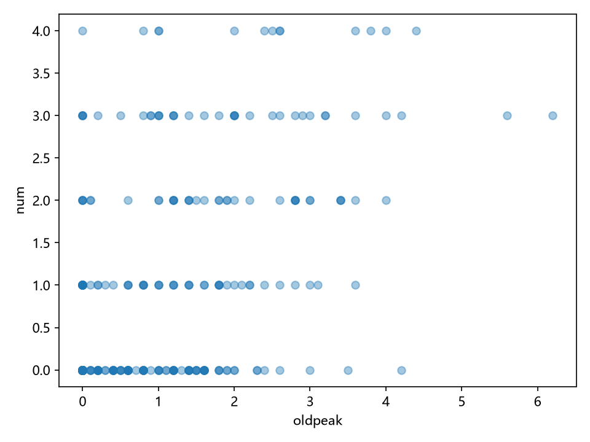
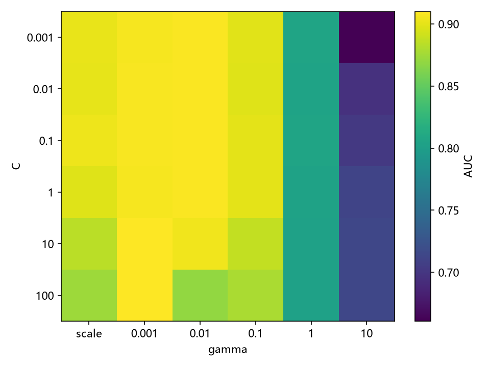
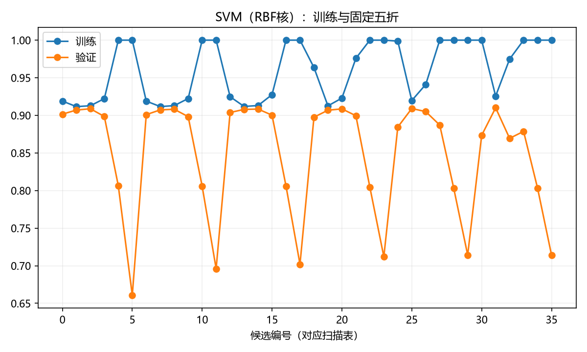
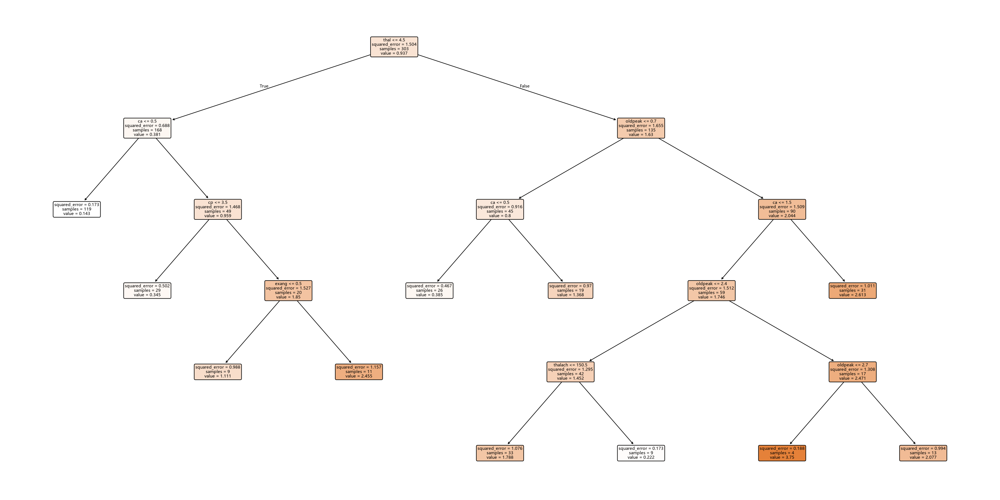
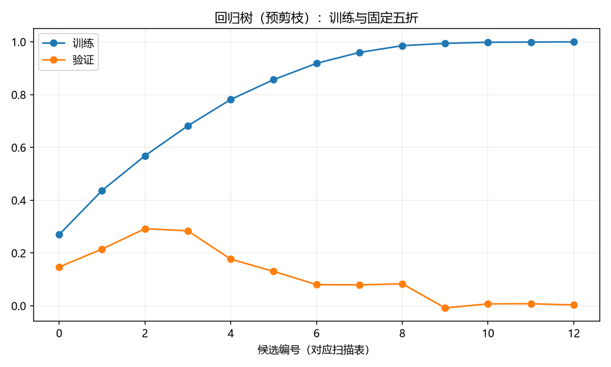

# 医学数据的分类与回归

## 1 总体设计

303例、13特征；分类目标 num>0，回归目标 num（0–4有序分级，不是血管支数）。二分类对应有无显著狭窄；回归保留程度信息，但假设等级距离可比较。五分类会损失顺序结构且最重等级仅13例，估计更不稳定。分类准确率与回归R²不可直接比较。

安装依赖后运行 `python assignment4/main.py`；仅重建文稿使用 `--report-only`。默认数据目录是仓库根目录 `data/assignment4-data`，可用 `--data-dir` 指定。全部种子42，随机划分种子0–9。版本及哈希见 figures/results.json。公共管线处理缺失和标准化；分类、回归、消融分别由对应脚本提供候选及实验定义。

课程固定五折用于扫描，扫描最优不等于无偏泛化估计；独立检查复用五个原始折，外层测试隔离，内层四折选参。分类按AUC、回归按R²选参；六位小数相同保留候选表中先出现的设置。

### 1.1 历史复现记录

此前完整运行及结果重建记录见figures/reproducibility_validation.json，原始结果哈希保持一致。此后的文稿整理未重跑实验，记录中的产物哈希对应当时版本。

### 1.2 独立选参检查

| 模型 | 评价指标 | 课程扫描最优 | 外层独立成绩 | 外层参数 |
|---|---|---|---|---|
| SVM（线性核） | AUC | 0.911160 | 0.904554 | [{'C': 0.01, 'gamma': 'scale', 'scale': True}, {'C': 0.1, 'gamma': 'scale', 'scale': True}, {'C': 0.001, 'gamma': 'scale', 'scale': True}, {'C': 0.001, 'gamma': 'scale', 'scale': True}, {'C': 0.01, 'gamma': 'scale', 'scale': True}] |
| SVM（RBF核） | AUC | 0.910040 | 0.897433 | [{'C': 100, 'gamma': 0.001, 'scale': True}, {'C': 0.1, 'gamma': 'scale', 'scale': True}, {'C': 10, 'gamma': 0.001, 'scale': True}, {'C': 1, 'gamma': 0.001, 'scale': True}, {'C': 1, 'gamma': 0.01, 'scale': True}] |
| 回归树（预剪枝） | R² | 0.292150 | 0.209500 | [{'max_depth': 4}, {'max_depth': 4}, {'max_depth': 3}, {'max_depth': 2}, {'max_depth': 4}] |
| 回归树（后剪枝） | R² | 0.236025 | 0.213837 | [{'path_fraction': 0.9}, {'path_fraction': 0.9}, {'path_fraction': 0.95}, {'path_fraction': 0.95}, {'path_fraction': 0.75}] |
| 岭回归 | R² | 0.524346 | 0.524346 | [{'alpha': 10}, {'alpha': 10}, {'alpha': 10}, {'alpha': 10}, {'alpha': 10}] |
| Lasso回归 | R² | 0.525461 | 0.525461 | [{'alpha': 0.01}, {'alpha': 0.01}, {'alpha': 0.01}, {'alpha': 0.01}, {'alpha': 0.01}] |
| 普通最小二乘线性回归 | R² | 0.522537 | 0.522537 | [{}, {}, {}, {}, {}] |
| 支持向量回归（SVR） | R² | 0.514087 | 0.504370 | [{'C': 1, 'epsilon': 0.1, 'gamma': 0.01}, {'C': 1, 'epsilon': 0.5, 'gamma': 0.01}, {'C': 1, 'epsilon': 0.1, 'gamma': 0.01}, {'C': 1, 'epsilon': 0.01, 'gamma': 0.01}, {'C': 1, 'epsilon': 0.1, 'gamma': 0.01}] |

选参表现与外层表现的差距体现选择偏差和样本不确定性，不以外层结果再挑参数并宣称无偏。

## 2 数据探索

| 字段 | 最小值 | 最大值 | 缺失数 |
|---|---|---|---|
| age | 29.000000 | 77.000000 | 0 |
| sex | 0.000000 | 1.000000 | 0 |
| cp | 1.000000 | 4.000000 | 0 |
| trestbps | 94.000000 | 200.000000 | 0 |
| chol | 126.000000 | 564.000000 | 0 |
| fbs | 0.000000 | 1.000000 | 0 |
| restecg | 0.000000 | 2.000000 | 0 |
| thalach | 71.000000 | 202.000000 | 0 |
| exang | 0.000000 | 1.000000 | 0 |
| oldpeak | 0.000000 | 6.200000 | 0 |
| slope | 1.000000 | 3.000000 | 0 |
| ca | 0.000000 | 3.000000 | 4 |
| thal | 3.000000 | 7.000000 | 2 |
| num | 0 | 4 | 0 |

缺失值集中在ca（4个）和thal（2个），其余字段完整；不同特征量纲和范围差异较大，应在训练折内处理填补与尺度。

连续量为age、trestbps、chol、thalach、oldpeak；其他输入沿用课程数值编码，因而类别间数值距离是假设和局限。缺失位于ca四处、thal两处，共6个单元格。处理方式为在Pipeline中使用SimpleImputer(strategy="median")：每折仅根据训练集各列的非缺失值计算中位数，再用这些值填补训练集和验证集；随后才进行标准化（树模型省略标准化）和模型拟合。选择这一方案首先是为了与课程baselines.py的预处理保持一致，使基线核对与后续扫描具有可比性；其次，303例属于小样本，保留含少量缺失的患者可避免删除整行带来的信息损失，中位数也比均值更少受极端值影响。填补器只在训练折拟合，可避免验证集分布参与预处理造成信息泄漏。这是简单、可复现的基线方案，并非对缺失临床值的真实恢复：ca、thal均为离散编码，尤其thal编码间距没有连续数值意义，因此中位数不一定是最合理的类别填补方式；本次沿用课程协议，尚未通过与众数填补等方案的消融证明其最优，也不假定缺失机制已被验证。

图解（标签分布）：num=0、1、2、3、4分别有164、55、36、35、13例；二分类阴性164例、阳性139例，类别并非完全均衡，而最高等级4只有13例。少量重症患者的误差可能明显影响回归平方损失，因此不能只报告多数等级的拟合情况，也不宜用单次划分代替固定五折。

图解（oldpeak与严重程度）：横轴为运动相对静息的ST段压低幅度oldpeak，纵轴为真实等级num；两者的全表Pearson相关系数为0.504092。图中较高oldpeak更多出现在阳性等级，但同一oldpeak范围内多个等级仍明显重叠，且num=0也有较高值，因此单个特征不能准确区分全部患者或确定具体等级；散点重叠还会遮住部分样本，不能直接把可见点数当作人数。

图解（相关结构）：颜色表示Pearson相关系数，红色为正、蓝色为负，对角线为变量与自身的相关。oldpeak与slope的相关系数为0.577537，age与thalach为-0.393806，说明输入之间存在共享信息；num与ca的相关系数为0.518909，与thalach为-0.415040。这些是全表描述性相关，包含目标num，未用来在折外挑选特征；相关不代表因果，离散编码的Pearson值也不能概括全部依赖关系。

### 2.1 特征类型、单位与编码

| 字段 | 类型 | 含义 | 单位／编码 |
|---|---|---|---|
| age | 连续 | 年龄 | 岁 |
| sex | 离散 | 性别 | 0=女；1=男 |
| cp | 离散 | 胸痛类型 | 1=典型心绞痛；2=非典型心绞痛；3=非心绞痛性疼痛；4=无症状 |
| trestbps | 连续 | 静息血压 | mm Hg |
| chol | 连续 | 血清胆固醇 | mg/dl |
| fbs | 离散 | 空腹血糖是否超过120 mg/dl | 0=否；1=是 |
| restecg | 离散 | 静息心电图 | 0=正常；1=ST-T波异常；2=左心室肥厚 |
| thalach | 连续 | 运动负荷试验中达到的最大心率 | bpm（次/分钟） |
| exang | 离散 | 运动诱发心绞痛 | 0=否；1=是 |
| oldpeak | 连续 | 运动相对静息的ST段压低幅度 | 沿用原记录数值尺度；题目未注明物理单位 |
| slope | 离散 | 峰值运动ST段斜率 | 1=上斜；2=平直；3=下斜 |
| ca | 离散 | 荧光透视显影的主要血管支数 | 0–3；不能直接等同num的严重程度分级 |
| thal | 离散 | 心肌灌注检查编码 | 3=正常；6=固定缺损；7=可逆缺损 |
| num | 目标 | 狭窄严重程度 | 0=无超过50%的主要血管狭窄；1–4=有显著狭窄且程度递增，不是血管支数 |

13个输入中只有5项是连续量，其余8项是离散编码，数字大小不能一概解释为生理量的线性变化；标签num也不能与ca互换。

单位和编码依据课程PDF及数据README，未为题目未标明单位的oldpeak补造单位。基线保持课程数值编码以便核对，但cp、thal等类别编码的数值距离仍是模型假设；标准化改变尺度，不会消除该假设。

## 3 复现核对

| 方法 | 指标 | 基线 | 我的值 | 差值 |
|---|---|---|---|---|
| SVM（线性核） | accuracy | 0.834863 | 0.834863 | 0.000000 |
| SVM（线性核） | precision | 0.836711 | 0.836711 | 0.000000 |
| SVM（线性核） | recall | 0.798413 | 0.798413 | -0.000000 |
| SVM（线性核） | f1 | 0.815262 | 0.815262 | 0.000000 |
| SVM（线性核） | auc | 0.910463 | 0.910463 | 0.000000 |
| SVM（RBF核） | accuracy | 0.838087 | 0.838087 | 0.000000 |
| SVM（RBF核） | precision | 0.852606 | 0.852606 | 0.000000 |
| SVM（RBF核） | recall | 0.783862 | 0.783862 | 0.000000 |
| SVM（RBF核） | f1 | 0.815278 | 0.815278 | 0.000000 |
| SVM（RBF核） | auc | 0.897508 | 0.897508 | -0.000000 |
| 回归树（预剪枝） | r2 | 0.292150 | 0.292150 | -0.000000 |
| 回归树（预剪枝） | mae | 0.712077 | 0.712077 | -0.000000 |
| 回归树（预剪枝） | rmse | 1.013903 | 1.013903 | 0.000000 |
| 岭回归 | r2 | 0.522760 | 0.522760 | -0.000000 |
| 岭回归 | mae | 0.634785 | 0.634785 | 0.000000 |
| 岭回归 | rmse | 0.842275 | 0.842275 | 0.000000 |
| Lasso回归 | r2 | 0.525461 | 0.525461 | 0.000000 |
| Lasso回归 | mae | 0.632992 | 0.632992 | -0.000000 |
| Lasso回归 | rmse | 0.840237 | 0.840237 | 0.000000 |
| 普通最小二乘线性回归 | r2 | 0.522537 | 0.522537 | 0.000000 |
| 普通最小二乘线性回归 | mae | 0.634911 | 0.634911 | 0.000000 |
| 普通最小二乘线性回归 | rmse | 0.842442 | 0.842442 | -0.000000 |
| 支持向量回归（SVR） | r2 | 0.430590 | 0.430590 | 0.000000 |
| 支持向量回归（SVR） | mae | 0.659730 | 0.659730 | -0.000000 |
| 支持向量回归（SVR） | rmse | 0.913401 | 0.913401 | 0.000000 |

纳入实验的全部基线项均在0.01容差内，正式扫描以这一已核对的管线为基础。原参考脚本另有不要求的分类器，仅用作背景，没有冒充自行实现。

## 4 分类实验

结果表的对照口径：第4、5章总表并列报告固定参数基线、扫描最优和朴素参考线；各完整扫描小节另列同一指标下的基线与最优对照，随后逐行展示候选。消融比较中“原固定参数”指课程基线配置，“扫描最优”指各信息或预处理条件下分别选参的结果。独立外层成绩、逐折结果、误差病例、系数及结构表用于不同分析目的，不将其冒称为扫描最优；类别编码和系数表不适用性能基线列。分类主要比较AUC，回归主要比较R²，MAE和RMSE同时报告，三者不能跨任务混比。

| 模型／参照 | accuracy：基线（固定超参） | accuracy：我的最优（扫描后） | Δaccuracy | precision：基线（固定超参） | precision：我的最优（扫描后） | Δprecision | recall：基线（固定超参） | recall：我的最优（扫描后） | Δrecall | F1：基线（固定超参） | F1：我的最优（扫描后） | ΔF1 | AUC：基线（固定超参） | AUC：我的最优（扫描后） | ΔAUC |
|---|---|---|---|---|---|---|---|---|---|---|---|---|---|---|---|
| SVM（线性核） | 0.834863 | 0.844754 | +0.00989071 | 0.836711 | 0.866493 | +0.02978199 | 0.798413 | 0.784127 | -0.01428571 | 0.815262 | 0.821905 | +0.00664331 | 0.910463 | 0.911160 | +0.00069695 |
| SVM（RBF核） | 0.838087 | 0.838197 | +0.00010929 | 0.852606 | 0.842461 | -0.01014559 | 0.783862 | 0.798413 | +0.01455026 | 0.815278 | 0.818062 | +0.00278423 | 0.897508 | 0.910040 | +0.01253232 |
| 多数类参考线 | 0.541257 | 不适用 | 不适用 | 0.000000 | 不适用 | 不适用 | 0.000000 | 不适用 | 不适用 | 0.000000 | 不适用 | 不适用 | 0.500000 | 不适用 | 不适用 |

RBF调参的AUC增益大于线性核，但扫描后AUC仍略低于线性核；线性核的召回率相对其固定基线下降，所以调参收益并不覆盖全部指标。

每项指标依次列出固定基线、扫描最优和Δ（最优−基线）；差值是绝对数值差，不是相对百分比。accuracy、precision、recall、F1、AUC、R²越高越好，MAE和RMSE越低越好。普通最小二乘没有选参过程，其两列表示重复评估；后剪枝的两行分别使用完整树与课程深度3树作为参照。

线性核扫描AUC=0.911160，RBF=0.910040；差距需结合独立选参结果判断。

AUC调用decision_function；负类以相反分数和相反标签计算时AUC相同，逐类accuracy按one-vs-rest定义也相同。敏感性等于正类recall，特异性等于负类recall；precision以预测为该类的样本为分母。

图解（RBF联合网格）：横轴是gamma、纵轴是C，颜色越亮表示固定五折平均验证AUC越高；scale是库根据训练数据计算的规则，不是一个与其他数值等距的gamma。当前网格最高AUC为0.910040，对应C=100、gamma=0.001；gamma=1或10的列整体较低，说明过度局部化损害新样本排序。最高点位于数值网格边界，结论只能限定为当前网格内最优，不能据此声称全局最优。

### 4.1 两种核的适用性结论

以AUC为主要评价指标，本数据集当前实验更倾向选择线性核。固定C=1时，线性核AUC为0.910463，高于RBF核的0.897508；分别调参后，两者为0.911160和0.910040，线性核仍高出0.001120。独立选参检查的外层平均AUC分别为0.904554和0.897433，方向一致。

最优配置的训练AUC减验证AUC，线性核为0.005785，RBF核为0.015535。RBF具有更强的局部拟合能力，但本次没有取得更好的验证排序能力，且训练与验证差距更大，支持在这份小样本数据上优先考虑简单线性分界的选择；这不能证明真实关系完全线性。

这一选择并非所有指标上的全面胜出：默认判别阈值下，RBF核召回率为0.798413，高于线性核的0.784127。若目标改为优先降低漏诊，需要另行明确召回率约束并在训练数据内选择阈值，不能仅凭AUC决定。调参后的AUC差距较小，且RBF最优参数位于网格边界，因此结论限于当前数据、扫描范围和评价口径，不声称统计显著或全局最优。

### 4.2 AUC口径、逐类指标与筛查含义

| 默认参数模型 | 硬标签AUC（错误口径示例） | 连续分数AUC（正式口径） | 差值 |
|---|---|---|---|
| SVM（线性核） | 0.832350 | 0.910463 | 0.078113 |
| SVM（RBF核） | 0.834166 | 0.897508 | 0.063342 |

使用硬标签会丢失类别内部的排序信息；是否发生模型排序逆转应以本表实测值判断，不照抄讲义示例。
本次固定参数结果中，硬标签口径排序较高的是SVM（RBF核），连续分数口径排序较高的是SVM（线性核）。正式评估始终使用decision_function而非predict；数值与讲义示例不同不改变这一规范。敏感性TP/(TP+FN)等于阳性recall，特异性TN/(TN+FP)等于阴性recall，阳性precision为TP/(TP+FP)，三者分母不同。两类AUC以相反分数和标签定义时相同，二分类逐类one-vs-rest准确率也相同，不能把这两个重复数值当作独立证据。混淆矩阵汇总303例折外预测；表中指标先逐折计算再平均，故直接从汇总矩阵计算的比例可能略有不同。

### 4.3 参数遍历所得最优配置的分类指标对照

在本次参数网格中，分别以五折平均验证AUC最高为准则选取两种核的配置：线性核C=0.01；RBF核C=100、gamma=0.001。下表报告这两组配置的五折指标均值。这里的最优指已遍历网格内的验证AUC最优，不代表所有指标同时最优；独立选参检查结果见第一节。

| 指标 | SVM（线性核，网格最优） | SVM（RBF核，网格最优） |
|---|---|---|
| accuracy | 0.844754 | 0.838197 |
| auc | 0.911160 | 0.910040 |
| hard_auc | 0.840359 | 0.835381 |
| precision_0 | 0.831760 | 0.838712 |
| recall_0 | 0.896591 | 0.872348 |
| f1_0 | 0.862226 | 0.854080 |
| precision_1 | 0.866493 | 0.842461 |
| recall_1 | 0.784127 | 0.798413 |
| f1_1 | 0.821905 | 0.818062 |
| precision | 0.866493 | 0.842461 |
| recall | 0.784127 | 0.798413 |
| f1 | 0.821905 | 0.818062 |
| sensitivity | 0.784127 | 0.798413 |
| specificity | 0.896591 | 0.872348 |
| auc_0 | 0.911160 | 0.910040 |
| auc_1 | 0.911160 | 0.910040 |
| accuracy_0 | 0.844754 | 0.838197 |
| accuracy_1 | 0.844754 | 0.838197 |
| train_accuracy | 0.858079 | 0.857256 |
| train_auc | 0.916945 | 0.925575 |
| train_hard_auc | 0.853000 | 0.853067 |
| train_precision_0 | 0.838045 | 0.843565 |
| train_recall_0 | 0.914654 | 0.903979 |
| train_f1_0 | 0.874636 | 0.872689 |
| train_precision_1 | 0.887211 | 0.876363 |
| train_recall_1 | 0.791345 | 0.802156 |
| train_f1_1 | 0.836464 | 0.837551 |
| train_precision | 0.887211 | 0.876363 |
| train_recall | 0.791345 | 0.802156 |
| train_f1 | 0.836464 | 0.837551 |
| train_sensitivity | 0.791345 | 0.802156 |
| train_specificity | 0.914654 | 0.903979 |
| train_auc_0 | 0.916945 | 0.925575 |
| train_auc_1 | 0.916945 | 0.925575 |
| train_accuracy_0 | 0.858079 | 0.857256 |
| train_accuracy_1 | 0.858079 | 0.857256 |
| support_vectors | 142.600000 | 96.800000 |
| zero_count | 0.000000 | — |

线性核验证AUC=0.911160略高于RBF的0.910040，但召回率分别为0.784127与0.798413，两核的排序能力和漏诊表现需要分开评价。

指标说明：train_前缀表示训练折指标，其余为验证折指标；类别后缀0表示阴性、1表示阳性。敏感性等于阳性召回率，特异性等于阴性召回率。support_vectors为支持向量数量的五折均值；zero_count为线性核权重中精确零系数数量的五折均值，RBF核不适用，以“—”表示。

### 4.4 SVM（线性核） 混淆矩阵

图中汇总扫描最优参数在固定五折上的303例折外预测，行是真实类别，列是预测类别；TN=147、FP=17、FN=30、TP=109。这是课程五折扫描结果，不是嵌套选参的外层结果。

### 4.5 SVM（RBF核） 混淆矩阵

图中汇总扫描最优参数在固定五折上的303例折外预测，行是真实类别，列是预测类别；TN=143、FP=21、FN=28、TP=111。这是课程五折扫描结果，不是嵌套选参的外层结果。

固定参数与扫描最优的指标权衡，以及RBF部分分类指标较好但AUC较低的原因，分别见第8.6、8.7节的阅读质疑与核查。

### 4.6 C的作用、双核敏感性与训练验证差距

| 核 | C | 训练AUC | 验证AUC | 训练错误率 | 验证错误率 |
|---|---|---|---|---|---|
| SVM（线性核） | 0.001000 | 0.911462 | 0.907902 | 0.288773 | 0.290219 |
| SVM（线性核） | 0.010000 | 0.916945 | 0.911160 | 0.141921 | 0.155246 |
| SVM（线性核） | 0.100000 | 0.921292 | 0.907406 | 0.146040 | 0.155191 |
| SVM（线性核） | 1 | 0.923765 | 0.910463 | 0.141914 | 0.165137 |
| SVM（线性核） | 10 | 0.923162 | 0.908061 | 0.140268 | 0.175027 |
| SVM（线性核） | 100 | 0.923163 | 0.908061 | 0.140268 | 0.175027 |
| SVM（RBF核） | 0.001000 | 0.912736 | 0.908771 | 0.458746 | 0.458743 |
| SVM（RBF核） | 0.010000 | 0.912901 | 0.908098 | 0.458746 | 0.458743 |
| SVM（RBF核） | 0.100000 | 0.913024 | 0.908332 | 0.171625 | 0.171694 |
| SVM（RBF核） | 1 | 0.922924 | 0.908592 | 0.143570 | 0.151913 |
| SVM（RBF核） | 10 | 0.941133 | 0.904939 | 0.122127 | 0.158525 |
| SVM（RBF核） | 100 | 0.974781 | 0.869393 | 0.062721 | 0.201530 |

RBF固定gamma=0.01时，大C提高了训练拟合能力，却可能损害验证排序；线性核的验证AUC变化更小。
在线性核中，C从0.001到100的验证AUC极差为0.003754；RBF固定gamma=0.01时为0.039378。两者对C的敏感性不同，并且RBF的结论必须限定gamma。线性核C=10与100的验证AUC均为0.908061，说明这个范围已进入平台，而非继续增大C就能提高泛化。

SVM最小化“权重范数惩罚＋C×间隔违例损失”，对偶约束为0≤a_i≤C；C增大放宽单样本对偶权重上限，同时加重原目标中对违例的惩罚，通常表示相对更弱的正则化。题目中关于C越大越容忍越界的文字方向与目标函数不一致，此处按目标函数解释。验证AUC对C不敏感，说明该范围内排序较稳定，不能直接推出训练边界完全不变；需要结合上表训练错误率、验证错误率和训练验证AUC差距判断。该现象可能来自近似线性结构和正则化平台，不能据此断言数据完全线性可分。

### 4.7 SVM（线性核） 完整扫描

扫描基线对照（C=1，线性核）：

| 指标 | 基线（固定超参） | 我的最优（扫描后） | Δ（最优−基线） |
|---|---|---|---|
| AUC | 0.910463 | 0.911160 | +0.00069695 |
| accuracy | 0.834863 | 0.844754 | +0.00989071 |
| precision | 0.836711 | 0.866493 | +0.02978199 |
| recall | 0.798413 | 0.784127 | -0.01428571 |
| f1 | 0.815262 | 0.821905 | +0.00664331 |

扫描最优AUC由固定对照的0.910463变为0.911160，差值为+0.00069695。AUC略升但阳性召回率下降，说明按AUC调参并不保证每项分类指标改善。

选定：`{'C': 0.01, 'gamma': 'scale', 'scale': True}`。

| 编号 | 参数 | auc | train_auc | accuracy | hard_auc | support_vectors |
|---|---|---|---|---|---|---|
| 0 | {'C': 0.001, 'gamma': 'scale', 'scale': True} | 0.907902 | 0.911462 | 0.709781 | 0.684139 | 223.400000 |
| 1 | {'C': 0.01, 'gamma': 'scale', 'scale': True} | 0.911160 | 0.916945 | 0.844754 | 0.840359 | 142.600000 |
| 2 | {'C': 0.1, 'gamma': 'scale', 'scale': True} | 0.907406 | 0.921292 | 0.844809 | 0.840900 | 100.400000 |
| 3 | {'C': 1, 'gamma': 'scale', 'scale': True} | 0.910463 | 0.923765 | 0.834863 | 0.832350 | 92.200000 |
| 4 | {'C': 10, 'gamma': 'scale', 'scale': True} | 0.908061 | 0.923162 | 0.824973 | 0.822718 | 91.200000 |
| 5 | {'C': 100, 'gamma': 'scale', 'scale': True} | 0.908061 | 0.923163 | 0.824973 | 0.822718 | 91.000000 |

在本表列出的6个候选中，参数{'C': 0.01, 'gamma': 'scale', 'scale': True}取得最高的表内验证auc=0.911160；这是当前扫描范围的结果，不是全局最优或统计显著性的证明。

参数选择依据：以固定五折平均验证AUC最大为准则，选取`{'C': 0.01, 'gamma': 'scale', 'scale': True}`，验证AUC=0.91115996。次高候选为`{'C': 1, 'gamma': 'scale', 'scale': True}`，验证AUC=0.91046301，差值=+0.00069695；该差距用于判断是否存在明显优势，不能解释为统计显著性。小C对应较强正则化；本次较强约束取得最高验证AUC，选择依据是验证成绩而非训练拟合程度。相对固定基线`C=1`，AUC变化为+0.00069695；其余指标的变化见总表。

### 4.8 SVM（RBF核） 完整扫描

扫描基线对照（C=1，gamma=scale）：

| 指标 | 基线（固定超参） | 我的最优（扫描后） | Δ（最优−基线） |
|---|---|---|---|
| AUC | 0.897508 | 0.910040 | +0.01253232 |
| accuracy | 0.838087 | 0.838197 | +0.00010929 |
| precision | 0.852606 | 0.842461 | -0.01014559 |
| recall | 0.783862 | 0.798413 | +0.01455026 |
| f1 | 0.815278 | 0.818062 | +0.00278423 |

扫描最优AUC由固定对照的0.897508变为0.910040，差值为+0.01253232。AUC增益较明显，但不能仅凭调参收益断言RBF超过线性核，仍须比较两者最终成绩。

选定：`{'C': 100, 'gamma': 0.001, 'scale': True}`。

| 编号 | 参数 | auc | train_auc | accuracy | hard_auc | support_vectors |
|---|---|---|---|---|---|---|
| 0 | {'C': 0.001, 'gamma': 'scale', 'scale': True} | 0.901562 | 0.918932 | 0.541257 | 0.500000 | 222.400000 |
| 1 | {'C': 0.001, 'gamma': 0.001, 'scale': True} | 0.907029 | 0.911612 | 0.541257 | 0.500000 | 222.400000 |
| 2 | {'C': 0.001, 'gamma': 0.01, 'scale': True} | 0.908771 | 0.912736 | 0.541257 | 0.500000 | 222.400000 |
| 3 | {'C': 0.001, 'gamma': 0.1, 'scale': True} | 0.898487 | 0.922222 | 0.541257 | 0.500000 | 222.400000 |
| 4 | {'C': 0.001, 'gamma': 1, 'scale': True} | 0.806371 | 1.000000 | 0.541257 | 0.500000 | 222.400000 |
| 5 | {'C': 0.001, 'gamma': 10, 'scale': True} | 0.660632 | 1.000000 | 0.541257 | 0.500000 | 222.600000 |
| 6 | {'C': 0.01, 'gamma': 'scale', 'scale': True} | 0.900906 | 0.918905 | 0.541257 | 0.500000 | 223.800000 |
| 7 | {'C': 0.01, 'gamma': 0.001, 'scale': True} | 0.907253 | 0.911667 | 0.541257 | 0.500000 | 222.400000 |
| 8 | {'C': 0.01, 'gamma': 0.01, 'scale': True} | 0.908098 | 0.912901 | 0.541257 | 0.500000 | 223.000000 |
| 9 | {'C': 0.01, 'gamma': 0.1, 'scale': True} | 0.898263 | 0.922360 | 0.541257 | 0.500000 | 225.000000 |
| 10 | {'C': 0.01, 'gamma': 1, 'scale': True} | 0.805714 | 1.000000 | 0.541257 | 0.500000 | 241.000000 |
| 11 | {'C': 0.01, 'gamma': 10, 'scale': True} | 0.696062 | 1.000000 | 0.541257 | 0.500000 | 242.400000 |
| 12 | {'C': 0.1, 'gamma': 'scale', 'scale': True} | 0.903754 | 0.924762 | 0.847978 | 0.843930 | 199.400000 |
| 13 | {'C': 0.1, 'gamma': 0.001, 'scale': True} | 0.907902 | 0.911818 | 0.541257 | 0.500000 | 222.800000 |
| 14 | {'C': 0.1, 'gamma': 0.01, 'scale': True} | 0.908332 | 0.913024 | 0.828306 | 0.818676 | 221.200000 |
| 15 | {'C': 0.1, 'gamma': 0.1, 'scale': True} | 0.900226 | 0.927519 | 0.841421 | 0.837329 | 208.400000 |
| 16 | {'C': 0.1, 'gamma': 1, 'scale': True} | 0.805929 | 1.000000 | 0.541257 | 0.500000 | 241.400000 |
| 17 | {'C': 0.1, 'gamma': 10, 'scale': True} | 0.701919 | 1.000000 | 0.541257 | 0.500000 | 242.400000 |
| 18 | {'C': 1, 'gamma': 'scale', 'scale': True} | 0.897508 | 0.963564 | 0.838087 | 0.834166 | 137.800000 |
| 19 | {'C': 1, 'gamma': 0.001, 'scale': True} | 0.906801 | 0.912600 | 0.841530 | 0.832962 | 208.000000 |
| 20 | {'C': 1, 'gamma': 0.01, 'scale': True} | 0.908592 | 0.922924 | 0.848087 | 0.843389 | 130.800000 |
| 21 | {'C': 1, 'gamma': 0.1, 'scale': True} | 0.899503 | 0.975785 | 0.841475 | 0.837870 | 151.000000 |
| 22 | {'C': 1, 'gamma': 1, 'scale': True} | 0.804436 | 1.000000 | 0.580710 | 0.544650 | 241.400000 |
| 23 | {'C': 1, 'gamma': 10, 'scale': True} | 0.711969 | 1.000000 | 0.541257 | 0.500000 | 242.400000 |
| 24 | {'C': 10, 'gamma': 'scale', 'scale': True} | 0.884454 | 0.998694 | 0.814973 | 0.812488 | 132.200000 |
| 25 | {'C': 10, 'gamma': 0.001, 'scale': True} | 0.909077 | 0.919660 | 0.848033 | 0.843389 | 124.800000 |
| 26 | {'C': 10, 'gamma': 0.01, 'scale': True} | 0.904939 | 0.941133 | 0.841475 | 0.837870 | 104.800000 |
| 27 | {'C': 10, 'gamma': 0.1, 'scale': True} | 0.887087 | 0.999959 | 0.801749 | 0.799285 | 145.600000 |
| 28 | {'C': 10, 'gamma': 1, 'scale': True} | 0.803155 | 1.000000 | 0.593989 | 0.562762 | 241.400000 |
| 29 | {'C': 10, 'gamma': 10, 'scale': True} | 0.714213 | 1.000000 | 0.541257 | 0.500000 | 242.400000 |
| 30 | {'C': 100, 'gamma': 'scale', 'scale': True} | 0.873347 | 1.000000 | 0.791803 | 0.789293 | 128.000000 |
| 31 | {'C': 100, 'gamma': 0.001, 'scale': True} | 0.910040 | 0.925575 | 0.838197 | 0.835381 | 96.800000 |
| 32 | {'C': 100, 'gamma': 0.01, 'scale': True} | 0.869393 | 0.974781 | 0.798470 | 0.794965 | 103.000000 |
| 33 | {'C': 100, 'gamma': 0.1, 'scale': True} | 0.878662 | 1.000000 | 0.791749 | 0.788884 | 141.800000 |
| 34 | {'C': 100, 'gamma': 1, 'scale': True} | 0.803155 | 1.000000 | 0.593989 | 0.562762 | 241.400000 |
| 35 | {'C': 100, 'gamma': 10, 'scale': True} | 0.714213 | 1.000000 | 0.541257 | 0.500000 | 242.400000 |

在本表列出的36个候选中，参数{'C': 100, 'gamma': 0.001, 'scale': True}取得最高的表内验证auc=0.910040；这是当前扫描范围的结果，不是全局最优或统计显著性的证明。

参数选择依据：以固定五折平均验证AUC最大为准则，选取`{'C': 100, 'gamma': 0.001, 'scale': True}`，验证AUC=0.91003988。次高候选为`{'C': 10, 'gamma': 0.001, 'scale': True}`，验证AUC=0.90907738，差值=+0.00096250；该差距用于判断是否存在明显优势，不能解释为统计显著性。所选C位于扫描上边界，gamma位于数值网格下边界，因此仅能称为当前网格最优，尚不能证明已定位更广范围内的最优点。相对固定基线`C=1，gamma=scale`，AUC变化为+0.01253232；其余指标的变化见总表。

#### 4.8.1 RBF核的联合网格及gamma过大的验证

C取{0.001, 0.01, 0.1, 1, 10, 100}，gamma取{scale, 0.001, 0.01, 0.1, 1, 10}，形成36组组合，超过题目对两个参数各至少4个取值的要求。第四节AUC热力图横轴为gamma、纵轴为C，完整扫描表对每组组合同时列出训练和五折验证AUC。

以平均验证AUC最大选取C=100、gamma=0.001，验证AUC=0.910040，训练AUC=0.925575；选择依据是验证排序能力，而不是追求训练AUC=1。该参数处于网格边界，仅代表已遍历范围内的最优。

为单独考察gamma而不混入C变化，下面固定C=1，沿用相同数据、折内预处理和五折划分；scale作为自适应宽度参考，数值gamma按从小到大绘制。

| gamma | 训练AUC | 五折验证AUC | 差距（训练−验证） | 验证accuracy | 平均支持向量数 |
|---|---|---|---|---|---|
| scale | 0.963564 | 0.897508 | 0.066056 | 0.838087 | 137.800000 |
| 0.001000 | 0.912600 | 0.906801 | 0.005799 | 0.841530 | 208.000000 |
| 0.010000 | 0.922924 | 0.908592 | 0.014332 | 0.848087 | 130.800000 |
| 0.100000 | 0.975785 | 0.899503 | 0.076282 | 0.841475 | 151.000000 |
| 1 | 1.000000 | 0.804436 | 0.195564 | 0.580710 | 241.400000 |
| 10 | 1.000000 | 0.711969 | 0.288031 | 0.541257 | 242.400000 |

固定C=1时，gamma从0.01增大到10使训练AUC由0.922924升至1，而验证AUC由0.908592降至0.711969，训练拟合增强并未转化为泛化收益。

当gamma从0.01增至0.1、1、10时，训练AUC依次为0.922924、0.975785、1.000000、1.000000，验证AUC却从0.908592降至0.899503、0.804436和0.711969。gamma=10时训练与验证AUC差距达到0.288031，验证accuracy降为0.541257，已接近多数类参考线。由此直接验证了题目所述“训练AUC达到1.000，而新样本排序表现明显下降”的过拟合现象；该变化不意味着gamma在全部范围上越小越好，例如0.001到0.01时验证AUC仍有提升。

RBF核定义为K(x,x′)=exp(−gamma·‖x−x′‖²)，其中距离基于当前训练折拟合的标准化输入。对于不同样本，gamma越大，相似度随距离衰减越快；相同样本始终有K(x,x)=1，而其他样本对它的影响越来越弱。模型于是更容易围绕训练点形成高度局部的响应，记住训练样本，却难以把这种拟合推广到未见患者。支持向量数在gamma=10时接近每折训练样本数，也与多数训练点参与局部拟合的解释一致。

题目用“孤岛”和“退化为最近邻”描述极端局部化的直觉。本实验的AUC差距支持这一过拟合机制，但未绘制高维决策边界，不能声称直接观察到其形状，也不能将核SVM严格等同于最近邻分类器；最终决策仍取决于支持向量系数、C和截距。gamma=10时AUC仍高于0.5而accuracy已接近多数类水平，也表明连续分数的排序能力与默认阈值下的分类决策需要分开解释。

### 4.9 补充机制核查

固定五折扫描以线性核的AUC较高；AUC差为0.001120。这支持当前样本下该核更适合排序，但不能把微小差异解释为总体上的确定优势。

gamma=0.001时，该行最佳C=100，训练AUC=0.925575、验证AUC=0.910040、差距=0.015535。

gamma=0.01时，该行最佳C=0.001，训练AUC=0.912736、验证AUC=0.908771、差距=0.003965。

gamma=0.1时，该行最佳C=0.1，训练AUC=0.927519、验证AUC=0.900226、差距=0.027292。

gamma=1时，该行最佳C=0.001，训练AUC=1.000000、验证AUC=0.806371、差距=0.193629。

gamma=10时，该行最佳C=10，训练AUC=1.000000、验证AUC=0.714213、差距=0.285787。

## 5 回归实验

| 模型／参照 | R²：基线（固定超参） | R²：我的最优（扫描后） | ΔR² | MAE：基线（固定超参） | MAE：我的最优（扫描后） | ΔMAE | RMSE：基线（固定超参） | RMSE：我的最优（扫描后） | ΔRMSE |
|---|---|---|---|---|---|---|---|---|---|
| 回归树（预剪枝） | 0.292150 | 0.292150 | +0.00000000 | 0.712077 | 0.712077 | +0.00000000 | 1.013903 | 1.013903 | +0.00000000 |
| 岭回归 | 0.522760 | 0.524346 | +0.00158615 | 0.634785 | 0.633793 | -0.00099202 | 0.842275 | 0.841125 | -0.00114995 |
| Lasso回归 | 0.525461 | 0.525461 | -0.00000076 | 0.632992 | 0.632995 | +0.00000372 | 0.840237 | 0.840238 | +0.00000048 |
| 普通最小二乘线性回归 | 0.522537 | 0.522537 | +0.00000000 | 0.634911 | 0.634911 | +0.00000000 | 0.842442 | 0.842442 | +0.00000000 |
| 支持向量回归（SVR） | 0.430590 | 0.514087 | +0.08349650 | 0.659730 | 0.628416 | -0.03131327 | 0.913401 | 0.851529 | -0.06187212 |
| 回归树（后剪枝，相对完整树） | 0.003372 | 0.236025 | +0.23265371 | 0.749126 | 0.744002 | -0.00512369 | 1.209231 | 1.051016 | -0.15821518 |
| 回归树（后剪枝，相对课程深度3树） | 0.292150 | 0.236025 | -0.05612447 | 0.712077 | 0.744002 | +0.03192514 | 1.013903 | 1.051016 | +0.03711280 |
| 训练均值参考线 | -0.011653 | 不适用 | 不适用 | 1.014840 | 不适用 | 不适用 | 1.228765 | 不适用 | 不适用 |

预剪枝扫描仍选课程深度3设置，后剪枝优于完整树却不及深度3基线；正则化线性模型与SVR的比较还需结合MAE，不能只看R²。

每项指标依次列出固定基线、扫描最优和Δ（最优−基线）；差值是绝对数值差，不是相对百分比。accuracy、precision、recall、F1、AUC、R²越高越好，MAE和RMSE越低越好。普通最小二乘没有选参过程，其两列表示重复评估；后剪枝的两行分别使用完整树与课程深度3树作为参照。

应在同一指标下比较模型；树的深度不能替代验证成绩。后剪枝用训练折路径的位置选候选，各折实际alpha保存在结果中。

图：代价复杂度后剪枝后的回归树。采用五折扫描选出的最优剪枝路径位置，在全部303例数据上重新计算剪枝路径、确定ccp_alpha并拟合，用于展示模型结构。该图不是预剪枝树，也不是某个测试折的树；报告中的泛化指标均由交叉验证获得，不使用这棵全数据解释树的训练成绩。部分节点规则如下（节点编号采用树数组顺序，非层序）：

| 节点 | 特征 | 阈值 | 样本数 |
|---|---|---|---|
| 0 | thal | 4.500000 | 303 |
| 1 | ca | 0.500000 | 168 |
| 2 | leaf | -2.000000 | 119 |
| 3 | cp | 3.500000 | 49 |
| 4 | leaf | -2.000000 | 29 |
| 5 | exang | 0.500000 | 20 |
| 6 | leaf | -2.000000 | 9 |

解释树根节点首先按thal分组，显示模型利用了灌注检查信息；这里展示的部分节点不等于完整的前两层，前两层的临床解释见下文专表。

规则左分支为特征≤阈值。ca、thal相关分裂属于题目所述昂贵检查信息；胸痛编码和ST压低相关分裂表示风险分组，不能解释为因果或诊断建议。

### 5.1 预剪枝与后剪枝的区别及效果比较

预剪枝在树生长过程中施加约束，本实验通过max_depth限制最大深度；达到限制后不再继续分裂。后剪枝先生成完整树，再根据代价复杂度准则，以ccp_alpha权衡拟合误差和叶节点数量，删除收益不足的子树。因此预剪枝可能阻止后续有益分裂，后剪枝则先考察更完整的结构，但二者都需要验证数据选择复杂度。

按本作业固定五折平均验证R²选参，预剪枝最优为max_depth=3，R²=0.292150；后剪枝最优R²=0.236025。因此在本次候选范围和课程五折扫描口径下，预剪枝更有效，未观察到后剪枝因避免‘剪早’而取得更优验证结果。

独立选参检查中，预剪枝与后剪枝的外层平均R²分别为0.209500和0.213837，差距较小且排序相反，说明扫描优势不应扩大为稳定的总体优劣结论。深树容易形成样本很少甚至只有一个样本的叶节点，记住训练噪声；本实验的叶内样本数和训练／验证差距用于检验这一机制。

#### 5.1.1 后剪枝树前两层的实际分裂及临床解释

| 层级 | 节点 | 规则（左分支） | 解释 |
|---|---|---|---|
| 1 | 0 | thal ≤ 4.500000 | 阈值4.5将正常灌注编码3与固定／可逆缺损编码6、7分开，反映检查结果的分组。 |
| 2 | 1 | ca ≤ 0.500000 | 阈值0.5将显影支数0与至少1支分开，使用了题目所述昂贵检查信息。 |
| 2 | 8 | oldpeak ≤ 0.700000 | 按运动ST段压低幅度分组，数值较大对应不同的运动负荷反应；这是统计分组而非因果证据。 |

树的早期分裂依赖灌注或显影信息，因此全特征树的良好拟合不等于低成本初筛可直接使用。
这张图是全数据后剪枝解释树，不是外层测试树；节点阈值和结构不能用于回算交叉验证成绩。固定五折中预剪枝优于后剪枝，没有证据证明本次预剪枝确实因“剪早”而失分；外层独立检查两者成绩接近且排序相反，也不能把一次结果推广成两种方法的普遍优劣。

### 5.2 回归树（预剪枝） 完整扫描

扫描基线对照（max_depth=3）：

| 指标 | 基线（固定超参） | 我的最优（扫描后） | Δ（最优−基线） |
|---|---|---|---|
| R² | 0.292150 | 0.292150 | +0.00000000 |
| MAE | 0.712077 | 0.712077 | +0.00000000 |
| RMSE | 1.013903 | 1.013903 | +0.00000000 |

扫描最优R²由固定对照的0.292150变为0.292150，差值为+0.00000000。选中的深度仍为3，与固定基线相同，所以这次扫描没有额外提升。

选定：`{'max_depth': 3}`。

| 编号 | 参数 | r2 | train_r2 | mae | rmse | 树深 | leaves | leaf_min | leaf_median | singleton_fraction | ccp_alpha |
|---|---|---|---|---|---|---|---|---|---|---|---|
| 0 | {'max_depth': 1} | 0.147202 | 0.269653 | 0.870262 | 1.123749 | 1.000000 | 2.000000 | 110.600000 | 121.200000 | 0.000000 | 0.000000 |
| 1 | {'max_depth': 2} | 0.215153 | 0.436834 | 0.764508 | 1.070871 | 2.000000 | 4.000000 | 23.000000 | 57.300000 | 0.000000 | 0.000000 |
| 2 | {'max_depth': 3} | 0.292150 | 0.568319 | 0.712077 | 1.013903 | 3.000000 | 8.000000 | 3.000000 | 21.300000 | 0.025000 | 0.000000 |
| 3 | {'max_depth': 4} | 0.284241 | 0.681943 | 0.693950 | 1.023114 | 4.000000 | 15.800000 | 1.000000 | 7.600000 | 0.125833 | 0.000000 |
| 4 | {'max_depth': 5} | 0.176890 | 0.781663 | 0.717008 | 1.091165 | 5.000000 | 27.600000 | 1.000000 | 2.700000 | 0.307668 | 0.000000 |
| 5 | {'max_depth': 6} | 0.130593 | 0.856788 | 0.719228 | 1.128722 | 6.000000 | 40.800000 | 1.000000 | 2.500000 | 0.353510 | 0.000000 |
| 6 | {'max_depth': 7} | 0.080483 | 0.918607 | 0.723437 | 1.164852 | 7.000000 | 54.600000 | 1.000000 | 2.000000 | 0.376895 | 0.000000 |
| 7 | {'max_depth': 8} | 0.079465 | 0.959841 | 0.723192 | 1.170435 | 8.000000 | 67.400000 | 1.000000 | 2.000000 | 0.400992 | 0.000000 |
| 8 | {'max_depth': 9} | 0.083597 | 0.985456 | 0.720991 | 1.164179 | 9.000000 | 75.800000 | 1.000000 | 2.000000 | 0.443116 | 0.000000 |
| 9 | {'max_depth': 10} | -0.007820 | 0.994313 | 0.757135 | 1.215382 | 10.000000 | 80.400000 | 1.000000 | 2.000000 | 0.462319 | 0.000000 |
| 10 | {'max_depth': 11} | 0.007529 | 0.998379 | 0.748470 | 1.206354 | 10.800000 | 82.200000 | 1.000000 | 2.000000 | 0.479002 | 0.000000 |
| 11 | {'max_depth': 12} | 0.008029 | 0.999151 | 0.747486 | 1.206007 | 11.200000 | 82.800000 | 1.000000 | 1.800000 | 0.482368 | 0.000000 |
| 12 | {'max_depth': None} | 0.003372 | 1.000000 | 0.749126 | 1.209231 | 11.400000 | 82.800000 | 1.000000 | 1.800000 | 0.479665 | 0.000000 |

在本表列出的13个候选中，参数{'max_depth': 3}取得最高的表内验证r2=0.292150；这是当前扫描范围的结果，不是全局最优或统计显著性的证明。

参数选择依据：以固定五折平均验证R²最大为准则，选取`{'max_depth': 3}`，验证R²=0.29214984。次高候选为`{'max_depth': 4}`，验证R²=0.28424100，差值=+0.00790884；该差距用于判断是否存在明显优势，不能解释为统计显著性。选中的深度与课程固定基线相同，故本次扫描没有带来提升；继续加深的结果和叶内样本数见本表，不能只因树更复杂便优先选择。相对固定基线`max_depth=3`，R²变化为+0.00000000；其余指标的变化见总表。

#### 5.2.1 树加深后为何可能不如线性模型

| 设置     | 训练R²     | 验证R²     | 叶节点数均值    | 叶内样本中位数均值 | 单例叶比例均值  |
| ------ | -------- | -------- | --------- | --------- | -------- |
| 深度3回归树 | 0.568319 | 0.292150 | 8.000000  | 21.300000 | 0.025000 |
| 无限深回归树 | 1.000000 | 0.003372 | 82.800000 | 1.800000  | 0.479665 |

完整树将训练误差降为零，却把大量叶节点分给很少的患者，无法可靠估计新患者的平均严重程度。
岭回归的验证R²为0.524346，无限深树仅为0.003372。叶节点预测是叶内训练标签的均值，样本少时一个异常或高等级患者就能大幅改变预测；单例叶直接记住一个标签。因此树加深带来的训练拟合收益被估计方差抵消，出现验证成绩低于共享全局系数的线性模型，机制不只是笼统的“过拟合”。

### 5.3 回归树（后剪枝） 完整扫描

扫描基线对照（完整未剪枝树（路径位置0））：

| 指标 | 基线（固定超参） | 我的最优（扫描后） | Δ（最优−基线） |
|---|---|---|---|
| R² | 0.003372 | 0.236025 | +0.23265371 |
| MAE | 0.749126 | 0.744002 | -0.00512369 |
| RMSE | 1.209231 | 1.051016 | -0.15821518 |

扫描最优R²由固定对照的0.003372变为0.236025，差值为+0.23265371。这里固定对照是完整未剪枝树；改善证明本次剪枝优于完整树，不代表超过课程深度3基线。

选定：`{'path_fraction': 0.9}`。

| 编号 | 参数 | r2 | train_r2 | mae | rmse | 树深 | leaves | leaf_min | leaf_median | singleton_fraction | ccp_alpha |
|---|---|---|---|---|---|---|---|---|---|---|---|
| 0 | {'path_fraction': 1} | -0.011653 | 0.000000 | 1.014840 | 1.228765 | 0.000000 | 1.000000 | 242.400000 | 242.400000 | 0.000000 | 0.406158 |
| 1 | {'path_fraction': 0.95} | 0.232057 | 0.464870 | 0.759539 | 1.060486 | 2.800000 | 4.400000 | 14.800000 | 44.800000 | 0.000000 | 0.069026 |
| 2 | {'path_fraction': 0.9} | 0.236025 | 0.580416 | 0.744002 | 1.051016 | 4.000000 | 7.400000 | 3.600000 | 20.600000 | 0.028571 | 0.035945 |
| 3 | {'path_fraction': 0.75} | 0.165746 | 0.767620 | 0.739327 | 1.095443 | 7.000000 | 19.200000 | 1.000000 | 6.200000 | 0.121561 | 0.015639 |
| 4 | {'path_fraction': 0.5} | 0.153949 | 0.911861 | 0.716590 | 1.118376 | 9.000000 | 40.200000 | 1.000000 | 3.000000 | 0.254960 | 0.005611 |
| 5 | {'path_fraction': 0.25} | 0.066429 | 0.961225 | 0.747180 | 1.170719 | 10.600000 | 57.800000 | 1.000000 | 2.200000 | 0.311542 | 0.002888 |
| 6 | {'path_fraction': 0.1} | 0.022428 | 0.984272 | 0.747969 | 1.196928 | 10.800000 | 70.400000 | 1.000000 | 2.000000 | 0.387495 | 0.002207 |
| 7 | {'path_fraction': 0} | 0.003372 | 1.000000 | 0.749126 | 1.209231 | 11.400000 | 82.800000 | 1.000000 | 1.800000 | 0.479665 | 0.000000 |

在本表列出的8个候选中，参数{'path_fraction': 0.9}取得最高的表内验证r2=0.236025；这是当前扫描范围的结果，不是全局最优或统计显著性的证明。

参数选择依据：以固定五折平均验证R²最大为准则，选取`{'path_fraction': 0.9}`，验证R²=0.23602537。次高候选为`{'path_fraction': 0.95}`，验证R²=0.23205750，差值=+0.00396787；该差距用于判断是否存在明显优势，不能解释为统计显著性。path_fraction表示训练折剪枝路径的位置，而不是ccp_alpha本身；所选位置对应五个训练折的实际ccp_alpha分别为[0.03553422, 0.03156148, 0.03374656, 0.03937471, 0.03950617]。各折均只用自己的训练数据生成路径，完整树与课程深度3树的两种差值已在总表分别报告。

### 5.4 岭回归 完整扫描

扫描基线对照（alpha=1）：

| 指标 | 基线（固定超参） | 我的最优（扫描后） | Δ（最优−基线） |
|---|---|---|---|
| R² | 0.522760 | 0.524346 | +0.00158615 |
| MAE | 0.634785 | 0.633793 | -0.00099202 |
| RMSE | 0.842275 | 0.841125 | -0.00114995 |

扫描最优R²由固定对照的0.522760变为0.524346，差值为+0.00158615。适度增加惩罚的收益较小，不能把很小的数值优势解释成显著提升。

选定：`{'alpha': 10}`。

| 编号 | 参数 | r2 | train_r2 | mae | rmse |
|---|---|---|---|---|---|
| 0 | {'alpha': 0.001} | 0.522538 | 0.571809 | 0.634911 | 0.842441 |
| 1 | {'alpha': 0.01} | 0.522540 | 0.571809 | 0.634910 | 0.842440 |
| 2 | {'alpha': 0.1} | 0.522560 | 0.571809 | 0.634899 | 0.842425 |
| 3 | {'alpha': 1} | 0.522760 | 0.571806 | 0.634785 | 0.842275 |
| 4 | {'alpha': 10} | 0.524346 | 0.571514 | 0.633793 | 0.841125 |
| 5 | {'alpha': 100} | 0.520169 | 0.555985 | 0.639327 | 0.846580 |
| 6 | {'alpha': 1000} | 0.343253 | 0.357566 | 0.808043 | 0.993768 |
| 7 | {'alpha': 10000} | 0.058621 | 0.069756 | 0.975415 | 1.186277 |

在本表列出的8个候选中，参数{'alpha': 10}取得最高的表内验证r2=0.524346；这是当前扫描范围的结果，不是全局最优或统计显著性的证明。

参数选择依据：以固定五折平均验证R²最大为准则，选取`{'alpha': 10}`，验证R²=0.52434566。次高候选为`{'alpha': 1}`，验证R²=0.52275950，差值=+0.00158615；该差距用于判断是否存在明显优势，不能解释为统计显著性。选择alpha时优先考虑验证误差，alpha更大不保证表现更好；与固定alpha=1的差值用于判断增强收缩是否实际有益。相对固定基线`alpha=1`，R²变化为+0.00158615；其余指标的变化见总表。

#### 5.4.1 扫描首个取值：小alpha岭回归与普通最小二乘的对应关系

本节按alpha从小到大排列，首个取值为0.001。岭回归在残差平方和之外加入alpha加权的系数平方惩罚；当alpha足够小时，惩罚作用很弱，解趋近于无正则化的普通最小二乘解。因此，按照作业要求，可以将扫描首个小alpha的岭回归结果作为近似普通线性回归的参照，而不必单独运行普通线性回归。本实验额外运行普通最小二乘，用相同预处理和固定五折检验这一近似：

| 模型 | 验证R² | 验证MAE | 验证RMSE |
|---|---|---|---|
| 岭回归（alpha=0.001） | 0.52253756 | 0.63491104 | 0.84244139 |
| 普通最小二乘线性回归 | 0.52253733 | 0.63491117 | 0.84244156 |

alpha=0.001时岭回归与普通最小二乘的R²相差仅+0.00000023，支持小惩罚下近似无正则化线性解的解释。

两者303例折外预测的最大绝对差仅为0.00000899个等级，五折汇总指标也几乎一致，说明在本数据及当前标准化尺度下，alpha=0.001时岭回归已近似普通最小二乘。这里的小alpha取值用于解释线性参照，并不是本次验证R²最高的alpha；最终选定alpha仍依据完整扫描结果。

### 5.5 Lasso回归 完整扫描

扫描基线对照（alpha=0.01）：

| 指标 | 基线（固定超参） | 我的最优（扫描后） | Δ（最优−基线） |
|---|---|---|---|
| R² | 0.525461 | 0.525461 | -0.00000076 |
| MAE | 0.632992 | 0.632995 | +0.00000372 |
| RMSE | 0.840237 | 0.840238 | +0.00000048 |

扫描最优R²由固定对照的0.525461变为0.525461，差值为-0.00000076。最优alpha与固定基线相同，微小差异来自求解容差，不是调参带来的性能收益。

选定：`{'alpha': 0.01}`。

| 编号 | 参数 | r2 | train_r2 | mae | rmse |
|---|---|---|---|---|---|
| 0 | {'alpha': 10} | -0.011653 | 0.000000 | 1.014840 | 1.228765 |
| 1 | {'alpha': 1} | -0.011653 | 0.000000 | 1.014840 | 1.228765 |
| 2 | {'alpha': 0.1} | 0.507696 | 0.541368 | 0.641279 | 0.858773 |
| 3 | {'alpha': 0.01} | 0.525461 | 0.571084 | 0.632995 | 0.840238 |
| 4 | {'alpha': 0.001} | 0.522913 | 0.571801 | 0.634600 | 0.842150 |
| 5 | {'alpha': 0.0001} | 0.522575 | 0.571809 | 0.634879 | 0.842412 |

在本表列出的6个候选中，参数{'alpha': 0.01}取得最高的表内验证r2=0.525461；这是当前扫描范围的结果，不是全局最优或统计显著性的证明。

参数选择依据：以固定五折平均验证R²最大为准则，选取`{'alpha': 0.01}`，验证R²=0.52546054。次高候选为`{'alpha': 0.001}`，验证R²=0.52291290，差值=+0.00254763；该差距用于判断是否存在明显优势，不能解释为统计显著性。所选alpha与课程基线相同，因而没有参数选择带来的提升；数值微差源于扫描中使用了更严格的求解容差和迭代上限，应视为求解精度差异。相对固定基线`alpha=0.01`，R²变化为-0.00000076；其余指标的变化见总表。

### 5.6 普通最小二乘线性回归：五折评估

普通最小二乘线性回归不含正则化强度、核宽度或树深等需要扫描的超参数。本实验采用带截距的LinearRegression，沿用训练折中位数填补和标准化管线，在课程固定五折上评估。该模型作为无正则化的线性参照，用于与岭回归和Lasso比较，不进行参数扫描。

| 验证折 | 训练R² | 验证R² | 训练MAE | 验证MAE | 训练RMSE | 验证RMSE |
|---|---|---|---|---|---|---|
| 1 | 0.558224 | 0.578279 | 0.590002 | 0.684856 | 0.798770 | 0.856053 |
| 2 | 0.581377 | 0.453051 | 0.627395 | 0.565768 | 0.820098 | 0.767168 |
| 3 | 0.582163 | 0.494202 | 0.584756 | 0.713042 | 0.781260 | 0.919652 |
| 4 | 0.559448 | 0.579653 | 0.634618 | 0.533535 | 0.830746 | 0.721639 |
| 5 | 0.577833 | 0.507501 | 0.601402 | 0.677355 | 0.779791 | 0.927708 |
| 五折汇总 | 0.571809 | 0.522537 | 0.607635 | 0.634911 | 0.802133 | 0.842442 |

普通最小二乘各折验证R²从0.453051到0.579653，存在样本划分波动；应使用五折汇总而非挑最好一折。

汇总行的R²和MAE为五折算术平均，RMSE为各折MSE平均后开方，与主结果表口径一致。

左图比较各折的训练与验证R²；右图使用全部303例折外预测，虚线为理想预测。五折汇总R²=0.522537、MAE=0.634911、RMSE=0.842442，预测值保留连续数值，不截断到0–4。

### 5.7 支持向量回归（SVR） 完整扫描

扫描基线对照（C=1，其余使用课程默认值）：

| 指标 | 基线（固定超参） | 我的最优（扫描后） | Δ（最优−基线） |
|---|---|---|---|
| R² | 0.430590 | 0.514087 | +0.08349650 |
| MAE | 0.659730 | 0.628416 | -0.03131327 |
| RMSE | 0.913401 | 0.851529 | -0.06187212 |

扫描最优R²由固定对照的0.430590变为0.514087，差值为+0.08349650。该配置同时减少MAE和RMSE，但其选择依据仍是R²；按MAE重新选参可能得到另一配置。

选定：`{'C': 1, 'epsilon': 0.5, 'gamma': 0.01}`。

| 编号 | 参数 | r2 | train_r2 | mae | rmse |
|---|---|---|---|---|---|
| 0 | {'C': 0.1, 'epsilon': 0.01, 'gamma': 'scale'} | 0.289863 | 0.356010 | 0.705628 | 1.035043 |
| 1 | {'C': 0.1, 'epsilon': 0.01, 'gamma': 0.01} | 0.251500 | 0.257980 | 0.713737 | 1.064451 |
| 2 | {'C': 0.1, 'epsilon': 0.01, 'gamma': 0.1} | 0.240471 | 0.314932 | 0.726120 | 1.070377 |
| 3 | {'C': 0.1, 'epsilon': 0.1, 'gamma': 'scale'} | 0.303466 | 0.369370 | 0.708083 | 1.023877 |
| 4 | {'C': 0.1, 'epsilon': 0.1, 'gamma': 0.01} | 0.275772 | 0.283578 | 0.716402 | 1.047649 |
| 5 | {'C': 0.1, 'epsilon': 0.1, 'gamma': 0.1} | 0.248969 | 0.324753 | 0.730805 | 1.063250 |
| 6 | {'C': 0.1, 'epsilon': 0.5, 'gamma': 'scale'} | 0.318589 | 0.380165 | 0.790321 | 1.011059 |
| 7 | {'C': 0.1, 'epsilon': 0.5, 'gamma': 0.01} | 0.318481 | 0.329613 | 0.784451 | 1.015071 |
| 8 | {'C': 0.1, 'epsilon': 0.5, 'gamma': 0.1} | 0.273043 | 0.344125 | 0.811499 | 1.044391 |
| 9 | {'C': 1, 'epsilon': 0.01, 'gamma': 'scale'} | 0.427918 | 0.721046 | 0.644736 | 0.917147 |
| 10 | {'C': 1, 'epsilon': 0.01, 'gamma': 0.01} | 0.505541 | 0.548128 | 0.601584 | 0.860143 |
| 11 | {'C': 1, 'epsilon': 0.01, 'gamma': 0.1} | 0.409104 | 0.757578 | 0.665171 | 0.932027 |
| 12 | {'C': 1, 'epsilon': 0.1, 'gamma': 'scale'} | 0.430590 | 0.728018 | 0.659730 | 0.913401 |
| 13 | {'C': 1, 'epsilon': 0.1, 'gamma': 0.01} | 0.508326 | 0.554348 | 0.605788 | 0.857760 |
| 14 | {'C': 1, 'epsilon': 0.1, 'gamma': 0.1} | 0.416305 | 0.763370 | 0.675220 | 0.925449 |
| 15 | {'C': 1, 'epsilon': 0.5, 'gamma': 'scale'} | 0.429321 | 0.697939 | 0.706874 | 0.916256 |
| 16 | {'C': 1, 'epsilon': 0.5, 'gamma': 0.01} | 0.514087 | 0.566911 | 0.628416 | 0.851529 |
| 17 | {'C': 1, 'epsilon': 0.5, 'gamma': 0.1} | 0.414828 | 0.723478 | 0.724981 | 0.927699 |
| 18 | {'C': 10, 'epsilon': 0.01, 'gamma': 'scale'} | 0.329313 | 0.958768 | 0.726582 | 0.989314 |
| 19 | {'C': 10, 'epsilon': 0.01, 'gamma': 0.01} | 0.457773 | 0.617869 | 0.611381 | 0.894637 |
| 20 | {'C': 10, 'epsilon': 0.01, 'gamma': 0.1} | 0.346462 | 0.980238 | 0.729955 | 0.979300 |
| 21 | {'C': 10, 'epsilon': 0.1, 'gamma': 'scale'} | 0.343583 | 0.958299 | 0.726998 | 0.978741 |
| 22 | {'C': 10, 'epsilon': 0.1, 'gamma': 0.01} | 0.465641 | 0.627643 | 0.619259 | 0.887658 |
| 23 | {'C': 10, 'epsilon': 0.1, 'gamma': 0.1} | 0.359969 | 0.976299 | 0.727293 | 0.968103 |
| 24 | {'C': 10, 'epsilon': 0.5, 'gamma': 'scale'} | 0.395533 | 0.872071 | 0.729330 | 0.940043 |
| 25 | {'C': 10, 'epsilon': 0.5, 'gamma': 0.01} | 0.461401 | 0.635148 | 0.668031 | 0.890395 |
| 26 | {'C': 10, 'epsilon': 0.5, 'gamma': 0.1} | 0.400735 | 0.877181 | 0.731110 | 0.935463 |
| 27 | {'C': 100, 'epsilon': 0.01, 'gamma': 'scale'} | 0.200520 | 0.999718 | 0.785065 | 1.077750 |
| 28 | {'C': 100, 'epsilon': 0.01, 'gamma': 0.01} | 0.309155 | 0.747266 | 0.717105 | 0.997249 |
| 29 | {'C': 100, 'epsilon': 0.01, 'gamma': 0.1} | 0.269340 | 0.999933 | 0.759017 | 1.031407 |
| 30 | {'C': 100, 'epsilon': 0.1, 'gamma': 'scale'} | 0.242144 | 0.993775 | 0.764972 | 1.048665 |
| 31 | {'C': 100, 'epsilon': 0.1, 'gamma': 0.01} | 0.295789 | 0.759490 | 0.727915 | 1.006278 |
| 32 | {'C': 100, 'epsilon': 0.1, 'gamma': 0.1} | 0.300255 | 0.993849 | 0.746068 | 1.008847 |
| 33 | {'C': 100, 'epsilon': 0.5, 'gamma': 'scale'} | 0.348599 | 0.888446 | 0.738291 | 0.973174 |
| 34 | {'C': 100, 'epsilon': 0.5, 'gamma': 0.01} | 0.286720 | 0.755292 | 0.777123 | 1.016404 |
| 35 | {'C': 100, 'epsilon': 0.5, 'gamma': 0.1} | 0.370339 | 0.885531 | 0.739111 | 0.956954 |

在本表列出的36个候选中，参数{'C': 1, 'epsilon': 0.5, 'gamma': 0.01}取得最高的表内验证r2=0.514087；这是当前扫描范围的结果，不是全局最优或统计显著性的证明。

参数选择依据：以固定五折平均验证R²最大为准则，选取`{'C': 1, 'epsilon': 0.5, 'gamma': 0.01}`，验证R²=0.51408660。次高候选为`{'C': 1, 'epsilon': 0.1, 'gamma': 0.01}`，验证R²=0.50832557，差值=+0.00576103；该差距用于判断是否存在明显优势，不能解释为统计显著性。通过C、epsilon、gamma的联合网格选择，epsilon控制不敏感带，gamma控制核的局部性；该设置因验证R²最高被选中，不以训练R²或MAE单独选参。相对固定基线`C=1，epsilon=0.1，gamma=scale`，R²变化为+0.08349650；其余指标的变化见总表。

### 5.8 回归树后剪枝的参照与剪枝效果

课程基线脚本只提供max_depth=3的回归树，没有单独规定后剪枝的固定参数基线。因此以相同固定五折上的完整树（max_depth=None、ccp_alpha=0）作为剪枝前对照，并列出课程深度3基线，区分剪枝自身的收益与相对课程基线的表现。

| 设置 | R² | MAE | RMSE | 平均树深 | 平均叶节点数 |
|---|---|---|---|---|---|
| 完整回归树（剪枝前） | 0.003372 | 0.749126 | 1.209231 | 11.400000 | 82.800000 |
| 课程回归树基线（深度3） | 0.292150 | 0.712077 | 1.013903 | 3.000000 | 8.000000 |
| 回归树后剪枝（网格最优） | 0.236025 | 0.744002 | 1.051016 | 4.000000 | 7.400000 |

这里“剪枝前”指未剪枝完整树，不是深度3预剪枝树。后剪枝相对完整树的R²、MAE和RMSE均改善，平均树深由11.4降为4、叶数由82.8降为7.4；相对深度3预剪枝树，三项预测指标均变差，叶数虽由8略减为7.4，深度却由3升为4。因此结构更小不能单独作为泛化更优的证据，具体逐折定位与解释见第8.8节。

后剪枝相对完整树提高了验证R²并减少叶节点，但本次网格最优R²仍低于课程深度3基线；因此不能将剪枝有效误写为后剪枝优于预剪枝。表中树深和叶节点数均为五折均值。

后剪枝与预剪枝的逐折差距、失分患者、结构约束和独立选参结果，见第8.8节；“剪枝前完整树”和“预剪枝深度3树”是两个不同参照，不能混用。

### 5.9 正则化系数与稳定性
系数基于训练折标准化后的量纲；下表为五折均值±标准差。alpha趋零与OLS对照；Lasso精确零数量见扫描JSON。岭回归在本次拟合中没有稀疏选择功能，但“任何数据下系数绝不等于零”不是数学定理。高度相关输入可能使Lasso选中变量随折变化；相关图和逐折系数是判断依据，不能只凭单次系数排序。

| 特征 | OLS | Ridge | Lasso |
|---|---|---|---|
| age | -0.072689 ± 0.021638 | -0.060598 ± 0.020003 | -0.047157 ± 0.019862 |
| sex | 0.089792 ± 0.033932 | 0.090949 ± 0.032149 | 0.081863 ± 0.032513 |
| cp | 0.195494 ± 0.031019 | 0.192494 ± 0.029040 | 0.190436 ± 0.030255 |
| trestbps | 0.076177 ± 0.011218 | 0.072504 ± 0.010680 | 0.061490 ± 0.010689 |
| chol | 0.009865 ± 0.027500 | 0.010430 ± 0.025881 | 0.004554 ± 0.019164 |
| fbs | -0.018726 ± 0.029572 | -0.016191 ± 0.027514 | -0.014099 ± 0.020083 |
| restecg | 0.090981 ± 0.010047 | 0.088648 ± 0.009696 | 0.083364 ± 0.009456 |
| thalach | -0.121905 ± 0.020737 | -0.120010 ± 0.020636 | -0.110236 ± 0.022863 |
| exang | 0.116425 ± 0.028934 | 0.117521 ± 0.027232 | 0.116232 ± 0.029393 |
| oldpeak | 0.216765 ± 0.020925 | 0.213911 ± 0.018502 | 0.217501 ± 0.018293 |
| slope | 0.103106 ± 0.012434 | 0.103464 ± 0.011759 | 0.097491 ± 0.012707 |
| ca | 0.400786 ± 0.028880 | 0.383994 ± 0.026818 | 0.388834 ± 0.027691 |
| thal | 0.256793 ± 0.021848 | 0.250895 ± 0.020888 | 0.257366 ± 0.022008 |

最优岭回归中绝对标准化系数均值最大的特征为ca，但还需看折间标准差及相关输入的共同作用，不能将该排序当作因果重要性。

### 5.10 正则化作用、稀疏性与相关特征稳定性

代码中的alpha对应讲义的正则化强度λ，不是SVM对偶变量。扫描跨多个数量级，适合比较弱惩罚、适度惩罚和强惩罚的不同机制。

| 模型 | alpha | 平均精确零系数数 | 验证R² | 验证MAE |
|---|---|---|---|---|
| 岭回归 | 0.001000 | 0.000000 | 0.522538 | 0.634911 |
| 岭回归 | 0.010000 | 0.000000 | 0.522540 | 0.634910 |
| 岭回归 | 0.100000 | 0.000000 | 0.522560 | 0.634899 |
| 岭回归 | 1 | 0.000000 | 0.522760 | 0.634785 |
| 岭回归 | 10 | 0.000000 | 0.524346 | 0.633793 |
| 岭回归 | 100 | 0.000000 | 0.520169 | 0.639327 |
| 岭回归 | 1000 | 0.000000 | 0.343253 | 0.808043 |
| 岭回归 | 10000 | 0.000000 | 0.058621 | 0.975415 |
| Lasso回归 | 0.000100 | 0.000000 | 0.522575 | 0.634879 |
| Lasso回归 | 0.001000 | 0.200000 | 0.522913 | 0.634600 |
| Lasso回归 | 0.010000 | 0.600000 | 0.525461 | 0.632995 |
| Lasso回归 | 0.100000 | 4.400000 | 0.507696 | 0.641279 |
| Lasso回归 | 1 | 13.000000 | -0.011653 | 1.014840 |
| Lasso回归 | 10 | 13.000000 | -0.011653 | 1.014840 |

岭回归在本次全部强度下没有产生精确零系数，Lasso随惩罚增强出现稀疏解，并最终退化为常数预测。

| 特征 | 岭系数−OLS系数（五折均值） | 最优Lasso非零折数／5 | Lasso系数折间标准差 |
|---|---|---|---|
| age | 0.012090 | 5 | 0.019862 |
| sex | 0.001157 | 5 | 0.032513 |
| cp | -0.003000 | 5 | 0.030255 |
| trestbps | -0.003674 | 5 | 0.010689 |
| chol | 0.000565 | 3 | 0.019164 |
| fbs | 0.002536 | 4 | 0.020083 |
| restecg | -0.002332 | 5 | 0.009456 |
| thalach | 0.001895 | 5 | 0.022863 |
| exang | 0.001097 | 5 | 0.029393 |
| oldpeak | -0.002854 | 5 | 0.018293 |
| slope | 0.000358 | 5 | 0.012707 |
| ca | -0.016792 | 5 | 0.027691 |
| thal | -0.005898 | 5 | 0.022008 |

系数变化和变量保留情况须逐特征检查，不能把一次拟合的绝对系数直接当作稳定的临床重要性。
普通最小二乘R²=0.522537，岭回归最优R²=0.524346，差为+0.001808，表明在仅13个输入上适度收缩收益较小；岭alpha=10000时R²仅0.058621，说明惩罚过强会欠拟合。Lasso的alpha=10时，五折均将13个系数压到零，R²=-0.011653，与训练均值参考线一致；其截距保留训练标签均值，测试R²为负是训练和测试均值不一致造成的正常结果。

| 特征1     | 特征2     | Pearson相关系数 |
| ------- | ------- | ----------- |
| slope   | oldpeak | 0.577537    |
| thalach | age     | -0.393806   |
| slope   | thalach | -0.385601   |
| exang   | cp      | 0.384060    |
| thal    | sex     | 0.380936    |

数据存在相关输入，但不能仅据相关图声称所有特征高度共线，也不能把类别编码的Pearson系数等同于完整的依赖关系。
相关变量能共享预测信息，Lasso可能在它们之间分配或替换权重；上表非零折数和系数标准差提供本数据的稳定性证据，固定种子下并不是算法每次随机选择。当前五折现象只能部分支持讲义关于相关特征选择不稳定的提醒，不能证明选择“近乎随机”；要严格检验需要训练内重采样或受控相关特征实验。岭回归更适合保留多个相关输入的共同信息，Lasso适合希望获得稀疏解释的情形，但稀疏性不保证泛化或因果解释更好。

### 5.11 相对朴素参考线的实际提升

这里的朴素参考线是“训练折均值预测基线”：不使用患者的任何特征，在每一折中只计算训练折标签num的平均值，再将该平均值作为测试折所有患者的预测结果；不使用测试折标签计算均值。它用于判断模型是否比“所有人都猜训练平均等级”更有效。本实验中，该基线的五折汇总R²为−0.011653、MAE为1.014840、RMSE为1.228765。

下表的ΔR²为模型R²减去基线R²；MAE减少量和RMSE减少量分别为基线误差减去模型误差，因此三列均为正值时表示相对基线有所改善。

| 模型          | 验证R²     | 相对训练均值的ΔR² | MAE减少量   | RMSE减少量  |
| ----------- | -------- | ---------- | -------- | -------- |
| 回归树（预剪枝）    | 0.292150 | 0.303803   | 0.302763 | 0.214862 |
| 回归树（后剪枝）    | 0.236025 | 0.247678   | 0.270838 | 0.177749 |
| 岭回归         | 0.524346 | 0.535999   | 0.381047 | 0.387640 |
| Lasso回归     | 0.525461 | 0.537113   | 0.381845 | 0.388527 |
| 普通最小二乘线性回归  | 0.522537 | 0.534190   | 0.379929 | 0.386323 |
| 支持向量回归（SVR） | 0.514087 | 0.525740   | 0.386423 | 0.377236 |

全部入选模型均优于真正按训练折均值预测的参考线；误差减少量为正才表示改善。
题目写R²=0指的是理想均值参考概念；严格折外训练均值不等于测试标签均值，因此其测试R²略小于零。这里用实际折外参考作差，不在测试折上拟合均值。

### 5.12 误差与排名冲突

| 参数 | R² | MAE | 误差>1人数 | 平方误差占比 | 绝对误差占比 | 最大误差行号 | 最大误差 |
|---|---|---|---|---|---|---|---|
| {'max_depth': 1} | 0.147202 | 0.870262 | 96 | 0.886649 | 0.656747 | 211 | 3.656000 |
| {'max_depth': 6} | 0.130593 | 0.719228 | 62 | 0.821441 | 0.610558 | 183 | 4.000000 |

R²对大误差更敏感；本实验以R²选回归参数，同时给出MAE排序。若改以MAE选参，树的最佳参数为 {'max_depth': 4}；按R²为 {'max_depth': 3}。这不等于所有模型中的冠军必然变化。

### 5.13 指标冲突的完整模型排名与选择理由

本表固定各模型先按R²选出的配置，再分别按R²和MAE排序；MAE名次表示这些已选配置之间的比较，没有把每个模型重新按MAE选参。因此这里的SVR是表内MAE最佳配置，不能把本表数值称为整个参数网格的MAE最优值。

| R²名次 | 模型 | R² | MAE | MAE名次 |
|---|---|---|---|---|
| 1 | Lasso回归 | 0.525461 | 0.632995 | 2 |
| 2 | 岭回归 | 0.524346 | 0.633793 | 3 |
| 3 | 普通最小二乘线性回归 | 0.522537 | 0.634911 | 4 |
| 4 | 支持向量回归（SVR） | 0.514087 | 0.628416 | 1 |
| 5 | 回归树（预剪枝） | 0.292150 | 0.712077 | 5 |
| 6 | 回归树（后剪枝） | 0.236025 | 0.744002 | 6 |

在本表已按R²选参的配置中，按R²选择Lasso回归，改按MAE比较则选择支持向量回归（SVR），评价目标会改变表内模型排序。
本实验主要按R²选回归参数，是为了与课程比较并重视少数严重误差；但等级是否等距本身是建模假设，不意味平方惩罚具有既定临床代价。MAE更直接表达平均错多少等级，必须同时报告。前表的深度候选逆序及误差>1级样本的平方误差占比，解释了为何较少的大误差能改变R²排序；这与平均绝对误差下降不矛盾。

### 5.14 补充机制核查

后剪枝最优R²=0.236025，预剪枝最优R²=0.292150；本候选集合中预剪枝表现较好。这个对照不能隔离所有结构差异，因此不能据此普遍证实或反驳‘预剪枝可能剪早’。

| 模型 | alpha | 零系数数量（五折均值） | R² | MAE |
|---|---|---|---|---|
| 岭回归 | 10000 | 0.000000 | 0.058621 | 0.975415 |
| 岭回归 | 1000 | 0.000000 | 0.343253 | 0.808043 |
| 岭回归 | 100 | 0.000000 | 0.520169 | 0.639327 |
| 岭回归 | 10 | 0.000000 | 0.524346 | 0.633793 |
| 岭回归 | 1 | 0.000000 | 0.522760 | 0.634785 |
| 岭回归 | 0.100000 | 0.000000 | 0.522560 | 0.634899 |
| 岭回归 | 0.010000 | 0.000000 | 0.522540 | 0.634910 |
| 岭回归 | 0.001000 | 0.000000 | 0.522538 | 0.634911 |

岭回归最优alpha=10，验证R²=0.524346；强惩罚下零系数数量与验证成绩须一起解释，不能把更稀疏等同于更准确。

岭回归最优解中逐折精确零系数数量=[0, 0, 0, 0, 0]，逐特征系数标准差最大值=0.032149。这给出稀疏性与稳定性的直接证据。

| 模型 | alpha | 零系数数量（五折均值） | R² | MAE |
|---|---|---|---|---|
| Lasso回归 | 10 | 13.000000 | -0.011653 | 1.014840 |
| Lasso回归 | 1 | 13.000000 | -0.011653 | 1.014840 |
| Lasso回归 | 0.100000 | 4.400000 | 0.507696 | 0.641279 |
| Lasso回归 | 0.010000 | 0.600000 | 0.525461 | 0.632995 |
| Lasso回归 | 0.001000 | 0.200000 | 0.522913 | 0.634600 |
| Lasso回归 | 0.000100 | 0.000000 | 0.522575 | 0.634879 |

Lasso回归最优alpha=0.01，验证R²=0.525461；强惩罚下零系数数量与验证成绩须一起解释，不能把更稀疏等同于更准确。

Lasso回归最优解中逐折精确零系数数量=[0, 1, 0, 2, 0]，逐特征系数标准差最大值=0.032513。这给出稀疏性与稳定性的直接证据。

## 6 消融与对照实验

### 6.1 去除ca、thal

| 模型 | 评价指标 | 原始扫描最优 | 消融扫描最优 | 消融参数 |
|---|---|---|---|---|
| SVM（线性核） | AUC | 0.911160 | 0.865654 | {'C': 0.01, 'gamma': 'scale', 'scale': True} |
| SVM（RBF核） | AUC | 0.910040 | 0.864848 | {'C': 0.1, 'gamma': 'scale', 'scale': True} |
| 回归树（预剪枝） | R² | 0.292150 | 0.346120 | {'max_depth': 2} |
| 岭回归 | R² | 0.524346 | 0.390989 | {'alpha': 100} |
| Lasso回归 | R² | 0.525461 | 0.386736 | {'alpha': 0.01} |
| 支持向量回归（SVR） | R² | 0.514087 | 0.365754 | {'C': 1, 'epsilon': 0.5, 'gamma': 0.01} |

去除昂贵特征后，即使重新选参，岭回归R²仍由0.524346降至0.390989，说明这部分预测信息不能完全通过调参补偿；固定参数对照见下一表。

| 模型 | 评价指标 | 原固定参数 | 删除特征固定参数 |
|---|---|---|---|
| SVM（线性核） | AUC | 0.910463 | 0.855884 |
| SVM（RBF核） | AUC | 0.897508 | 0.863106 |
| 回归树（预剪枝） | R² | 0.292150 | 0.337606 |
| 岭回归 | R² | 0.522760 | 0.386073 |
| Lasso回归 | R² | 0.525461 | 0.386736 |
| 支持向量回归（SVR） | R² | 0.430590 | 0.286247 |

应同时看固定参数和重新选参的变化。删去两列改变了可用信息和模型方差，不同模型可以反向变化。全特征成绩是课程可比设置，11特征结果更贴近题目提出的低成本初筛场景；即使高分也不能证明模型可直接用于真实临床。

### 6.2 去除标准化

| 模型 | 评价指标 | 原始扫描最优 | 消融扫描最优 | 消融参数 |
|---|---|---|---|---|
| SVM（线性核） | AUC | 0.911160 | 0.908709 | {'C': 1, 'gamma': 'scale', 'scale': False} |
| SVM（RBF核） | AUC | 0.910040 | 0.874310 | {'C': 100, 'gamma': 'scale', 'scale': False} |

标准化改变距离和惩罚的有效尺度，最优C可能漂移；RBF的scale还会随总体方差改变，不能把差异全归因于C。树按单变量排序分裂，正线性缩放通常保持候选分组。

### 6.3 单次划分与模型容量

| 实验 | 数值 |
|---|---|
| values | [0.1364874134657491, 0.191036015455204, 0.3150684875812222, 0.1676225105704734, 0.11753836748502533, 0.29004991301648986, 0.14276914764340431, 0.15439431648805046, 0.17711112602125245, -0.20083349486129887] |
| min | -0.200833 |
| max | 0.315068 |
| std | 0.131900 |

十次单次划分R²范围为-0.200833至0.315068，同一模型可得到正负两种结论，说明只报告一次划分风险很大。

固定深度3五折R²=0.292150。十次单次划分的波动说明一次好成绩不能稳定排序模型。

| 模型 | R² | MAE | RMSE | 选定参数 |
|---|---|---|---|---|
| 岭回归 | 0.524346 | 0.633793 | 0.841125 | {'alpha': 10} |
| 二次多项式岭回归 | 0.378840 | 0.713875 | 0.955137 | {'alpha': 100} |

二次特征增加至104维并扩大估计方差，正则化能缓解；是否有益以本表和验证结果判断，与深树都涉及容量和小样本的权衡。

### 6.4 特征可用性、尺度、划分与容量的结论

（1）去掉ca和thal后，固定参数的线性SVM、RBF SVM、回归树和岭回归，主要指标变化分别为-0.054579、-0.034402、+0.045456、-0.136686。变化方向不一致：删除信息也可能减少树的过拟合，不能把某个模型的改善解释为这些特征普遍无用。是否允许使用特征应按预测时点确定；面向未接受这些检查的低成本初筛，不应依赖尚不可获得的信息。全特征实验用于课程可比性，11特征实验回答不同信息条件下的问题；thal的检查流程也不能笼统等同于所有患者都已完成造影。

（2）SVM（线性核）标准化最优C=0.01、AUC=0.911160；不标准化最优C=1、AUC=0.908709，C发生漂移。SVM（RBF核）标准化最优C=100、AUC=0.910040；不标准化最优C=100、AUC=0.874310，C未发生漂移。SVM的线性权重惩罚和RBF距离都受单位影响，尺度改变后同一C对应的约束效果不同；RBF的scale还会随输入总体方差变化。树按单变量阈值形成样本分组，正线性缩放保留排序，因此通常不需标准化，但并列分裂和浮点误差可能导致细微变化。

（3）深度3回归树十次80/20划分的R²最小-0.200833、最大0.315068、标准差0.131900，与固定五折平均0.292150相比，一次划分甚至可从正变负。挑选最好一次会系统性夸大成绩；小测试集的重症病例比例和个别大误差都能改变平方损失，因此不能依据单次结果稳定排序模型。

（4）二次多项式岭回归选alpha=100，R²=0.378840，低于原岭回归0.524346，变化为-0.145506。二次展开将13维增加为104维，本次在较强正则化下仍未获得收益；这与深树相同，都可能增加小样本下的估计方差，但具体机制分别是交互项系数估计和小叶节点均值估计，不能说两者完全相同。

### 6.5 补充机制核查

SVM（线性核）标准化最优C=0.01，不标准化最优C=1；AUC由0.911160变为0.908709。C发生漂移，说明调参结果须与特征尺度一起解释。

| 不标准化模型 | 参数 | 训练AUC | 验证AUC |
|---|---|---|---|
| SVM（线性核） | {'C': 0.001, 'gamma': 'scale', 'scale': False} | 0.840492 | 0.835345 |
| SVM（线性核） | {'C': 0.01, 'gamma': 'scale', 'scale': False} | 0.902926 | 0.889701 |
| SVM（线性核） | {'C': 0.1, 'gamma': 'scale', 'scale': False} | 0.917223 | 0.905339 |
| SVM（线性核） | {'C': 1, 'gamma': 'scale', 'scale': False} | 0.922614 | 0.908709 |
| SVM（线性核） | {'C': 10, 'gamma': 'scale', 'scale': False} | 0.923504 | 0.905900 |
| SVM（线性核） | {'C': 100, 'gamma': 'scale', 'scale': False} | 0.916279 | 0.899811 |

未标准化候选中，参数{'C': 1, 'gamma': 'scale', 'scale': False}对应本表最高验证AUC=0.908709；应与同核标准化最优结果比较，而不是仅用训练AUC挑参数。

SVM（RBF核）标准化最优C=100，不标准化最优C=100；AUC由0.910040变为0.874310。C未发生漂移，说明调参结果须与特征尺度一起解释。

| 不标准化模型 | 参数 | 训练AUC | 验证AUC |
|---|---|---|---|
| SVM（RBF核） | {'C': 0.001, 'gamma': 'scale', 'scale': False} | 0.742930 | 0.722904 |
| SVM（RBF核） | {'C': 0.001, 'gamma': 0.001, 'scale': False} | 0.794174 | 0.718934 |
| SVM（RBF核） | {'C': 0.001, 'gamma': 0.01, 'scale': False} | 0.998136 | 0.627568 |
| SVM（RBF核） | {'C': 0.001, 'gamma': 0.1, 'scale': False} | 1.000000 | 0.561212 |
| SVM（RBF核） | {'C': 0.001, 'gamma': 1, 'scale': False} | 1.000000 | 0.526413 |
| SVM（RBF核） | {'C': 0.001, 'gamma': 10, 'scale': False} | 1.000000 | 0.500000 |
| SVM（RBF核） | {'C': 0.01, 'gamma': 'scale', 'scale': False} | 0.749897 | 0.734056 |
| SVM（RBF核） | {'C': 0.01, 'gamma': 0.001, 'scale': False} | 0.795052 | 0.719397 |
| SVM（RBF核） | {'C': 0.01, 'gamma': 0.01, 'scale': False} | 0.998040 | 0.622799 |
| SVM（RBF核） | {'C': 0.01, 'gamma': 0.1, 'scale': False} | 1.000000 | 0.584869 |
| SVM（RBF核） | {'C': 0.01, 'gamma': 1, 'scale': False} | 1.000000 | 0.526413 |
| SVM（RBF核） | {'C': 0.01, 'gamma': 10, 'scale': False} | 1.000000 | 0.500000 |
| SVM（RBF核） | {'C': 0.1, 'gamma': 'scale', 'scale': False} | 0.750059 | 0.735387 |
| SVM（RBF核） | {'C': 0.1, 'gamma': 0.001, 'scale': False} | 0.795052 | 0.719375 |
| SVM（RBF核） | {'C': 0.1, 'gamma': 0.01, 'scale': False} | 0.998068 | 0.622785 |
| SVM（RBF核） | {'C': 0.1, 'gamma': 0.1, 'scale': False} | 1.000000 | 0.586188 |
| SVM（RBF核） | {'C': 0.1, 'gamma': 1, 'scale': False} | 1.000000 | 0.519920 |
| SVM（RBF核） | {'C': 0.1, 'gamma': 10, 'scale': False} | 1.000000 | 0.500000 |
| SVM（RBF核） | {'C': 1, 'gamma': 'scale', 'scale': False} | 0.761406 | 0.749810 |
| SVM（RBF核） | {'C': 1, 'gamma': 0.001, 'scale': False} | 0.882028 | 0.720797 |
| SVM（RBF核） | {'C': 1, 'gamma': 0.01, 'scale': False} | 0.999850 | 0.619706 |
| SVM（RBF核） | {'C': 1, 'gamma': 0.1, 'scale': False} | 1.000000 | 0.584553 |
| SVM（RBF核） | {'C': 1, 'gamma': 1, 'scale': False} | 1.000000 | 0.541669 |
| SVM（RBF核） | {'C': 1, 'gamma': 10, 'scale': False} | 1.000000 | 0.500000 |
| SVM（RBF核） | {'C': 10, 'gamma': 'scale', 'scale': False} | 0.786599 | 0.772397 |
| SVM（RBF核） | {'C': 10, 'gamma': 0.001, 'scale': False} | 0.977484 | 0.748265 |
| SVM（RBF核） | {'C': 10, 'gamma': 0.01, 'scale': False} | 1.000000 | 0.591341 |
| SVM（RBF核） | {'C': 10, 'gamma': 0.1, 'scale': False} | 1.000000 | 0.584444 |
| SVM（RBF核） | {'C': 10, 'gamma': 1, 'scale': False} | 1.000000 | 0.541669 |
| SVM（RBF核） | {'C': 10, 'gamma': 10, 'scale': False} | 1.000000 | 0.500000 |
| SVM（RBF核） | {'C': 100, 'gamma': 'scale', 'scale': False} | 0.890486 | 0.874310 |
| SVM（RBF核） | {'C': 100, 'gamma': 0.001, 'scale': False} | 0.997749 | 0.695884 |
| SVM（RBF核） | {'C': 100, 'gamma': 0.01, 'scale': False} | 1.000000 | 0.591341 |
| SVM（RBF核） | {'C': 100, 'gamma': 0.1, 'scale': False} | 1.000000 | 0.584444 |
| SVM（RBF核） | {'C': 100, 'gamma': 1, 'scale': False} | 1.000000 | 0.541669 |
| SVM（RBF核） | {'C': 100, 'gamma': 10, 'scale': False} | 1.000000 | 0.500000 |

未标准化候选中，参数{'C': 100, 'gamma': 'scale', 'scale': False}对应本表最高验证AUC=0.874310；应与同核标准化最优结果比较，而不是仅用训练AUC挑参数。

作为标准化条件下的参照，RBF核在gamma=scale这一列的最佳C=0.1，训练AUC=0.924762、验证AUC=0.903754、差距=0.021008；这一行来自标准化实验，不是不标准化表中的候选，也不是整个联合网格的最优配置。

二次容量模型R²=0.378840，原岭回归=0.524346；容量增加在本实验中无益，且这是经过正则化扫描后的比较，不是未调参模型的比较。

树固定深度3：标准化R²=0.292150，未标准化R²=0.292150。差异接近零支持基于排序分裂对尺度不敏感；浮点阈值与并列分裂可能产生细微差异。

| 多项式alpha | R² | MAE | RMSE |
|---|---|---|---|
| 10000 | 0.094447 | 0.960694 | 1.163613 |
| 1000 | 0.370708 | 0.780604 | 0.970883 |
| 100 | 0.378840 | 0.713875 | 0.955137 |
| 10 | 0.182216 | 0.818868 | 1.088222 |
| 1 | 0.050510 | 0.886189 | 1.169975 |
| 0.100000 | 0.025638 | 0.897224 | 1.184819 |
| 0.010000 | 0.022909 | 0.898423 | 1.186437 |
| 0.001000 | 0.022634 | 0.898544 | 1.186600 |

二次展开最优alpha=100时R²=0.378840，仍低于原岭回归，说明当前数据下增加容量未带来验证收益。

## 7 讨论题

### 7.1 线性核与RBF核
本次实验选择线性核：其最优五折平均AUC为0.911160，高于RBF核的0.910040。
非线性核没有带来提升，说明在当前特征和样本规模下，线性分界已经能够捕捉主要判别信息，增加局部非线性拟合没有获得额外收益。
当C=1、gamma=10时，RBF训练AUC达到1.000000，验证AUC降至0.711969，直接表现为过拟合。
这是因为核函数K(x,x′)=exp(−gamma·‖x−x′‖²)随gamma增大而快速衰减，训练点之间的相似性变小，模型的响应集中在训练点附近。
默认参数下从线性核换成RBF核，AUC变化为-0.012955；对RBF自身调参则提高0.012532，因此本次调好现有模型参数比直接换复杂模型更有效。
调参后线性核仍领先0.001120，结合其结构简单、参数较少，我将线性核作为本实验的首选分类模型。
这一选择以AUC为主要依据；若改以默认阈值下的召回率为标准，则RBF核以0.798413高于线性核的0.784127。
删除ca、thal两项昂贵检查特征并重新选参后，线性核与RBF核的AUC分别降至0.865654和0.864848，线性核略优的方向仍成立，但全特征成绩不能直接代表低成本初筛能力，面向尚未取得这些检查结果的患者应参考删除两列后的结果。

### 7.2 两条任务线的结论是否一致
两条任务线的结论一致：在本实验中，简单线性模型均优于对应的复杂非线性模型。
分类中线性核AUC为0.911160，高于RBF核的0.910040；回归中岭回归R²为0.524346，高于回归树的0.292150。
这两组任务内部的比较共同说明，当前数据的主要预测信息适合用平滑的全局关系表达，小样本下复杂局部结构的拟合收益不足以抵消估计方差。
线性SVM与岭回归测试折置换重要性前五共同包含cp、exang、ca、thal，进一步表明两条任务线利用了相近的输入信号。
去掉ca和thal后，岭回归R²为0.390989，仍高于回归树的0.346120，所以删去昂贵检查信息后这一模型选择结论仍成立。
回归树删除这两列后成绩提高、岭回归成绩下降，说明相同信息对不同模型的拟合与方差影响不同，树更容易因细分样本而损失泛化能力。
因此，两条线相互印证的数据性质是：主要信号可以由较简单的全局关系捕获，当前样本规模更适合控制模型复杂度。

### 7.3 回归模型能否用作分类器

以下七句为第三题简答正文；随后表格及“补充分析”用于提供实验依据，不计入简答正文。

可以，岭回归预测值能够用作分类分数，其五折平均AUC为0.909931，接近线性SVM的0.911160。
将岭回归预测值按大于1.0判为阳性时，accuracy为0.851257、F1为0.828258，均高于线性SVM默认决策的0.844754和0.821905。
但按大于0.3判为阳性时，岭回归accuracy为0.722787、F1为0.760533，均低于线性SVM，所以两种比较并不总给出相同结论。
据此，本次明确结论是：按连续分数AUC，岭回归排序能力接近SVM；按阈值0.3的分类决策，岭回归较差；按阈值1.0的accuracy和F1，岭回归更好。
回归器能够产生合理排序，是因为训练目标num本身包含num>0的信息，预测的严重程度越高，通常也越倾向于存在病变。
其局限在于平方损失拟合的是严重程度的条件均值，而分类关心的是阳性概率，少量重症与较多轻症可产生相近均值，使风险排序和二值边界发生偏差。
因此，回归模型在本实验中可以兼作分类器，分类效果取决于阈值；0.3、0.5、0.7、1.0的结果用于展示这种敏感性，实际阈值应在训练数据内选择后再作独立评估。

| 模型        | 阈值       | 五折平均AUC  | 五折平均accuracy | 五折平均F1   |
| --------- | -------- | -------- | ------------ | -------- |
| 岭回归       | 0.300000 | 0.909931 | 0.722787     | 0.760533 |
| 岭回归       | 0.500000 | 0.909931 | 0.775628     | 0.789360 |
| 岭回归       | 0.700000 | 0.909931 | 0.821530     | 0.818327 |
| 岭回归       | 1.000000 | 0.909931 | 0.851257     | 0.828258 |
| 回归树（预剪枝）  | 0.300000 | 0.825522 | 0.716175     | 0.736028 |
| 回归树（预剪枝）  | 0.500000 | 0.825522 | 0.795246     | 0.775119 |
| 回归树（预剪枝）  | 0.700000 | 0.825522 | 0.791913     | 0.769990 |
| 回归树（预剪枝）  | 1.000000 | 0.825522 | 0.782022     | 0.747917 |
| SVM（线性核）  | SVM默认决策  | 0.911160 | 0.844754     | 0.821905 |
| SVM（RBF核） | SVM默认决策  | 0.910040 | 0.838197     | 0.818062 |

所有模型使用相同的五折聚合方式，回归器阈值改变可使与SVM的accuracy／F1排序改变，但连续分数AUC不随阈值变化。

#### 7.3.1 补充分析：逐样本配对

上述四个阈值沿用作业第4.6（3）题的示例，用于敏感性分析，没有通过当前测试结果优化阈值。为检查模型是否在同一批患者上判断正确，将岭回归与两种SVM扫描最优配置的折外预测按原始行号配对；每位患者的预测均来自未用该患者训练的模型。

正确样本损失率＝“SVM正确、岭回归错误”的人数／SVM正确人数；错误样本纠正率＝“SVM错误、岭回归正确”的人数／SVM错误人数。前者描述替换模型时损失了多少原本正确的判断，后者描述纠正了多少原有错误；两者分母不同，不能直接相减作为净收益。另列判定不一致率＝两者预测类别不同的人数／303。这些是以SVM为参照的描述性指标，并不把SVM当作真实标签。

| 参照SVM | 岭回归阈值 | SVM对／岭错人数 | 岭对／SVM错人数 | 两者都错人数 | 正确样本损失率 | 错误样本纠正率 | 判定不一致率 |
|---|---|---|---|---|---|---|---|
| 线性核 | 0.3 | 61 | 24 | 23 | 23.83% | 51.06% | 28.05% |
| 线性核 | 0.5 | 39 | 18 | 29 | 15.23% | 38.30% | 18.81% |
| 线性核 | 0.7 | 20 | 13 | 34 | 7.81% | 27.66% | 10.89% |
| 线性核 | 1.0 | 4 | 6 | 41 | 1.56% | 12.77% | 3.30% |
| RBF核 | 0.3 | 57 | 22 | 27 | 22.44% | 44.90% | 26.07% |
| RBF核 | 0.5 | 35 | 16 | 33 | 13.78% | 32.65% | 16.83% |
| RBF核 | 0.7 | 15 | 10 | 39 | 5.91% | 20.41% | 8.25% |
| RBF核 | 1.0 | 6 | 10 | 39 | 2.36% | 20.41% | 5.28% |

线性SVM共判对256例、判错47例；阈值1.0时，岭回归损失其中4例正确判断（1.56%），同时纠正6例错误（12.77%），两者仍共同判错41例。新增的4例错误包括1例漏诊和3例误报；阈值0.3时损失的61例则全部为误报。因此，即使总体accuracy、F1或AUC接近，也不能保证同一个患者得到相同判断，更不能仅凭总分宣称两个模型可以互换。

accuracy只统计正确总数，F1汇总混淆矩阵，均不保留患者身份；一个模型纠正部分病例、同时判错另一些病例，可以得到相近总分。岭回归拟合严重程度num的条件均值，SVM使用二分类间隔目标，两者对重症、轻症及边界病例的权衡不同；改变阈值只能改变岭回归分数上的切分位置，不能任意重排患者，因而不保证复现SVM的逐样本决策。这些机制解释了为何总体表现接近与个体判断不一致可以同时发生，但尚未对每例不一致的原因作因果验证。

本表汇总303例折外预测的人数和比例，区别于上一表先逐折计算再平均的指标；它仍使用课程扫描选出的配置，属于探索性配对分析，不是新增的独立验证或显著性检验。逐例行号、真实等级、预测值与错误归属见[不一致样本清单](figures/paired_disagreements.csv)，row为原CSV零基数据行号、fold为零基折号；完整配对统计见figures/paired_comparison.json。

### 7.4 两条任务线的重要特征

| 特征 | SVM（线性核） | 岭回归 | Lasso回归 | 普通最小二乘线性回归 | 回归树（后剪枝） |
|---|---|---|---|---|---|
| age | 0.000272 | 0.003393 | 0.001935 | 0.005419 | 0.011230 |
| sex | 0.013585 | 0.008844 | 0.007122 | 0.007792 | -0.003321 |
| cp | 0.020636 | 0.053060 | 0.052684 | 0.052111 | 0.098574 |
| trestbps | 0.000901 | 0.006473 | 0.005075 | 0.006932 | -0.008039 |
| chol | 0.001019 | -0.000900 | -0.000819 | -0.000893 | -0.001970 |
| fbs | 0.001520 | -0.003003 | -0.002238 | -0.003215 | 0.000000 |
| restecg | 0.004447 | 0.015011 | 0.014403 | 0.015203 | 0.000000 |
| thalach | 0.010900 | 0.019001 | 0.016059 | 0.018931 | -0.008567 |
| exang | 0.016039 | 0.020635 | 0.020802 | 0.019398 | 0.000000 |
| oldpeak | 0.007128 | 0.063906 | 0.067260 | 0.062703 | 0.132719 |
| slope | 0.004099 | 0.014043 | 0.013167 | 0.013232 | 0.000000 |
| ca | 0.039705 | 0.218866 | 0.221499 | 0.228652 | 0.219313 |
| thal | 0.042045 | 0.081359 | 0.085909 | 0.081678 | 0.092974 |

分类线性SVM与岭回归前五置换重要性共享cp、exang、ca、thal，支持两条任务线利用部分共同信息；不同任务的分数变化不能直接比大小。

各列为测试折置换重要性的五折均值，跨任务数值不直接比较，只比较排序；完整重复与折间变化见JSON。

SVM（线性核）测试折置换重要性前五：thal(0.042045)、ca(0.039705)、cp(0.020636)、exang(0.016039)、sex(0.013585)。

岭回归测试折置换重要性前五：ca(0.218866)、thal(0.081359)、oldpeak(0.063906)、cp(0.053060)、exang(0.020635)。

回归树（后剪枝）测试折置换重要性前五：ca(0.219313)、oldpeak(0.132719)、cp(0.098574)、thal(0.092974)、age(0.011230)。

分类线性SVM与岭回归前五交集：cp、exang、ca、thal。排序交集支持共享风险信息，但不要求两个不同损失函数得到完全相同排序。

## 8 实验日志

以下五项分别展示评价口径、信息集合、损失函数、选参协议和任务定义如何影响结论。它们与本数据上的反直觉模型表现一并记录，但评估口径造成的现象不解释为数据集固有性质。其余14项见[补充实验发现](additional_findings.md)，完整记录仍保留。

除明确标为单折、单次划分或全体折外预测统计的项目外，成绩均为课程固定五折平均。“预期”是用于理解结果的直觉假设，不声称事前预注册；已完成检查与待做的进一步验证分开列出。按作业条款浏览全部现象可查阅[反直觉现象索引](phenomena_index.md)。

### 8.1 AUC计算口径一变，核的排名反转

对应作业条款：4.2（1）；4.4；4.6（1）。现象类别：评估口径对照。

研究意义：评价口径直接影响核的排名，必须先保证流程正确。

直觉预期：硬标签和连续分数计算的AUC可能只是数值不同，排序应一致。

- 数字对照：固定参数SVM，硬标签AUC（错误口径对照）：线性核 **0.832350** → RBF核 **0.834166**。
- 数字对照：固定参数SVM，连续分数AUC（正式口径）：线性核 **0.910463** → RBF核 **0.897508**。

可检验的原因假设：二值化删除了类别内部排序，两个输出值形成的ROC与连续分数ROC含有不同信息。

已完成的验证方式：保留同一模型的predict和decision_function输出，只改变AUC输入。

验证结果与边界：错误口径偏向RBF，正式口径偏向线性核；这是受控口径对照，不是正式AUC算错。

进一步验证：已通过协议单元测试防止硬标签进入正式AUC；无需再制造错误运行。

### 8.2 删除检查信息使树的R²上升，岭回归下降，树的MAE却略增

对应作业条款：4.3（1）；4.4；4.5（1）。现象类别：本数据上的特征与模型表现。

研究意义：同一特征删除使树与岭回归反向变化，且树的两个误差指标也不同向。

直觉预期：删除有用信息可能使所有模型、所有指标同方向变差。

- 数字对照：深度3回归树，R²：13特征 **0.292150** → 删除ca、thal **0.337606**。
- 数字对照：岭回归alpha=1，R²：13特征 **0.522760** → 删除ca、thal **0.386073**。
- 数字对照：深度3回归树，MAE：13特征 **0.712077** → 删除ca、thal **0.715035**。

可检验的原因假设：删除信息可能减少树的不稳定分裂，却损害岭回归可利用的全局信号；树的平方误差与绝对误差也可能发生权衡。

已完成的验证方式：先固定模型参数与五折，仅删除两列；再对11特征重新选参，区分信息变化与参数失配。

验证结果与边界：重新选参后方向仍表现为树改善、岭回归下降；这支持模型依赖的偏差方差权衡，不证明两列普遍无用。

进一步验证：可在训练内重采样测量预测方差，并分析误差尾部变化；临床可用性仍应按预测时点判断。

### 8.3 平均绝对误差较小，却可能有更差甚至负的R²

对应作业条款：4.3；4.4；4.6（2）。现象类别：损失函数与指标排序。

研究意义：误差分布与评价目标会改变最佳模型，不能只报告一个冠军。

直觉预期：误差指标可能应给出相同模型排序。

- 数字对照：回归模型，R²：Lasso **0.525461** → SVR **0.514087**。
- 数字对照：回归模型，MAE：Lasso **0.632995** → SVR **0.628416**。
- 数字对照：回归树，R²：深度1 **0.147202** → 深度10 **-0.007820**。
- 数字对照：回归树，MAE：深度1 **0.870262** → 深度10 **0.757135**。

可检验的原因假设：绝对损失和平方损失对少量大误差的权重不同，中等误差减少也可能伴随尾部误差增加。

已完成的验证方式：遍历所有树深候选的两种指标排序，检查逐患者误差及误差超过一级的损失贡献。

验证结果与边界：两个指标确实出现逆序；按R²总体选择Lasso，按MAE选择SVR，不是四舍五入造成。

进一步验证：若要推断临床代价，需要另外定义等级间损失，而不能直接以任一统计指标替代临床效用。

### 8.4 后剪枝没有超过预剪枝，外层评估又改变两者排序

对应作业条款：4.3（2）。现象类别：复杂度控制与独立评估。

研究意义：剪枝方法的扫描优势没有稳定延续到外层评估，限制了可推广结论。

直觉预期：先长完整树再剪，可能避免预剪枝剪早，从而更好。

- 数字对照：回归树，扫描验证R²：预剪枝 **0.292150** → 后剪枝 **0.236025**。
- 数字对照：回归树，独立外层R²：预剪枝 **0.209500** → 后剪枝 **0.213837**。

可检验的原因假设：两种结构约束及候选集合不同，后剪枝只扫描路径的若干位置；扫描选择偏差和样本扰动也会影响排序。

已完成的验证方式：对比完整树、最优预剪枝和后剪枝的叶数、树深及成绩，再采用外层隔离评估。

验证结果与边界：后剪枝优于完整树却未超过深度3扫描成绩；外层差距很小且排序相反，不支持稳定的普遍优劣结论。

进一步验证：可在各训练折细化后剪枝路径候选，并用同一独立外层比较；不能把未细扫的结果当作后剪枝理论上限。

### 8.5 程度回归能接近分类器，换阈值又能改变谁更好

对应作业条款：4.6（3）。现象类别：任务目标与决策阈值。

研究意义：程度回归能提供分类排序，但决策优劣取决于阈值和指标。

直觉预期：没有用二分类目标训练的回归模型可能应明显不如分类器。

- 数字对照：回归器与分类器，五折平均AUC：岭回归连续预测 **0.909931** → 线性SVM **0.911160**。
- 数字对照：岭回归，accuracy：阈值0.3 **0.722787** → 阈值1.0 **0.851257**。
- 数字对照：阈值决策，F1：岭回归阈值1.0 **0.828258** → 线性SVM默认决策 **0.821905**。

可检验的原因假设：num本身包含num>0的信息，条件均值可提供风险排序；阈值改变决策，但不改变连续分数排序。

已完成的验证方式：以相同五折分别计算AUC及四个阈值的accuracy、F1，再平均，与两个SVM同口径比较。

验证结果与边界：岭回归AUC接近SVM，低阈值下决策较差，阈值1.0时accuracy和F1反而较高；该阈值仅作敏感性分析，未独立验证。

进一步验证：应仅在训练数据选阈值，在外层测试评估；不能挑当前最高阈值成绩宣称可部署。

以下三组是2026年11月17日阅读结果后提出的补充质疑，现从已下载的远端提交2b3cafa整合；依据原有结果重算核对，没有新增训练，不增加五项主要日志或19项发现的计数。

### 8.6 阅读结果后的质疑：为什么遍历最优会低于固定超参，提升又往往很小？

记录日期：2026-11-17。本次讨论由阅读固定参数与扫描结果后的疑问引出，依据已保存的实验结果和选参代码核对，未新增训练；作为原第10、17项及主要日志第04项的补充解释，不增加19条发现的计数。

**质疑与判断标准。** 如果固定配置包含在候选集合中，数据划分、预处理、求解设置和评价方式完全一致，那么按同一主指标取最大值，扫描最优不应低于固定配置。本项目按保留六位小数后的指标选择，并列时保留先出现的候选，因此严格数值比较还需考虑这一精度规则。这里的“最优”限定为分类AUC或回归R²最优配置，不能理解成表中各项指标分别最优。

**为什么会看到下降？** 线性SVM由固定C=1改为按AUC选出的C=0.01，AUC由0.910463升至0.911160，准确率由0.834863升至0.844754，但召回率由0.798413降至0.784127。排序改善并不保证默认阈值下漏诊减少。后剪枝最优R²=0.236025低于固定深度3树的0.292150，是剪枝路径候选与最大深度候选两种集合的比较；后剪枝集合不保证包含那棵预剪枝树。预剪枝自身扫描包含深度3，最终仍选深度3，与固定基线相同。Lasso同样选中alpha=0.01，R²约下降0.00000076，源于扫描采用更严格的求解容差与迭代上限，属于求解精度差异。外层独立成绩评价的是训练内选参过程在未参与选参数据上的表现，也不保证超过固定参数成绩。

**提升究竟有多大？**

| 对照 | 主指标 | 扫描配置相对参照的增益 |
|---|---|---:|
| 线性SVM，相对固定C=1 | AUC | +0.000697 |
| RBF SVM，相对固定C=1、gamma=scale | AUC | +0.012532 |
| 岭回归，相对固定alpha=1 | R² | +0.001586 |
| SVR，相对固定配置 | R² | +0.083497 |
| 后剪枝，相对完整树 | R² | +0.232654 |

固定基线已经较好的模型，调参收益主要是微调：深度3和Lasso的固定参数再次被选中；线性SVM六个C的验证AUC约在0.907—0.911之间，候选成绩本身就很接近。原配置不合适时收益明显更大，SVR和完整树的对照说明本次调参并非普遍无效。小数位数也不直接代表实际效果：准确率增加0.01为增加1个百分点，在303例上大致相当于多判对3例（报告使用逐折平均，并非严格按总人数换算）；AUC增加0.01衡量排序改善，不能换算成多判对几例，R²增益也不能解释为准确率增益。

**讨论结论。** 当前结果中的下降分别来自非选参指标的权衡、候选集合不同、数值求解差异或独立评价口径；固定参数已较好和候选表现平稳，则解释了部分模型收益较小。遍历保证的是当前集合内、指定精度与主指标下的最优选择，改善幅度取决于基线与候选的实际差距。已核对的微小增益不足以单独证明稳定的泛化提升；若要判断稳定性，应在隔离的外层评价中比较逐折差值，尚未为本次讨论新增实验。

### 8.7 阅读结果后的质疑：为什么RBF核多项分类指标较好，AUC却低于线性核？

记录日期：2026-11-17。对照已保存的固定参数与扫描结果解释指标排序；本次未新增训练，补充原第01、10、11项相关讨论，不增加19条发现的计数。

**先明确比较对象。** “RBF多项指标较好”主要出现在固定超参数对照中，而非两核各自按AUC选出的配置。以下均为相同五折的验证指标均值，precision、recall和F1针对阳性类。

| 配置 | 核 | accuracy | precision | recall | F1 | AUC |
|---|---|---:|---:|---:|---:|---:|
| 固定超参数 | 线性 | 0.834863 | 0.836711 | 0.798413 | 0.815262 | 0.910463 |
| 固定超参数 | RBF | 0.838087 | 0.852606 | 0.783862 | 0.815278 | 0.897508 |
| 各自按AUC选参 | 线性 | 0.844754 | 0.866493 | 0.784127 | 0.821905 | 0.911160 |
| 各自按AUC选参 | RBF | 0.838197 | 0.842461 | 0.798413 | 0.818062 | 0.910040 |

固定参数下，RBF准确率、阳性精确率和F1略高，但阳性召回率较低；F1仅高约0.000016，不能理解为明显优势。分别选参后，线性核的准确率、阳性精确率、F1和AUC更高，RBF阳性召回率更高。因此“RBF大部分指标更好”应限定为固定参数表中的部分指标；train_指标反映训练拟合，也不能用来支持验证表现更好。敏感性与阳性recall相同，逐类AUC等重复定义也不能重复计作独立优势。

**为什么这种排序可以同时成立？** accuracy、precision、recall和F1依据默认阈值下的预测类别计算；二分类SVM以decision_function的0为判别边界。AUC则使用连续决策分数，考察阈值变化下的总体排序：随机抽取一名阳性与一名阴性，阳性分数更高计1分，相同计半分，对所有阳性—阴性配对取平均。本项目先在各验证折计算，再对五折取平均。一个模型在0阈值附近恰好多判对一些患者，并不意味着它在所有患者配对上的风险排序都更好。

举例说明（仅为指标机制示意，并非本次患者数据）：两个阳性、两个阴性，线性模型的阳性分数为−0.1、0.8，阴性分数为−0.8、−0.2，在0阈值下准确率为75%，但四个阳性—阴性配对全部排序正确，AUC=1。另一个模型的阳性分数为0.1、0.2，阴性分数为−0.1、0.3，同样准确率75%，却有两个配对顺序错误，AUC=0.5。只看预测类别会遗漏这些排序差异；即使准确率相同，AUC也可能相差很大。

**本次实验的确定结论。** 固定参数RBF在默认阈值下取得了较高的精确率和较低的召回率，并略微提高准确率，但连续分数的总体排序弱于线性核。固定参数的硬标签AUC为RBF 0.834166、线性0.832350，连续分数AUC却为RBF 0.897508、线性0.910463，也直接展示了单一分类决策与完整排序的区别。正式评价采用后者，计算口径没有矛盾。固定参数RBF训练AUC=0.963564、验证AUC=0.897508，差距约0.066056；线性核对应差距约0.013302，这与RBF局部拟合更强、泛化收益不足的解释一致。调参后RBF验证AUC升至0.910040，接近线性的0.911160，表明固定配置影响了表现；目前按AUC仍选择线性核。具体哪些患者配对导致差异，需要逐样本排序误差分析，不能仅由汇总指标推断。

### 8.8 阅读结果后的质疑：后剪枝为什么明显不如预剪枝？

记录日期：2026-11-17。本次沿用保存的结果、逐折指标和逐样本预测，补充主要实验日志第04项；未重新训练模型，也不增加19条发现的计数。

**总体回答。** 固定五折扫描中，深度3预剪枝确实优于当前八个路径位置候选中的最佳后剪枝，但主要差距集中在第4折，不能解释为后剪枝在所有划分上都差。实现采用不同的结构约束，后剪枝候选又较稀疏；这些是本次比较的重要条件。独立外层选参后，两者R²接近且后剪枝略高，说明“后剪枝明显更差”的结论限于本次固定五折扫描，不能推广到方法本身。

**补充质疑：为什么参照表看起来R²较低，其余指标却更好？** 这张表中的“剪枝前”指未剪枝完整树，不是“预剪枝”；必须固定同一个参照对象，并区分指标方向。

| 后剪枝相对的参照 | R²（越高越好） | MAE（越低越好） | RMSE（越低越好） | 树深／叶数的含义 |
|---|---|---|---|---|
| 未剪枝完整树 | 0.003372→0.236025，改善 | 0.749126→0.744002，改善 | 1.209231→1.051016，改善 | 11.4→4、82.8→7.4，结构明显缩小 |
| 深度3预剪枝树 | 0.292150→0.236025，变差 | 0.712077→0.744002，变差 | 1.013903→1.051016，变差 | 深度3→4，叶数8→7.4，结构约束不同 |

因此在这一节中，并不存在“后剪枝R²低于预剪枝，但MAE与RMSE更好”的实测现象：MAE和RMSE都是误差，数值变大表示预测更差，三项预测指标相对深度3树方向一致。若把后剪枝的误差与第一行完整树比较、R²却与第二行预剪枝比较，就会混合两个参照。平均树深和叶节点数是结构统计，不是预测误差指标，也不是越小就必然越好；后剪枝叶数略少却更深，是因为分支更不均匀，已在下文结构分析中解释。不能把“叶子少”作为其泛化更优的证据。

本次表中R²与RMSE并未出现方向冲突。一般而言，在同一验证折、相同真实标签上，R²=1−MSE/Var(y)，所以R²下降必然对应MSE及RMSE上升；MAE因采用绝对损失，可能给出不同排序。跨折分别平均R²与MSE时，各折标签方差不同，也不保证两种均值对任意模型始终同序；这些是一般指标性质，不能替代本表的实际数值判断。

**差距有多大？** 预剪枝与后剪枝的R²分别为0.292150、0.236025，绝对差0.056124；这不是准确率下降5.6个百分点。MAE由0.712077升至0.744002，约增加4.48%；RMSE由1.013903升至1.051016，约增加3.66%；五折平均MSE约增加7.45%。后剪枝相对完整树的R²=0.003372仍有明显改善，说明剪枝已经有效抑制完整树的过拟合，只是当前扫描没有超过深度3。

**逐折定位：平均差距主要来自第4折。**

| 验证折 | 深度3预剪枝R² | 路径位置0.9后剪枝R² | 后剪枝−预剪枝 |
|---|---:|---:|---:|
| 1 | 0.467224 | 0.462431 | -0.004793 |
| 2 | 0.078202 | 0.168426 | 0.090224 |
| 3 | 0.280311 | 0.262288 | -0.018023 |
| 4 | 0.279522 | -0.047620 | -0.327141 |
| 5 | 0.355490 | 0.334602 | -0.020888 |

第1、3、5折的差距较小，第2折后剪枝反而提高约0.090224；第4折下降约0.327141，对五折平均差贡献约−0.065428，超过总差−0.056124，其余四折合起来抵消了一部分下降。若仅为定位来源而查看其余四折，后剪枝平均还高约0.011630；正式评价仍保留全部五折，不能删除不利折重新宣称更优。由此可确定，平均差距主要由某个训练／验证划分下预测结构失配驱动，而非所有折一致的大幅退步。

**结构约束不同，叶子更少也不代表预测更稳。** 预剪枝统一限制最大深度为3，五折均有8个叶节点；后剪枝用训练误差与叶节点数量的惩罚进行权衡，平均7.4个叶节点，但各折深度为4、5、3、4、4。它可以合并某些分支、同时保留其他较深分支，因此与统一截断在第3层的结构不同。后剪枝训练R²=0.580416略高于预剪枝的0.568319，验证R²却更低，训练—验证差距约0.344390与0.276169。这支持当前后剪枝保留的部分训练拟合没有转化为验证收益的解释；但两者平均叶内样本中位数20.6与21.3接近，不能简单说后剪枝所有叶子都过小。

代价复杂度剪枝沿完整树的一条嵌套子树路径选择，它不是枚举任意子树结构；按最大深度得到的树不保证在该路径中。剪枝依据训练误差衡量分支收益，不保证每个被保留的分支对新患者都有益。算法定义参见[scikit-learn代价复杂度剪枝说明](https://scikit-learn.org/stable/modules/tree.html#minimal-cost-complexity-pruning)。这解释了为什么“先长完整再剪”没有必然包含或超过深度3方案的数学保证。

**具体失分机制：同一叶区间的预测均值变化放大了部分患者误差。** 第4折预剪枝MSE=0.892593，后剪枝MSE=1.297884。逐样本记录中，原始零基行号154、真实等级3的患者，预测由1.600000降至0.259843，平方误差增加约5.548463；行号271、真实等级0的患者，预测由2.250000升至2.850000，平方误差增加3.060000；行号3、27、80的三名等级0患者，预测均由1.333333升至2.166667。第4折共60例，后剪枝相对预剪枝的平方误差总和净增24.317511。这些结果直接表明，严重程度的低估与高估同时增加，经过平方损失放大后拉低该折R²。它们能够定位失分样本，但保存的预测不足以确定每次路径分裂与合并的具体因果；不据此臆测其临床特征或节点规则。

**搜索分辨率也限制了结论。** 预剪枝遍历深度1–12及None，共13个候选；后剪枝仅取路径位置{0,0.1,0.25,0.5,0.75,0.9,0.95,1}，共8个候选。这里0.9表示按训练折剪枝路径索引取90%位置，不是删除90%的节点，也不是固定ccp_alpha=0.9；实际五折alpha约为0.035534、0.031561、0.033747、0.039375、0.039506。同一位置在不同训练折对应不同树形。位置0.9与0.95的平均叶数从7.4变为4.4，R²分别为0.236025与0.232057，显示该区间结构变化明显，现有候选并未覆盖完整路径。候选较少本身不证明失分由粗网格造成；可以确定的是，本次只找到了八个位置中的最优，尚未验证细化路径能否超过预剪枝。

**独立选参检查改变了最终判断。** 每个外层训练集合内重新选参后，预剪枝选择的深度为4、4、3、2、4，外层R²=0.209500；后剪枝选择的位置为0.9、0.9、0.95、0.95、0.75，外层R²=0.213837，后者略高约0.004338。两种搜索都受到训练样本变化影响；固定五折扫描同时用于挑选与报告最优成绩，不能用它的差距替代独立评价的差距。外层MAE仍是预剪枝略低（0.748292对0.756324），也说明当前证据不支持所有指标上的统一胜负。

**讨论结论与后续检验。** 在课程固定五折扫描中选择深度3预剪枝更合适；本次后剪枝失分主要集中在第4折，结构与预测均值变化有直接数值证据，不同约束和稀疏路径搜索则是合理的机制解释与搜索限制。独立外层结果表明两种方法当前表现接近，不能认定后剪枝本质更差。若继续检验，应在各训练集合内细化剪枝路径，并以不参与选参的外层折比较逐折差值及叶结构；本次没有执行这项新增实验，也不保证细化后一定反超。

## 9 讨论与反思

### 9.1 易错步骤与修正

第一处是评估聚合口径不一致。初稿将岭回归全部303例折外预测一次计算的AUC（0.909853），与SVM的逐折平均AUC直接比较。检查指标调用和逐折记录时发现，两个数字使用了不同的聚合方式，不能据此严格比较模型。修正后，对回归器与SVM都逐折计算AUC、accuracy和F1，再取算术平均；岭回归AUC为0.909931，并在同口径表中重新比较。这个错误不会必然触发报错，说明“数字看起来合理”不能替代评价协议检查。

第二处是分类参考线误接到回归评估分支。静态检查发现，初稿曾以回归任务标志调用多数类分类器，得到的R²、MAE不能作为分类参考指标。删除该调用后，改为各训练折确定多数类，再计算分类指标，并核验常数分类分数的AUC为0.5、阳性召回率为0。硬标签AUC与连续分数AUC的对照则是有意设置的错误口径实验，不把它冒充正式实验曾误用硬标签。

第三处是完整实验计算成功后无法保存结果。异常堆栈指出树叶节点数是NumPy整数，JSON不能直接序列化。将相关数量转为Python原生整数后，新增序列化测试，重跑实验并检查结果文件可重新读取。这说明可复现性不仅是模型能训练，还包括结果可保存、可审计、可由生成器重建文稿。

第四处是报告组织和文字检查不足。阅读时发现：分类扫描被放进回归章节、混淆矩阵只输出数组、普通最小二乘被错误套用“完整扫描”模板，以及某些讨论只有数字没有明确回答。随后按PDF条款建立定位清单，修正章节、图表和讨论，并同步修改生成代码。整理排序文案时还发生过中文编码损坏，检查源文件及生成文稿后改用明确的UTF-8文本，并增加中文完整性检查。这些问题表明，脚本正常退出并不能保证报告满足题意或可读。

### 9.2 局限与材料勘误

固定五折中位数编码用于可比性，不代表最合理的类别编码。样本来自单中心历史资料，缺少外部验证；等级按等距回归有局限。独立选参检查使用同一数据来源，仍不等于外部有效性。

材料对C的文字方向与惩罚目标不一致：C越大，对违例惩罚越强，正则化相对越弱。均值参考线实际折外R²为 -0.011653，并非严格0；0对应以被评价数据自身均值作常数预测。参考脚本打印的全表均值参考数不作为可部署的折外参考。

### 9.3 若时间允许，优先补充的实验

优先补充RBF核边界最优附近的扩展与细化实验。当前最优C=100、gamma=0.001分别位于已扫描数值网格的上、下边界，现有证据只能支持“网格内最优”，还不能说明最优区域已被充分覆盖。可预先固定C∈{10,30,100,300,1000}、gamma∈{0.0001,0.0003,0.001,0.003,0.01}的25组网格，保留原有最优组合，检验更宽、更平滑的候选是否能改善验证排序。

该实验仍保持课程固定五折、折内填补与标准化以及连续分数AUC；在每个外层训练集合中用其余四折选参，最后才评价外层测试折。报告新旧网格的外层平均AUC、逐折差值、训练验证差距及所选参数，不能只报告新增候选中的最高分。如果扩展后仍无稳定收益，线性核的当前选择会获得更多支持；若出现收益，也需限定为补充实验结果。现有数据已用于多轮探索，这仍是同一数据来源的补充检查，最终可推广性需要独立外部数据验证。此实验目前是后续计划，尚未执行。

## 10 AI 使用声明

使用Codex AI编程助手完成需求解析、代码、实验运行、排错、图表、数字分析和报告文字，使用Python和scikit-learn执行模型计算。本人已详细阅读报告中的全部数据和结论，对阅读中发现有疑问或不合理的部分提出质疑，并要求检查、重算或补充分析；已发现的问题均已修复，修订后的数据呈现和结论已经本人审阅确认。

### 10.1 AI错误及纠正实例：将普通最小二乘误写为完整参数扫描

**AI给出的错误或误导性结果：** 初稿将普通最小二乘线性回归套入其他模型的“完整扫描”模板，使标题暗示已经进行了超参数扫描；但该实验只使用一组固定配置，在课程给定的五折上评估，没有遍历待选超参数。

**如何发现：** 本人在阅读AI生成的报告时，觉得普通最小二乘部分的数据呈现不太对，因此对这一部分提出质疑，并要求AI检查、重新计算。后续核查确认，该实验只有一组固定配置，表中不同折的结果并不代表不同超参数的扫描结果；“完整扫描”的标题与实际实验内容不符。本人首先发现的是报告中值得怀疑的地方，具体问题由AI在检查过程中定位，并非本人先逐行阅读代码后发现。

**如何纠正：** 要求AI检查并重算相关结果，区分五折评估与超参数扫描；将标题改为“普通最小二乘线性回归：五折评估”，明确其用途是无正则化的线性参照，并用逐折训练与验证指标及汇总行呈现结果；同步修改生成器，避免重建报告时再次套用扫描模板。

**修正后的结果与验证：** 当前报告第5.6节明确说明不进行参数扫描，表格按五个验证折列出结果，图也展示逐折表现与折外预测。重新计算用于核查结果，而不是通过调参获得提升；这里确认的错误是实验描述和呈现方式不当，不据此声称模型成绩发生了变化。

**发现与纠正的分工：** 本人通过阅读报告发现疑点、提出质疑并要求检查重算；AI负责定位问题、执行计算及修改报告。本次记录依据本人对当时经过的补充说明和项目既有错误记录整理，不将AI执行的计算写成本人独立复算，也不将这一次核查扩大为对全部代码和实验的人工确认。其他错误及修正记录见本节下文。

### 10.2 对AI结论的质疑：总分相近能否代表逐样本可替代

此前AI主要依据AUC、accuracy和F1讨论“岭回归不逊于分类器”，虽然限定了指标和阈值，却没有检查两个模型是否在同一批患者上判对，容易让读者把总体指标接近理解为具体患者的判断也可替代。用户明确质疑这种证据是否充分，并提出统计“SVM分对、回归判错”的样本；本次检查由用户提出，配对计算由AI执行。

据此补充正确样本损失率和错误样本纠正率，并同时列出反向纠正、共同错误及判定不一致情况：阈值1.0时，岭回归相对线性SVM新增4例错误、纠正6例错误，正确样本损失率为1.56%、错误样本纠正率为12.77%，仍有41例两者都判错；新增错误中有1例漏诊和3例误报。

修正后的结论是：总体指标只能支持相应指标上的表现比较，不能证明逐样本决策一致或临床可替代。汇总指标丢失患者身份，不同训练目标也可能改变患者排序；调阈值无法保证消除这种差异。新增分析可由保存的折外预测重算，未重新训练模型，也未利用配对结果再选择最优阈值；本次补充的数据和结论已经本人审阅确认。

### 10.3 工具分工与人工复核

本人负责确定实验与报告的目标、详细审阅全部数据和结论，并对证据不足、描述不清或与实验不符的内容提出质疑，要求AI核查及修订。具体参与包括：阅读普通最小二乘部分时发现数据呈现有疑点，要求检查重算，随后纠正将五折评估误写为完整参数扫描的问题；询问朴素参考线的含义，要求补充预测方式和差值定义；指出报告编号混用，要求统一层级；注意到核选择讨论遗漏昂贵检查特征的影响，要求结合删除ca、thal的结果补充结论边界。

在回归器转分类的讨论中，本人进一步质疑仅比较accuracy、F1等总体指标是否充分，提出检查“SVM判对、回归判错”的具体样本，并要求加入正确样本损失率、错误样本纠正率及相应解释。这一判断推动报告从总体性能比较扩展到逐样本配对分析，并明确总体指标相近不能保证个体判定相同。

AI负责代码编写、实验执行、重算核查、图表与文稿生成，以及根据上述质疑定位问题、补充证据和修正表述。本人已详细审阅修订后的数据和结论，确认已发现的问题得到修复；本人的参与是审阅、判断、质疑与修订确认，不将AI执行的计算写成本人独立复算，也不将AI自检发现的其他错误改写为本人发现。

### 10.4 其他错误及纠正记录

#### 10.4.1 排序文案的中文编码损坏

整理19条发现的排序与分配时，一次经PowerShell管道传入Python的中文文案被编码成问号。数值记录未改变，但排序理由和部分标签不可读。检查生成器和文稿时发现后，将相关文案改为明确的UTF-8源文件生成，恢复中文，并增加文稿无连续问号和替换字符的检查。报告、主要日志、补充发现及条款索引均已重新生成并检查。

#### 10.4.2 将分类朴素参考线误接到回归评估分支

- 初稿在 `main.py` 中对 DummyClassifier 调用了 `evaluate(..., cls=False)`，因而会暂时得到R²/MAE等回归指标。这是任务类型路由错误，不能用这些数字充当分类参考线。

- 静态核查发现后，删除该错误调用；分类参考线逐折只在训练标签上确定多数类，再以常数分类分数计算accuracy、precision、recall、F1和AUC。

- 二分类多数类参考线的连续分数为常数，所以AUC必须为0.5，正类recall为0；验收会断言这些性质。

- 此错误在首轮代码检查中由AI自身发现并修正。

#### 10.4.3 首轮完整实验未能保存树指标

首轮计算完成后，写results.json时报错：TypeError: Object of type int64 is not JSON serializable，定位到树的leaves指标。初稿错误地假定库返回的叶节点数一定是Python原生整数。根据异常堆栈定位后，在评估入口显式转为int，并增加树结果可序列化的回归测试；随后重新运行完整实验，以成功写入、重新读取和重建报告复验。此错误由AI排查并修正。

#### 10.4.4 AI错误及纠正实例：混用两种AUC聚合口径

**AI给出的错误或误导性结果：** 报告初稿将岭回归全部303例折外预测一次计算的AUC（0.909853），直接与线性SVM的五折平均AUC（0.911160）比较，并据此讨论两者的分类排序能力。两个数使用了不同的统计口径，未加说明地并列比较不够严谨。

**如何发现：** 逐项检查第4.6（3）题的指标计算时，追溯了预测记录和指标调用：回归器先拼接全部折外预测再算AUC，SVM却先在各折计算AUC再平均。AUC不是可任意线性平均的逐样本损失，两种方式涉及的样本配对不同，因此不保证得到相同数值。全体折外AUC本身不是错误，错误在于比较双方使用不同定义而没有明确区分。

**如何纠正：** 保持原始模型、参数、五折划分和预测不变，对回归器与两个SVM统一采用“每个测试折使用连续分数计算AUC，再取五折算术平均”；accuracy和F1也采用相同的逐折聚合规则，并重建报告及analysis.md中的对照表。

**修正后的结果与验证：** 岭回归同口径AUC为0.909931，线性SVM为0.911160。已根据保存的逐样本折外预测重新计算，并核对figures/discussion_evidence.json及主实验记录；改变阈值时，连续分数AUC保持不变，accuracy和F1随阈值变化。此处修正的是比较口径，不是模型训练，不能把数值变化写成性能提升，也没有据此宣称模型排名发生反转。

**发现者与人工核查状态：** 该错误由AI在报告复查中自检发现，并通过代码重算纠正；本人已完成人工复核并确认没有问题。

### 10.5 引用资料

资料：课程作业PDF第2–14页；课程数据README及baselines.py（仅参考协议和核对数字，未改名提交）；UCI Heart Disease https://archive.ics.uci.edu/dataset/45/heart+disease ；scikit-learn SVC https://scikit-learn.org/stable/modules/generated/sklearn.svm.SVC.html ；剪枝 https://scikit-learn.org/stable/auto_examples/tree/plot_cost_complexity_pruning.html ；项目源码；本次AI对话。
